# 🎬 TERENCE — Nền tảng xem phim trực tuyến

> **Terence** là nền tảng khám phá và thưởng thức phim trực tuyến chất lượng cao,
> được xây dựng bằng **Next.js 16** (App Router), **Prisma ORM**, **Socket.IO**,
> tích hợp **TMDB API** và nguồn dữ liệu **OPhim/OPhim18**.
>
> 📚 Đồ án môn **Công nghệ phần mềm** — Đại học HUTECH.


---

## 📑 Mục lục

- [1. Tổng quan hệ thống](#1-tổng-quan-hệ-thống)
- [2. Kiến trúc hệ thống](#2-kiến-trúc-hệ-thống)
- [3. Tính năng hệ thống](#3-tính-năng-hệ-thống)
- [4. Cấu trúc thư mục](#4-cấu-trúc-thư-mục)
- [5. Tech Stack](#5-tech-stack)
- [6. Database Overview](#6-database-overview)
- [7. API / Data Flow](#7-api--data-flow)
- [8. User Story](#8-user-story)
- [9. Use Case Overview](#9-use-case-overview)
- [10. Sequence Diagram](#10-sequence-diagram)
- [11. Activity Diagram](#11-activity-diagram)
- [12. Coding Convention](#12-coding-convention)
- [13. Development Workflow](#13-development-workflow)
- [14. README Rule](#14-readme-rule)
- [15. Changelog](#15-changelog)
- [16. Future Roadmap](#16-future-roadmap)
- [17. System Design (Senior Level)](#17-system-design-senior-level)
- [Phụ lục A — Cài đặt & Chạy local](#phụ-lục-a--cài-đặt--chạy-local)
- [Phụ lục B — Biến môi trường](#phụ-lục-b--biến-môi-trường)
- [Phụ lục C — Deploy Production](#phụ-lục-c--deploy-production)
- [Phụ lục D — Refactor Report](#phụ-lục-d--refactor-report-2026-04-03)
- [License](#license)

---

## 1. Tổng quan hệ thống

### 1.1 Giới thiệu

TERENCE là nền tảng xem phim trực tuyến full-stack, cho phép người dùng khám phá kho phim phong phú, xem phim với chất lượng HLS adaptive streaming, và trải nghiệm tính năng **Watch Party** — xem phim chung real-time với bạn bè. Hệ thống tích hợp pipeline đồng bộ dữ liệu tự động từ OPhim/OPhim18, làm giàu metadata từ TMDB, và cung cấp hệ thống quản trị nội dung (CMS) hoàn chỉnh cho admin.

### 1.2 Mục tiêu

| # | Mục tiêu | Trạng thái |
|---|----------|------------|
| 1 | Xây dựng web app xem phim full-stack hoàn chỉnh | ✅ Đạt |
| 2 | Tích hợp nguồn dữ liệu phim tự động (TMDB, OPhim) | ✅ Đạt |
| 3 | Hệ thống quản trị nội dung (CMS) cho admin | ✅ Đạt |
| 4 | Watch Party — xem phim chung real-time | ✅ Đạt |
| 5 | TCoin — hệ thống tiền ảo demo | ✅ Đạt |
| 6 | Kiến trúc module-based, layered, dễ mở rộng | ✅ Đạt |

### 1.3 Phạm vi hiện tại

- ✅ Trang chủ, duyệt phim, tìm kiếm, lọc theo thể loại/quốc gia
- ✅ Xem phim với HLS player, resume playback, danh sách tập
- ✅ Đăng ký / Đăng nhập / Phân quyền (5 roles)
- ✅ Admin Dashboard đầy đủ CRUD
- ✅ Watch Party / Xem chung real-time (Socket.IO + LiveKit)
- ✅ TCoin hệ thống tiền ảo
- ✅ Tin tức phim, đánh giá
- ✅ Sync pipeline (OPhim → TMDB enrichment → DB)
- ✅ Deploy production (Vultr VPS + PM2 + Nginx)

### 1.4 Định hướng phát triển

Dự án hướng tới mô hình **Modular Monolith** — giữ đơn giản trong triển khai nhưng sẵn sàng tách microservice khi cần. Ưu tiên: migrate PostgreSQL, thêm AI recommendation, mobile app, và payment gateway thực tế.

---

## 2. Kiến trúc hệ thống

### 2.1 Tổng quan kiến trúc

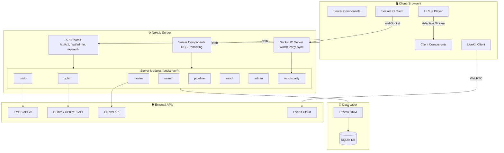

### 2.2 Luồng hoạt động chính

| # | Luồng | Mô tả |
|---|-------|-------|
| 1 | **Page Render** | Người dùng truy cập → Next.js render Server Component → Prisma query DB |
| 2 | **Client Interaction** | Client Component gọi `/api/v1/` endpoints → Service xử lý → Response |
| 3 | **Admin CMS** | Admin thao tác qua `/dashboard` → `/api/admin/` → Service + Audit Log |
| 4 | **Watch Party** | User tạo/join phòng → Socket.IO sync playback + chat real-time |
| 5 | **Data Pipeline** | OPhim sync → TMDB enrichment → DB upsert → SyncJob/SyncLog tracking |
| 6 | **Video Playback** | Player load → HLS.js adaptive streaming → Progress save (localStorage + DB) |

---

## 3. Tính năng hệ thống

### 3.1 Tính năng người dùng (User)

| Nhóm | Tính năng | Chi tiết |
|------|-----------|----------|
| 🔐 **Auth** | Đăng ký / Đăng nhập | Email + password (bcrypt), cookie session 30 ngày |
| 🎬 **Phim** | Duyệt & tìm kiếm | Filter thể loại, quốc gia, năm, full-text search |
| 🎬 **Phim** | Chi tiết phim | Poster, backdrop, cast & crew, phim tương tự |
| 📺 **Player** | Xem phim HLS | Adaptive bitrate, resume playback, multi-source |
| 📺 **Player** | Danh sách tập | Series/anime episode navigation |
| 📋 **Lịch sử** | Xem tiếp | Continue watching, đồng bộ khi đăng nhập |
| 🎉 **Watch Party** | Xem chung | Tạo/join phòng, sync playback, chat, video/voice call |
| 📰 **Tin tức** | Tin phim | Tổng hợp GNews + TMDB, phim sắp chiếu |
| ⭐ **Đánh giá** | Review phim | Rating + comment, moderation workflow |
| 💰 **TCoin** | Tiền ảo | Earn (daily login, review, xem phim), Spend (premium features) |

### 3.2 Tính năng quản trị (Admin)

| Nhóm | Tính năng | Chi tiết |
|------|-----------|----------|
| 📊 **Dashboard** | Tổng quan | Thống kê users, phim, revenue, page views |
| 🎬 **Phim** | CRUD đầy đủ | Tạo, sửa, xóa, publish, hide, archive, feature, trending |
| 📺 **Episodes** | Quản lý tập | Video sources, subtitles, quality levels |
| 👥 **Users** | Quản lý user | Block/unblock, reset password, phân quyền 5 roles |
| 📰 **Tin tức** | Quản lý news | CRUD bài viết, phân loại |
| ⭐ **Reviews** | Duyệt đánh giá | Approve/reject/flag moderation |
| 🏷️ **Metadata** | Thể loại & Quốc gia | CRUD genres, countries |
| 📤 **Upload** | Media upload | Poster, backdrop, thumbnail, video |
| 🔄 **Sync** | Data pipeline | Trigger OPhim sync, TMDB enrichment |
| 📝 **Audit** | Logs | Ai làm gì, lúc nào, chi tiết action |
| 💰 **TCoin** | Ví & giao dịch | Quản lý wallet, transaction history |

---

## 4. Cấu trúc thư mục

```
TERENCE-main/
├── app/                        # Next.js App Router (routes + API)
│   ├── api/                    # REST API endpoints
│   │   ├── admin/              #   Admin CRUD (movies, users, episodes, ...)
│   │   ├── auth/               #   Login, logout, signup, me
│   │   ├── v1/                 #   Public API (home, movies, search, watch)
│   │   ├── news/               #   Tin tức phim (GNews + TMDB)
│   │   ├── tcoin/              #   TCoin wallet, reward, spend
│   │   ├── watch/              #   Watch progress, continue, bootstrap
│   │   ├── watch-party/        #   Watch party rooms
│   │   ├── livekit/            #   LiveKit token generation
│   │   ├── payments/           #   Payment orders
│   │   └── socket/             #   Socket.IO bootstrap
│   ├── browse/                 # Trang duyệt phim (filter, search)
│   ├── movie/[id]/             # Chi tiết phim
│   ├── movies/                 # Danh sách phim lẻ
│   ├── series/                 # Danh sách phim bộ
│   ├── watch/[id]/             # Xem phim (player)
│   ├── xem-chung/              # Watch party
│   ├── dashboard/              # Admin panel (movies, users, news, ...)
│   ├── genres/                 # Duyệt theo thể loại
│   ├── countries/              # Duyệt theo quốc gia
│   ├── people/                 # Diễn viên / Đạo diễn
│   ├── news/                   # Tin tức phim
│   ├── reviews/                # Đánh giá phim
│   ├── tcoin/                  # TCoin (tiền ảo)
│   ├── login/ & signup/        # Auth pages
│   └── layout.tsx              # Root layout
│
├── components/                 # React Components
│   ├── ui/                     # shadcn/ui primitives
│   ├── shared/                 # Shared (MovieCard, MovieRow, ...)
│   ├── home/                   # Homepage (HeroBanner, ContinueWatchingRow)
│   ├── watch/                  # Watch page components
│   ├── player/                 # HLS Player (EnhancedVideoPlayer)
│   ├── news/                   # News components
│   ├── watch-party/            # Watch party UI
│   ├── header.tsx              # Navbar (mega dropdown)
│   ├── footer.tsx              # Footer
│   └── layout-wrapper.tsx      # Layout wrapper
│
├── src/server/                 # Server-side domain modules
│   ├── movies/                 # Movie service, serializers
│   ├── ophim/                  # OPhim sync (client, mapper, service)
│   ├── tmdb/                   # TMDB enrichment
│   ├── search/                 # Elasticsearch integration
│   ├── pipeline/               # Movie enrichment pipeline
│   ├── watch/                  # Watch history service
│   ├── modules/                # Domain modules (controller/service/repo)
│   │   ├── admin/  analytics/  auth/  episodes/  movies/
│   │   ├── news/  payments/  reviews/  tcoin/
│   │   └── uploads/  users/  watch/  watch-party/
│   └── shared/                 # DB, errors, guards, utils
│
├── lib/                        # Shared libraries (FE + Server)
│   ├── auth/                   # Session, password, permissions
│   ├── admin/                  # Admin API helpers, validators
│   ├── db/                     # DB query builders
│   ├── tmdb/                   # TMDB API client + mapper
│   ├── news/                   # News aggregator
│   ├── player/                 # Player source adapter
│   ├── data/                   # Static data (genres, countries, tcoin)
│   ├── watch-history/          # Watch history service + storage
│   └── watch-party/            # Watch party client (store, sync)
│
├── hooks/                      # Custom React Hooks
├── contexts/                   # React Contexts (AuthProvider)
├── services/                   # External service integrations
├── types/                      # TypeScript type definitions
├── prisma/                     # Prisma schema + migrations + seed
├── server/                     # Custom server (Socket.IO + Watch Party)
├── scripts/                    # CLI scripts (sync, enrich, pipeline)
├── docs/                       # Tài liệu kỹ thuật bổ sung
├── deploy/                     # Deploy configs (Nginx)
├── public/                     # Static assets
├── server.ts                   # Custom server entry (Next.js + Socket.IO)
├── middleware.ts                # Route protection middleware
└── package.json                # Dependencies & scripts
```

---

## 5. Tech Stack

| Layer | Công nghệ | Phiên bản |
|-------|-----------|-----------|
| **Framework** | Next.js (App Router, RSC) | 16 |
| **Language** | TypeScript | 5.7 |
| **Styling** | Tailwind CSS + Radix UI + shadcn/ui | 4 |
| **Database** | SQLite via Prisma ORM | Prisma 6 |
| **Auth** | Cookie-based sessions + bcryptjs | — |
| **API dữ liệu** | TMDB API v3, OPhim API, OPhim18 API | — |
| **Video Streaming** | HLS.js (adaptive bitrate) | — |
| **Real-time** | Socket.IO | 4.8 |
| **Voice/Video Call** | LiveKit (WebRTC) | — |
| **State Management** | React Context + SWR | — |
| **Validation** | Zod | — |
| **Forms** | React Hook Form | — |
| **Charts** | Recharts | 2.15 |
| **Font** | Google Fonts — Inter (Latin + Vietnamese) | — |
| **Deploy** | Docker / PM2 / Nginx / Cloudflare | — |

---

## 6. Database Overview

### 6.1 Entity chính

| Model | Mô tả |
|-------|-------|
| `User` / `Session` | Tài khoản, phiên đăng nhập (5 roles) |
| `Movie` / `Episode` / `VideoSource` | Phim, tập phim, nguồn video |
| `Genre` / `Country` / `Person` | Metadata phim (M:N qua bảng trung gian) |
| `WatchHistory` / `Favorite` | Lịch sử xem, phim yêu thích |
| `Review` | Đánh giá phim (rating + moderation) |
| `NewsPost` | Bài tin tức CMS |
| `Wallet` / `WalletTransaction` | TCoin ví + giao dịch |
| `WatchPartyRoom` / `...Participant` / `...State` / `...Message` | Watch party |
| `AdminLog` / `PageView` | Audit log, analytics |
| `SyncJob` / `SyncLog` | Data pipeline tracking |
| `Short` | Video ngắn (TikTok-style) |
| `Upload` / `PaymentOrder` | File upload, đơn thanh toán |

### 6.2 ERD — Sơ đồ quan hệ thực thể

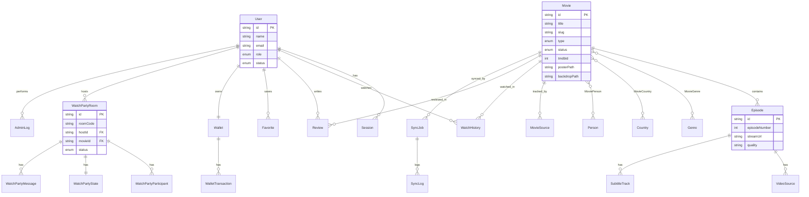

---

## 7. API / Data Flow

### 7.1 Flow lấy phim (Homepage)

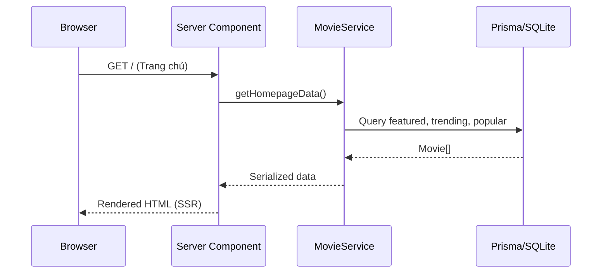

### 7.2 Flow xem phim (Player)

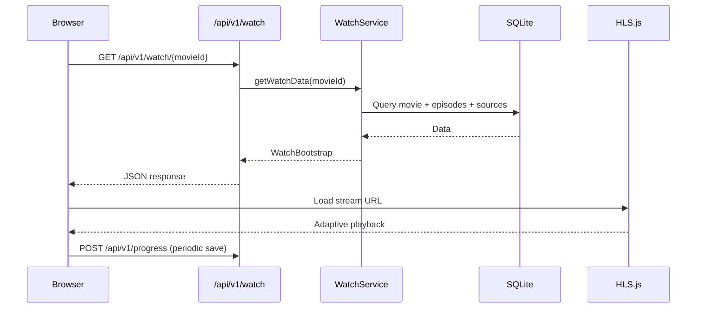

### 7.3 Flow sync dữ liệu (Pipeline)

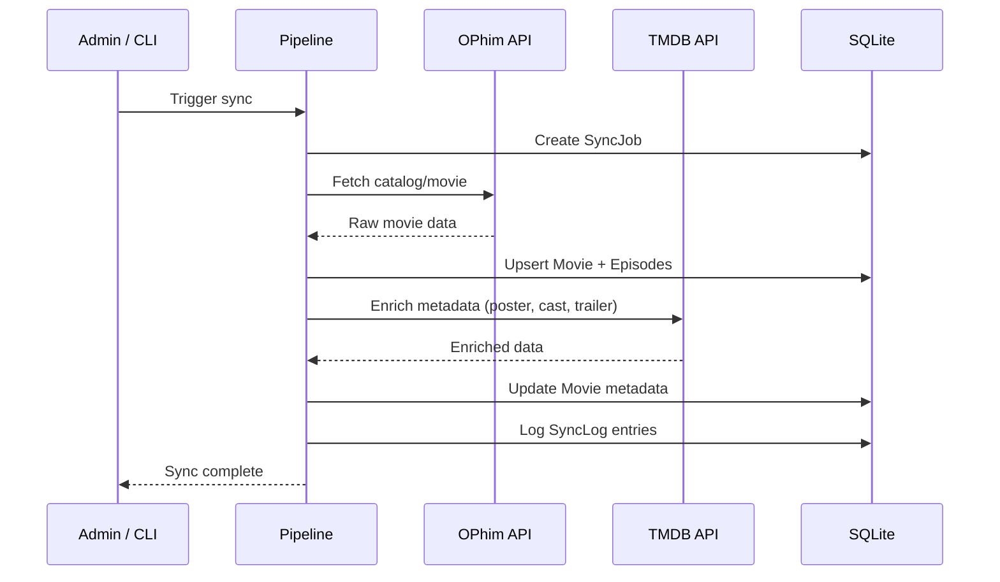

### 7.4 Flow Watch Party

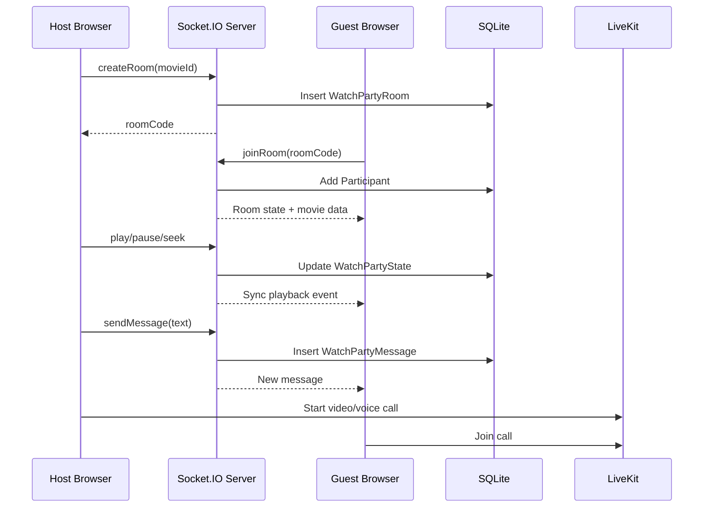

### 7.5 API Endpoints tổng hợp

<details>
<summary><strong>📡 Public API — /api/v1/</strong></summary>

| Method | Path | Mô tả |
|--------|------|-------|
| GET | `/api/v1/home` | Homepage data (featured, trending) |
| GET | `/api/v1/movies` | Paginated movie list + filters |
| GET | `/api/v1/movies/[slug]` | Movie detail by slug |
| GET | `/api/v1/movies/[slug]/episodes` | Episodes for a movie |
| GET | `/api/v1/search` | Full-text search |
| GET | `/api/v1/search/suggest` | Search suggestions |
| GET | `/api/v1/watch/[movieId]` | Watch playback data |
| GET | `/api/v1/watch-history` | User watch history |
| POST | `/api/v1/progress` | Save watch progress |
| GET | `/api/v1/continue-watching` | Continue watching list |

</details>

<details>
<summary><strong>🔐 Auth API — /api/auth/</strong></summary>

| Method | Path | Mô tả |
|--------|------|-------|
| POST | `/api/auth/login` | Đăng nhập |
| POST | `/api/auth/signup` | Đăng ký |
| POST | `/api/auth/logout` | Đăng xuất |
| GET | `/api/auth/me` | Lấy user hiện tại |

</details>

<details>
<summary><strong>🛡️ Admin API — /api/admin/</strong></summary>

| Method | Path | Mô tả |
|--------|------|-------|
| GET | `/api/admin/summary` | Dashboard statistics |
| GET/POST | `/api/admin/movies` | List / Create movies |
| GET/PATCH/DEL | `/api/admin/movies/[id]` | Detail / Update / Delete |
| PATCH | `/api/admin/movies/[id]/publish,hide,archive,restore` | Status management |
| PATCH | `/api/admin/movies/[id]/feature,trending,recommend` | Toggle flags |
| GET/POST | `/api/admin/episodes` | Episode management |
| GET/POST | `/api/admin/shorts` | Short management |
| GET/POST | `/api/admin/users` | User management |
| PATCH | `/api/admin/users/[id]/block,unblock` | User moderation |
| POST | `/api/admin/users/[id]/reset-password` | Reset password |
| GET/POST | `/api/admin/genres` | Genre management |
| GET/POST | `/api/admin/countries` | Country management |
| GET/POST | `/api/admin/news` | News management |
| GET/PATCH/DEL | `/api/admin/reviews/[id]` | Review moderation |
| POST | `/api/admin/uploads/*` | Media upload |
| GET | `/api/admin/logs` | Audit logs |
| POST | `/api/admin/sync/ophim/catalog` | Trigger OPhim sync |
| POST | `/api/admin/sync/tmdb/[movieId]` | Trigger TMDB enrichment |
| GET | `/api/admin/tcoin/wallets` | TCoin wallet management |

</details>

<details>
<summary><strong>🎉 Watch Party API</strong></summary>

| Method | Path | Mô tả |
|--------|------|-------|
| POST | `/api/watch-party/create` | Tạo phòng |
| POST | `/api/watch-party/join` | Join phòng |
| POST | `/api/watch-party/leave` | Rời phòng |
| GET | `/api/watch-party/[roomCode]` | Thông tin phòng |
| GET | `/api/watch-party/[roomCode]/messages` | Tin nhắn phòng |
| POST | `/api/watch-party/[roomCode]/sync` | Sync playback state |

</details>

---

## 8. User Story

### 8.1 User Stories — Người dùng

#### US-01: Duyệt và tìm kiếm phim

| | |
|---|---|
| **Actor** | Người dùng (Guest / User) |
| **Mục tiêu** | Tìm phim theo sở thích nhanh chóng |
| **Flow** | Truy cập trang chủ → Xem phim trending/featured → Dùng bộ lọc (thể loại, quốc gia, năm) hoặc search bar → Xem danh sách kết quả → Chọn phim |
| **Kết quả** | Người dùng tìm được phim phù hợp và truy cập trang chi tiết |

#### US-02: Xem phim trực tuyến

| | |
|---|---|
| **Actor** | Người dùng đã đăng nhập |
| **Mục tiêu** | Xem phim liền mạch với chất lượng tốt nhất |
| **Flow** | Chọn phim → Nhấn "Xem phim" → Player tự chọn chất lượng phù hợp → Xem phim → Tắt tab → Quay lại → Xem tiếp từ vị trí cũ |
| **Kết quả** | Phim phát mượt mà, progress được lưu tự động |

#### US-03: Watch Party — Xem phim cùng bạn bè

| | |
|---|---|
| **Actor** | Người dùng đã đăng nhập |
| **Mục tiêu** | Xem phim đồng bộ real-time với bạn bè |
| **Flow** | Chọn phim → Tạo phòng Watch Party → Chia sẻ room code → Bạn bè join → Playback đồng bộ → Chat / Voice call |
| **Kết quả** | Mọi người xem cùng lúc, tương tác real-time |

#### US-04: Đánh giá phim

| | |
|---|---|
| **Actor** | Người dùng đã đăng nhập |
| **Mục tiêu** | Chia sẻ đánh giá về phim đã xem |
| **Flow** | Xem phim → Chọn rating (1-5 sao) → Viết comment → Gửi → Chờ admin duyệt → Hiển thị |
| **Kết quả** | Review được lưu, hiển thị sau khi được duyệt |

#### US-05: TCoin — Kiếm và sử dụng tiền ảo

| | |
|---|---|
| **Actor** | Người dùng đã đăng nhập |
| **Mục tiêu** | Kiếm TCoin từ hoạt động và đổi lấy tính năng premium |
| **Flow** | Đăng nhập hàng ngày → Nhận TCoin → Viết review / Xem phim → Nhận thêm TCoin → Dùng TCoin đổi premium features |
| **Kết quả** | User tích lũy TCoin và sử dụng trong hệ thống |

### 8.2 User Stories — Admin

#### US-06: Quản lý kho phim

| | |
|---|---|
| **Actor** | Admin / Staff |
| **Mục tiêu** | Quản lý nội dung phim trên hệ thống |
| **Flow** | Đăng nhập admin → Dashboard → Quản lý phim → CRUD phim/tập → Publish/Hide/Archive → Upload media |
| **Kết quả** | Kho phim được cập nhật, phim mới hiển thị trên trang chủ |

#### US-07: Đồng bộ dữ liệu phim

| | |
|---|---|
| **Actor** | Admin |
| **Mục tiêu** | Import phim tự động từ nguồn bên ngoài |
| **Flow** | Vào Admin → Trigger OPhim sync → Hệ thống fetch catalog → Upsert vào DB → Trigger TMDB enrichment → Cập nhật metadata |
| **Kết quả** | Kho phim được làm giàu tự động, có đầy đủ poster/cast/trailer |

#### US-08: Quản lý và duyệt đánh giá

| | |
|---|---|
| **Actor** | Admin / Staff |
| **Mục tiêu** | Đảm bảo chất lượng nội dung đánh giá |
| **Flow** | Dashboard → Reviews → Xem pending reviews → Approve / Reject / Flag → Lưu audit log |
| **Kết quả** | Chỉ review chất lượng được hiển thị, hành động được tracking |

---

## 9. Use Case Overview

### 9.1 Sơ đồ Use Case

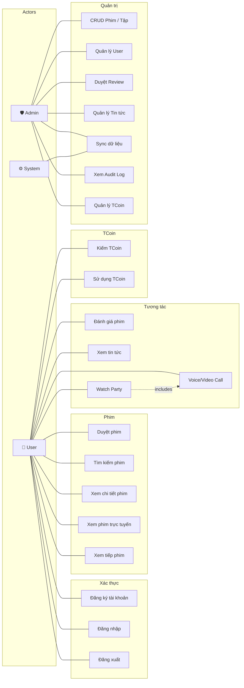

### 9.2 Nhóm Use Case chính

| Nhóm | Mô tả | Actors |
|------|--------|--------|
| **Xác thực** | Đăng ký, đăng nhập, phân quyền 5 roles | User |
| **Phim** | Duyệt, tìm kiếm, xem chi tiết, xem phim, xem tiếp | User |
| **Tương tác** | Đánh giá, tin tức, watch party, voice/video call | User |
| **TCoin** | Kiếm và sử dụng tiền ảo trong hệ thống | User |
| **Quản trị** | CRUD nội dung, quản lý user, sync data, audit log | Admin, System |

---

## 10. Sequence Diagram

Các sơ đồ tuần tự mô tả chi tiết luồng tương tác giữa các thành phần trong hệ thống cho các nghiệp vụ chính.

### 10.1 Luồng xem phim (Movie Watching Flow)

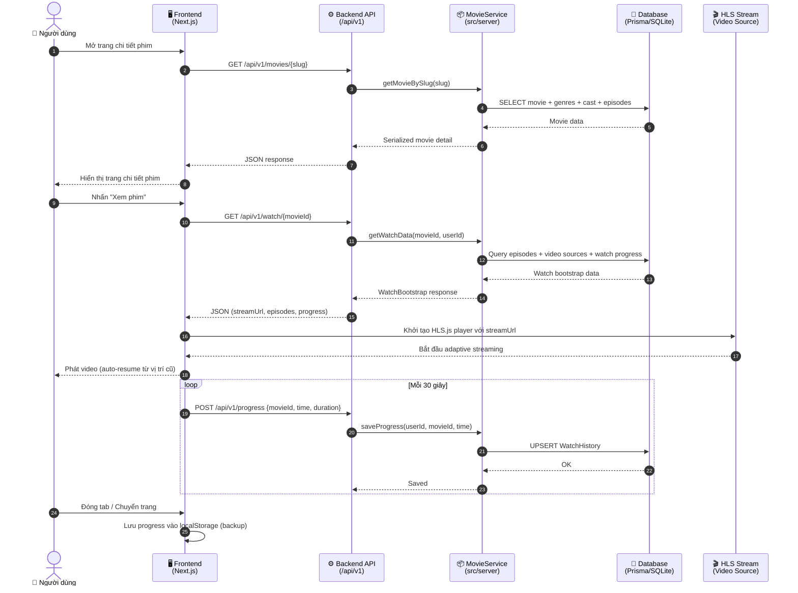

> **Mô tả:** Người dùng mở trang phim → Frontend gọi API lấy chi tiết → nhấn xem phim → API trả về stream URL và watch bootstrap → HLS.js khởi tạo adaptive streaming → Progress được lưu tự động mỗi 30 giây vào DB và localStorage để hỗ trợ "xem tiếp" (resume playback).

### 10.2 Luồng Watch Party (Xem phim chung real-time)

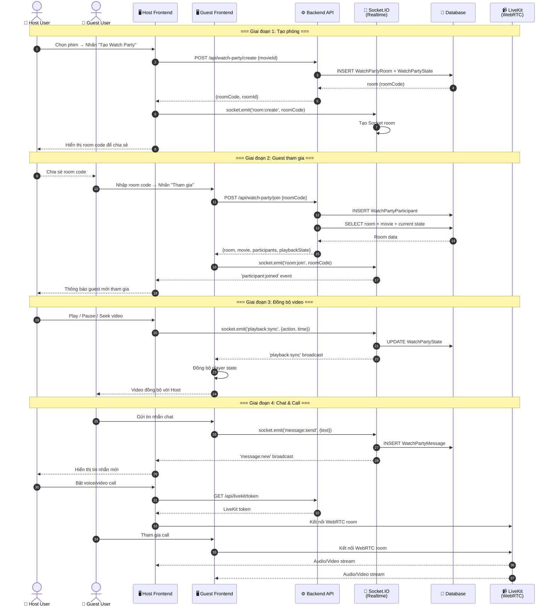

> **Mô tả:** Host tạo phòng Watch Party → chia sẻ room code → Guest join bằng room code → Socket.IO đồng bộ mọi hành động playback (play/pause/seek) real-time giữa tất cả participants → Chat real-time qua Socket.IO → Video/Voice call qua LiveKit WebRTC. Mọi trạng thái đều được persist vào DB.

### 10.3 Luồng sync dữ liệu phim (Data Pipeline)

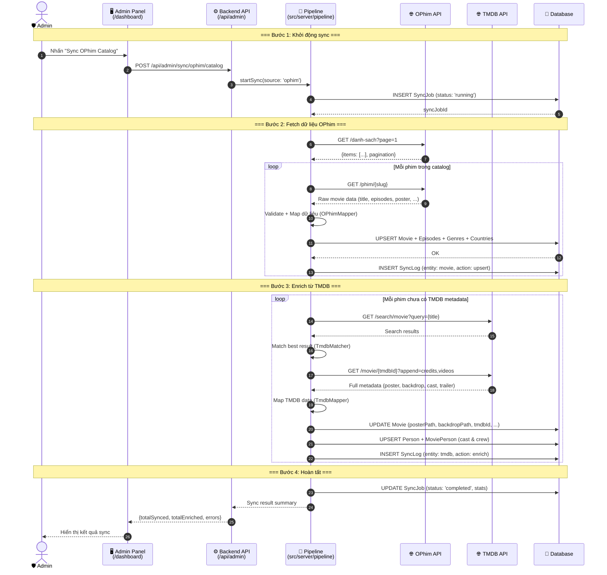

> **Mô tả:** Admin trigger sync từ dashboard → Pipeline tạo SyncJob để tracking → Fetch catalog từ OPhim API → Validate và map dữ liệu qua OPhimMapper → Upsert vào DB (Movie, Episodes, Genres, Countries) → Enrich metadata từ TMDB (poster HD, backdrop, cast, trailer) qua TmdbMatcher + TmdbMapper → Ghi SyncLog cho mọi thao tác → Cập nhật SyncJob status khi hoàn tất. Toàn bộ quá trình có error handling và audit trail.

---

## 11. Activity Diagram

Các sơ đồ hoạt động mô tả luồng nghiệp vụ chính của hệ thống, thể hiện rõ các bước xử lý, điều kiện rẽ nhánh và kết quả.

### 11.1 Đăng nhập hệ thống

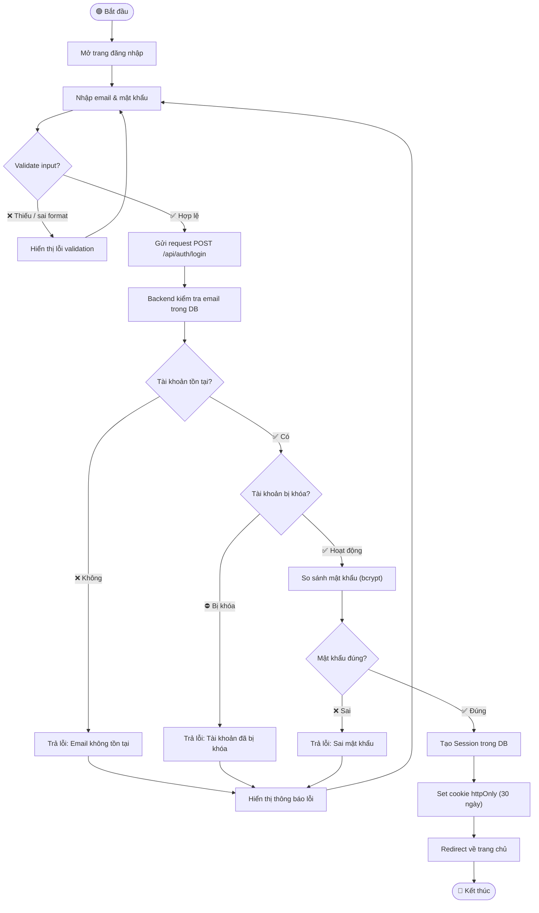

> **Mô tả:** Người dùng nhập email và mật khẩu → Validate input phía client → Gửi lên server → Kiểm tra tài khoản tồn tại + không bị khóa → So sánh mật khẩu bằng bcrypt → Tạo session cookie httpOnly 30 ngày → Redirect về trang chủ. Mọi nhánh lỗi đều hiển thị thông báo rõ ràng.

### 11.2 Xem phim

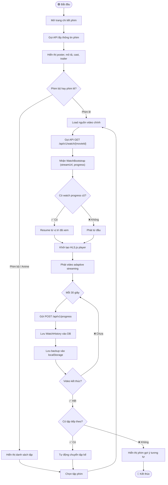

> **Mô tả:** Người dùng mở chi tiết phim → Chọn tập (nếu phim bộ) → API trả về stream URL + progress → HLS.js player resume hoặc phát từ đầu → Tiến trình được lưu tự động mỗi 30 giây vào DB và localStorage → Khi hết tập, tự động chuyển tập tiếp theo hoặc gợi ý phim tương tự.

### 11.3 Tạo Watch Party (Xem phim chung)

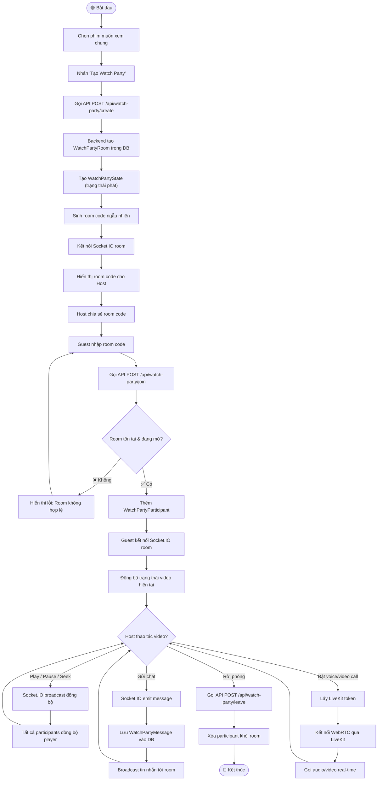

> **Mô tả:** Host chọn phim → Tạo phòng Watch Party → Hệ thống sinh room code → Guest join bằng code → Socket.IO đồng bộ mọi thao tác playback (play/pause/seek) → Chat real-time trong phòng → Voice/Video call qua LiveKit WebRTC → Mọi participant có thể rời phòng bất kỳ lúc nào.

### 11.4 Sync dữ liệu phim (Data Pipeline)

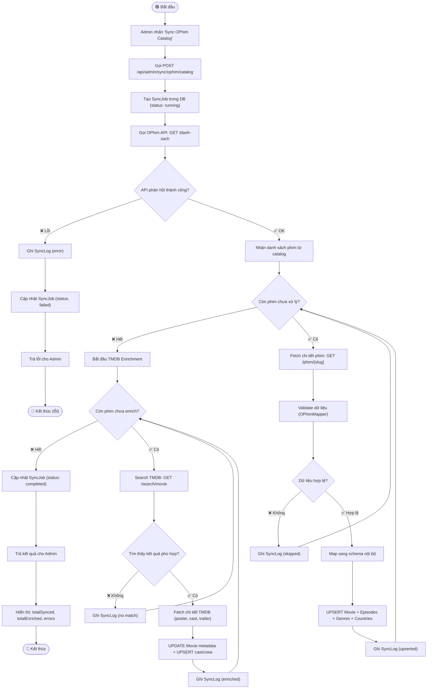

> **Mô tả:** Admin trigger sync → Tạo SyncJob tracking → Fetch catalog từ OPhim API → Validate + map từng phim qua OPhimMapper → Upsert vào DB → Tiếp tục enrich metadata từ TMDB (poster HD, cast, trailer) → Ghi SyncLog cho mọi thao tác (upserted, skipped, error, enriched) → Cập nhật SyncJob status → Trả kết quả tổng hợp cho admin.

### 11.5 Quản lý phim (Admin CMS)

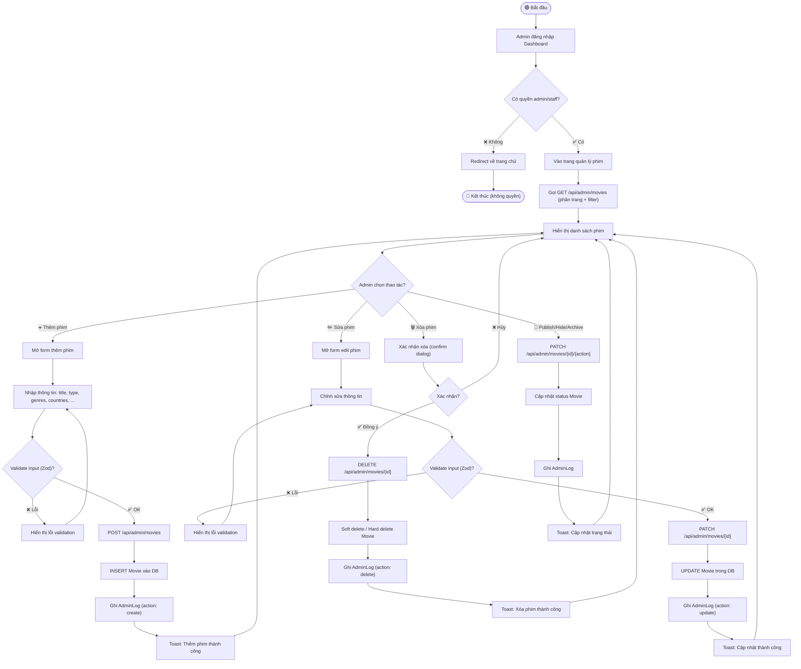

> **Mô tả:** Admin đăng nhập → Kiểm tra quyền (RBAC) → Xem danh sách phim (phân trang + filter) → Thực hiện CRUD: Thêm / Sửa / Xóa phim → Validate input bằng Zod → Lưu DB → Ghi AdminLog audit trail → Hiển thị thông báo kết quả. Hỗ trợ thêm các thao tác nhanh: Publish, Hide, Archive, Feature, Trending.

---

## 12. Coding Convention

### 12.1 Naming Convention

| Loại | Quy ước | Ví dụ |
|------|---------|-------|
| File component | PascalCase | `MovieCard.tsx`, `HeroBanner.tsx` |
| File hook | camelCase, prefix `use` | `usePlayer.ts`, `useHLS.ts` |
| File service | kebab-case | `movie-service.ts` |
| File type | kebab-case | `watch-history.ts` |
| API route | kebab-case folders | `app/api/watch-party/create/` |
| DB model | PascalCase (Prisma) | `WatchPartyRoom` |
| Constants | UPPER_SNAKE_CASE | `MOBILE_BREAKPOINT` |
| Enum values | UPPER_SNAKE_CASE | `SUPER_ADMIN` |

### 12.2 Folder Rule

| Loại | Đường dẫn | Ghi chú |
|------|-----------|---------|
| Components | `components/` | UI dùng chung |
| Pages/Routes | `app/` | Next.js App Router |
| Server logic | `src/server/` | Domain modules, services |
| Shared utils | `lib/` | Dùng chung FE + Server |
| Custom hooks | `hooks/` | Client-side hooks |
| Types | `types/` | TypeScript definitions |
| CLI Scripts | `scripts/` | Automation scripts |
| Static data | `lib/data/` | Genres, countries, tcoin |

### 12.3 Service / Repository Rule

- **Components**: chỉ chứa UI logic, **không gọi DB** trực tiếp
- **API routes**: thin handlers, delegate to services
- **Services** (`src/server/`): business logic, gọi Prisma
- **Repositories** (`server/watch-party/repository.ts`): pure data access
- **Hooks**: client-side state + side effects
- **Contexts**: shared client state (auth)

### 12.4 Validation Rule

- Input validation dùng **Zod** schemas (trong `lib/admin/validators.ts`)
- API response shape thống nhất:
  - ✅ Success: `{ data, pagination? }`
  - ❌ Error: `{ error: string }`

### 12.5 Error Handling

- API routes: `try/catch` + `NextResponse.json({ error }, { status })`
- Server services: throw Error → catch ở route handler
- Client: toast notification cho user-facing errors
- Helper: `getErrorMessage()` cho unknown errors

### 12.6 Import Rule

- Sử dụng alias `@/` (= root project)
- Import Prisma qua `@/lib/db` hoặc `@/lib/auth/db`
- Import types qua `@/types`
- ❌ Không circular imports giữa modules

---

## 13. Development Workflow

### 13.1 Branch Strategy

| Branch | Mục đích | Merge vào |
|--------|----------|-----------|
| `main` | Production-ready code | — |
| `develop` | Tích hợp features đang phát triển | `main` |
| `feature/<tên>` | Phát triển tính năng mới | `develop` |
| `fix/<tên>` | Sửa bug | `develop` hoặc `main` |
| `refactor/<tên>` | Tái cấu trúc code | `develop` |

### 13.2 Commit Rule

Format: `<type>(<scope>): <mô tả ngắn>`

| Type | Mô tả |
|------|-------|
| `feat` | Tính năng mới |
| `fix` | Sửa bug |
| `refactor` | Tái cấu trúc (không thay đổi logic) |
| `docs` | Cập nhật tài liệu |
| `style` | Format code (không thay đổi logic) |
| `chore` | Build, config, dependencies |

Ví dụ:
```
feat(watch-party): add voice call via LiveKit
fix(player): resolve HLS resume playback issue
docs(readme): update API endpoints section
```

### 13.3 PR Rule

- Mỗi PR phải có mô tả rõ ràng thay đổi gì, tại sao
- PR template: `.github/pull_request_template.md`
- Checklist bắt buộc:
  - [ ] Code chạy được, không lỗi
  - [ ] README.md đã cập nhật (nếu thay đổi quan trọng)
  - [ ] Không có file debug/test committed
  - [ ] Import không bị break

### 13.4 Quy trình phát triển tính năng mới

1. **Tạo module đúng cấu trúc**:
   - Server logic → `src/server/modules/<domain>/`
   - API routes → `app/api/<domain>/`
   - Components → `components/<domain>/`
   - Hooks → `hooks/use<Feature>.ts`
   - Types → `types/<domain>.ts`

2. **Tách rõ UI / Business / Data**:
   - UI component không gọi DB
   - Business logic nằm trong service
   - Data access qua Prisma

3. **Cập nhật schema** nếu thêm model/field:
   ```bash
   npx prisma migrate dev --name <mô-tả-thay-đổi>
   ```

4. **⚠️ Cập nhật README.md bắt buộc** (xem mục 14)

---

## 14. README Rule

> **📌 README.md là tài liệu tổng chính thức duy nhất của dự án TERENCE.**

### 14.1 Quy tắc bắt buộc

| Thay đổi | Cập nhật mục |
|----------|-------------|
| Chức năng mới | Mục 3 (Tính năng) |
| API mới | Mục 7 (API / Data Flow) |
| Schema/model mới | Mục 6 (Database) |
| Route mới | Mục 4 (Cấu trúc thư mục) |
| Env mới | Phụ lục B (Biến môi trường) |
| Command mới | Phụ lục A (Scripts) |
| Thay đổi kiến trúc | Mục 2 (Kiến trúc) |
| Công nghệ mới | Mục 5 (Tech Stack) |

### 14.2 Quy tắc merge

- ❌ **Không merge code** nếu README.md chưa phản ánh đúng thay đổi quan trọng
- ❌ **Không tạo tài liệu rải rác** — README.md là trung tâm duy nhất
- ✅ Tài liệu chi tiết kỹ thuật có thể đặt trong `docs/` nhưng README phải link đến

### 14.3 Kiểm tra tự động

Dự án có script `npm run docs:check` để cảnh báo nếu có thay đổi code mà README chưa được cập nhật.

---

## 15. Changelog

| Ngày | Chức năng | Module ảnh hưởng |
|------|-----------|-----------------|
| 2026-03-22 | Khởi tạo dự án, auth, TMDB | app/, lib/auth, services/ |
| 2026-03-23 | Refactor navigation, browse | components/, app/browse |
| 2026-03-24 | Error boundaries, loading states | app/, components/ |
| 2026-03-24 | OPhim API integration | src/server/ophim, scripts |
| 2026-03-25 | HLS player, deploy production | components/player, deploy |
| 2026-03-26 | Watch Party + LiveKit | watch-party, server/ |
| 2026-03-30 | Full debugging + stabilization | toàn bộ codebase |
| 2026-03-31 | Admin CMS: genres, countries, reviews, news | app/api/admin, dashboard |
| 2026-04-03 | Refactor kiến trúc toàn bộ | toàn bộ codebase |
| 2026-04-03 | **Nâng cấp README chuẩn công ty** | README.md |

---

## 16. Future Roadmap

| # | Hạng mục | Mô tả | Ưu tiên |
|---|----------|-------|---------|
| 1 | 🐘 **PostgreSQL Migration** | Migrate SQLite → PostgreSQL cho production scale | 🔴 Cao |
| 2 | 🧪 **Testing** | Unit tests cho services, E2E tests cho routes chính | 🔴 Cao |
| 3 | 🤖 **AI Recommendation** | Gợi ý phim dựa trên lịch sử xem và sở thích (collaborative filtering) | 🟡 Trung bình |
| 4 | 📱 **Mobile App** | React Native hoặc Flutter app cho iOS/Android | 🟡 Trung bình |
| 5 | 💳 **Payment Gateway** | Tích hợp VNPay/MoMo cho thanh toán TCoin thực tế | 🟡 Trung bình |
| 6 | 🔍 **Elasticsearch** | Full-text search chuyên sâu thay Prisma text search | 🟡 Trung bình |
| 7 | 📨 **Message Queue** | Bull/BullMQ cho background jobs (sync, email, notification) | 🟢 Thấp |
| 8 | 🗄️ **Redis Cache** | Caching layer cho homepage, movie detail, session | 🟢 Thấp |
| 9 | 🏗️ **Microservices** | Tách Watch Party, Sync Pipeline thành service riêng | 🟢 Thấp |
| 10 | 📊 **Advanced Analytics** | Heatmap xem phim, user behavior tracking, A/B testing | 🟢 Thấp |

### Refactor cần làm

| # | Việc cần làm | Ưu tiên |
|---|-------------|---------|
| 1 | Gom OPhim + OPhim18 thành 1 client trừu tượng | 🟡 Trung bình |
| 2 | Gom 3 lớp TMDB code thành 1 TMDB module duy nhất | 🟡 Trung bình |
| 3 | Gom watch history code thành 1 module | 🟢 Thấp |
| 4 | Chuẩn hóa toàn bộ API response format | 🟡 Trung bình |

---

## 17. System Design (Senior Level)

Mục này phân tích kiến trúc hệ thống ở góc nhìn production-grade, giúp nâng tầm dự án từ đồ án lên mức tài liệu kỹ thuật có chiều sâu.

### 17.1 Kiến trúc triển khai Production

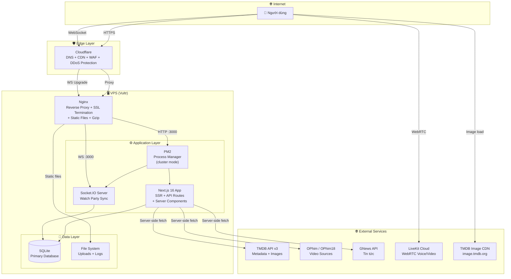

**Giải thích các tầng:**

| Tầng | Thành phần | Vai trò |
|------|-----------|--------|
| **Edge** | Cloudflare | DNS resolution, CDN cache static assets, WAF chống tấn công, SSL certificate, DDoS protection |
| **Reverse Proxy** | Nginx | SSL termination, gzip compression, serve static files, proxy pass tới Next.js, WebSocket upgrade |
| **Process Manager** | PM2 | Quản lý process Node.js, auto-restart khi crash, cluster mode cho multi-core, log management |
| **Application** | Next.js 16 | SSR/RSC rendering, API routes, business logic, Server Components cho SEO |
| **Realtime** | Socket.IO | Watch party sync (play/pause/seek), chat real-time, participant management |
| **Data** | SQLite + Prisma | Primary database, file-based (dễ backup), migrate sang PostgreSQL khi scale |
| **External** | TMDB, OPhim, LiveKit | Metadata enrichment, video sources, WebRTC voice/video call |

### 17.2 Data Flow Production

#### Request Flow — Người dùng xem phim

```
User → Cloudflare CDN → Nginx → PM2/Next.js → Prisma → SQLite
                                      ↓
                              Server Component render HTML
                                      ↓
                              Response → Nginx (gzip) → Cloudflare (cache) → User
```

- **Static assets** (JS, CSS, images): Cloudflare cache tại edge, TTL dài → giảm tải server
- **SSR pages**: Next.js render Server Component → HTML stream về client, không cần client-side fetch ban đầu
- **API calls** (`/api/v1/*`): Client fetch → Nginx proxy → Next.js API route → Service → Prisma → SQLite
- **Image loading**: Browser load trực tiếp từ `image.tmdb.org` (CDN của TMDB) → không qua server

#### Sync Data Flow

```
Admin trigger → API Route → Pipeline Service
                                ↓
                    OPhim API (fetch catalog)
                                ↓
                    OPhimMapper (validate + transform)
                                ↓
                    Prisma UPSERT (Movie + Episode + Genre)
                                ↓
                    TMDB API (enrich: poster, cast, trailer)
                                ↓
                    TmdbMapper (transform + match)
                                ↓
                    Prisma UPDATE (metadata enrichment)
                                ↓
                    SyncJob + SyncLog (audit trail)
```

- Sync chạy **server-side only**, không ảnh hưởng user request
- Mỗi sync tạo `SyncJob` với status tracking (`running` → `completed` / `failed`)
- Mỗi thao tác ghi `SyncLog` chi tiết (entity, action, result)
- Error handling: phim lỗi bị skip, không dừng toàn bộ pipeline

#### Watch Party Realtime Flow

```
Host action (play/pause/seek)
        ↓
Socket.IO emit → Server validate → DB persist state
        ↓
Socket.IO broadcast → All participants in room
        ↓
Each client sync player state
```

- State persist vào `WatchPartyState` → reconnect không mất trạng thái
- Chat messages persist vào `WatchPartyMessage` → scroll history khi join
- Voice/Video call đi riêng qua **LiveKit Cloud** (WebRTC) → không qua server app

### 17.3 Khả năng mở rộng (Scalability)

| Thành phần | Hiện tại | Khi cần scale |
|-----------|---------|---------------|
| **Frontend** | 1 Next.js instance | PM2 cluster mode (multi-core) → Vercel/Cloudflare Pages cho static |
| **API** | Monolith trong Next.js | Tách API routes thành standalone Express/Fastify service |
| **Database** | SQLite (single file) | Migrate sang **PostgreSQL** + connection pooling (PgBouncer) |
| **Realtime** | Socket.IO in-process | Tách thành standalone service + **Redis Adapter** cho multi-instance |
| **Media** | External HLS streams | **Object Storage** (S3/R2) + CDN cho self-hosted content |
| **Search** | Prisma text search | **Elasticsearch** / **Meilisearch** cho full-text search |
| **Background Jobs** | Sync chạy inline | **BullMQ** + Redis cho job queue, retry, scheduling |

**Lộ trình scale theo giai đoạn:**

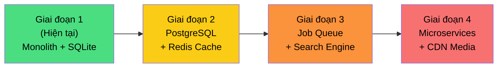

### 17.4 Hiệu năng (Performance)

| Kỹ thuật | Áp dụng | Trạng thái |
|---------|---------|------------|
| **Server Components (RSC)** | Trang chủ, chi tiết phim render server-side → zero JS bundle cho static content | ✅ Đã áp dụng |
| **Lazy Loading** | HLS.js, components nặng load dynamic (`next/dynamic`) | ✅ Đã áp dụng |
| **Image Optimization** | TMDB Image CDN với size params (`/w500/`, `/w780/`, `/original/`) | ✅ Đã áp dụng |
| **Pagination** | API trả paginated results, không load toàn bộ | ✅ Đã áp dụng |
| **Gzip Compression** | Nginx gzip cho text responses | ✅ Đã áp dụng |
| **HLS Adaptive Bitrate** | Player tự chọn quality theo bandwidth | ✅ Đã áp dụng |
| **SWR Client Cache** | Client-side cache + revalidation cho API calls | ✅ Đã áp dụng |
| **Query Optimization** | Prisma `select` + `include` chỉ lấy fields cần thiết | ✅ Đã áp dụng |
| **Redis Server Cache** | Cache homepage data, movie detail, session | 🔲 Chưa (Roadmap) |
| **DB Indexing** | Index cho slug, tmdbId, status, createdAt | 🔲 Cần bổ sung |
| **CDN Static Assets** | Cloudflare cache JS/CSS/images tại edge | ✅ Đã áp dụng |
| **Bundle Splitting** | Next.js auto code-split per route | ✅ Đã áp dụng |

### 17.5 Bảo mật (Security)

| Lớp bảo mật | Giải pháp | Chi tiết |
|-------------|----------|----------|
| **Authentication** | Cookie-based session | `httpOnly`, `secure`, `sameSite=lax`, TTL 30 ngày, bcrypt hash password |
| **Authorization (RBAC)** | 5 roles phân quyền | `super_admin > admin > staff > editor > user`, permission guards trên mọi admin route |
| **Input Validation** | Zod schemas | Validate tất cả API input, reject invalid data trước khi xử lý |
| **API Key Protection** | Server-only env vars | TMDB/OPhim/LiveKit keys chỉ dùng server-side, **không** expose qua `NEXT_PUBLIC_` |
| **Route Protection** | Next.js Middleware | Chặn truy cập `/dashboard/*` nếu không có session admin |
| **Audit Trail** | AdminLog model | Mọi thao tác admin (CRUD, block, sync) đều ghi log: ai, làm gì, lúc nào |
| **CORS** | Restrict origins | Production chỉ accept requests từ domain chính |
| **SSL/TLS** | Cloudflare + Nginx | HTTPS everywhere, auto-renew certificate |
| **Rate Limiting** | 🔲 Chưa triển khai | Cần thêm: `express-rate-limit` hoặc Cloudflare Rate Limiting Rules |
| **SQL Injection** | Prisma ORM | Parameterized queries mặc định, không raw SQL |
| **XSS** | React auto-escape | JSX tự escape output, không `dangerouslySetInnerHTML` |

### 17.6 Độ tin cậy và Vận hành (Reliability & Operations)

| Hạng mục | Giải pháp hiện tại | Cải thiện |
|---------|-------------------|----------|
| **Process Management** | PM2 với `ecosystem.config.js` | Auto-restart on crash, memory limit, log rotation |
| **Deploy** | `deploy.sh` script (git pull → build → PM2 restart) | CI/CD pipeline (GitHub Actions → auto deploy) |
| **Log Management** | PM2 logs + AdminLog DB | Tập trung hóa: ELK Stack hoặc Grafana Loki |
| **Monitoring** | Manual check | Cần: Uptime Robot / Grafana + Prometheus metrics |
| **Database Backup** | SQLite file copy | Cron job backup daily → offsite storage (S3) |
| **Sync Error Handling** | Skip failed items, log SyncLog | Retry mechanism + dead letter queue cho failed jobs |
| **External API Failure** | Try/catch, graceful fallback | Circuit breaker pattern, fallback cache |
| **Health Check** | Không có | Thêm `/api/health` endpoint cho monitoring |
| **Rollback** | Git revert + rebuild | Blue-green deploy hoặc canary release |

**Deploy Flow hiện tại:**

```
Developer push → GitHub (main branch)
        ↓
SSH vào server → git pull → npm install → npm run build
        ↓
PM2 restart → Nginx serve
```

**Deploy Flow mục tiêu:**

```
Developer push → GitHub Actions CI
        ↓
Lint + Type check + Test → Build → Docker image
        ↓
Deploy to server → Health check → Traffic switch
```

### 17.7 Technical Debt và Hướng cải thiện

| # | Technical Debt | Ảnh hưởng | Hướng cải thiện | Ưu tiên |
|---|---------------|----------|----------------|--------|
| 1 | **SQLite cho production** | Không hỗ trợ concurrent writes, không scale | Migrate sang PostgreSQL | 🔴 Cao |
| 2 | **Không có test** | Không đảm bảo regression, refactor rủi ro | Unit tests (Vitest) + E2E (Playwright) | 🔴 Cao |
| 3 | **TMDB code phân tán** | 3 nơi chứa TMDB logic (`lib/tmdb`, `services/tmdb`, `src/server/tmdb`) | Gom thành 1 module duy nhất `src/server/tmdb/` | 🟡 Trung bình |
| 4 | **OPhim + OPhim18 trùng code** | 2 bộ sync gần giống nhau | Trừu tượng hóa thành 1 `AbstractOPhimClient` | 🟡 Trung bình |
| 5 | **Watch history code phân tán** | Logic ở cả `lib/` lẫn `src/server/` | Gom vào `src/server/watch/` duy nhất | 🟢 Thấp |
| 6 | **Không có rate limiting** | Dễ bị abuse API | Thêm rate limit middleware | 🟡 Trung bình |
| 7 | **Sync chạy inline** | Block request thread khi sync lượng lớn | Chuyển sang background job (BullMQ) | 🟡 Trung bình |
| 8 | **Không có health check** | Không biết service có healthy không | Thêm `/api/health` + monitoring | 🟡 Trung bình |
| 9 | **API response format chưa thống nhất** | Một số API trả format khác nhau | Standardize `{ data, meta?, error? }` | 🟢 Thấp |
| 10 | **No DB indexing strategy** | Query chậm khi data lớn | Thêm index cho các trường filter/sort hay dùng | 🟡 Trung bình |

### 17.8 Roadmap kỹ thuật

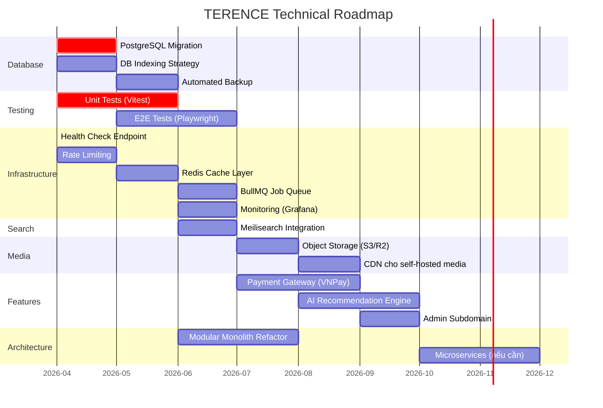

**Chi tiết các milestone:**

| Giai đoạn | Mục tiêu | Kết quả kỳ vọng |
|-----------|---------|----------------|
| **Q2/2026** | Foundation | PostgreSQL, testing, health check, rate limiting |
| **Q3/2026** | Performance | Redis cache, job queue, search engine, monitoring |
| **Q3-Q4/2026** | Features | Payment gateway, object storage, CDN, AI recommendation |
| **Q4/2026** | Architecture | Admin subdomain, modular monolith, microservices evaluation |

---

## Phụ lục A — Cài đặt & Chạy local

### Yêu cầu

- **Node.js** ≥ 18.x
- **npm** ≥ 9.x
- TMDB API key (miễn phí tại [themoviedb.org](https://www.themoviedb.org/settings/api))

### Cài đặt

```bash
# Clone repo
git clone <repo-url>
cd TERENCE-main

# Cài dependencies (postinstall tự chạy prisma generate)
npm install

# Copy env template và điền giá trị
cp .env.example .env
# → Điền TMDB_API_KEY, TMDB_READ_ACCESS_TOKEN vào .env

# Tạo database & chạy migration
npx prisma migrate dev --name init

# Seed dữ liệu mẫu (admin, phim, ...)
npx prisma db seed
```

### Chạy development

```bash
# Chạy Next.js dev server (không có Socket.IO)
npm run dev
# → http://localhost:3000

# Chạy custom server với Socket.IO (watch party)
npm run dev:socket
# → http://localhost:3000 (có Socket.IO)
```

### Build production

```bash
npm run build
npm start
# → http://localhost:3000
```

### Scripts quan trọng

```bash
npm run dev              # Next.js dev server
npm run dev:socket       # Custom server (Socket.IO)
npm run build            # Production build
npm start                # Start production
npm run lint             # ESLint check
npm run db:generate      # Prisma generate client
npm run db:migrate       # Run migrations
npm run db:seed          # Seed database
npm run db:reset         # Reset database
npm run sync:ophim:catalog   # Sync OPhim catalog
npm run sync:ophim18:catalog # Sync OPhim18 catalog
npm run enrich:tmdb      # TMDB metadata enrichment
npm run pipeline:movie   # Full movie pipeline
npm run elastic:reindex  # Elasticsearch reindex
```

### Tài khoản seed

| Email | Mật khẩu | Quyền |
|-------|----------|-------|
| `admin@terence.vn` | `Admin@12345` | Super Admin |
| `staff@terence.vn` | `Staff@12345` | Staff |
| `user@terence.vn` | `User@12345` | User |

---

## Phụ lục B — Biến môi trường

Tạo file `.env` từ `.env.example`:

| Biến | Loại | Mô tả |
|------|------|-------|
| `NODE_ENV` | Server-only | `development` hoặc `production` |
| `PORT` | Server-only | Port chạy app (mặc định `3000`) |
| `HOSTNAME` | Server-only | `0.0.0.0` cho production |
| `DATABASE_URL` | Server-only | SQLite connection (`file:./prisma/dev.db`) |
| `TMDB_API_KEY` | Server-only | TMDB API key v3 |
| `TMDB_READ_ACCESS_TOKEN` | Server-only | TMDB Bearer token (ưu tiên dùng) |
| `TMDB_BASE_URL` | Server-only | `https://api.themoviedb.org/3` |
| `NEXT_PUBLIC_SITE_URL` | Public | URL production site |
| `NEXT_PUBLIC_TMDB_IMAGE_BASE_URL` | Public | `https://image.tmdb.org/t/p` |
| `NEXT_PUBLIC_REGION` | Public | Region cho TMDB (mặc định `VN`) |
| `OPHIM_BASE_URL` | Server-only | OPhim API base URL |
| `OPHIM18_BASE_URL` | Server-only | OPhim18 API base URL |
| `DEMO_HLS_URL` | Server-only | Demo HLS stream URL |
| `GNEWS_API_KEY` | Server-only | GNews API key (optional) |
| `ELASTICSEARCH_HOST` | Server-only | Elasticsearch URL (optional) |
| `LIVEKIT_API_KEY` | Server-only | LiveKit API key (watch party call) |
| `LIVEKIT_API_SECRET` | Server-only | LiveKit API secret |
| `NEXT_PUBLIC_LIVEKIT_URL` | Public | LiveKit WebSocket URL |

> ⚠️ **Server-only** keys **KHÔNG** prefix `NEXT_PUBLIC_` — chỉ dùng trong API routes & Server Components.

---

## Phụ lục C — Deploy Production

### PM2 (Vultr VPS)

```bash
# SSH vào server
ssh root@<server-ip>

# Clone repo
cd /var/www
git clone <repo-url> TERENCE
cd /var/www/TERENCE

# Tạo .env
cp .env.example .env
nano .env  # Điền production values

# Cài đặt + Build
npm install
npx prisma generate
npx prisma migrate deploy
npx prisma db seed
npm run build

# Start PM2
mkdir -p logs
pm2 start ecosystem.config.js
pm2 save
```

### Docker

```bash
docker-compose up -d
```

### Nginx

File config: `deploy/nginx/terence.conf`

```nginx
server {
    server_name terence.com.vn;
    location / {
        proxy_pass http://127.0.0.1:3000;
    }
}
```

---

## Phụ lục D — Refactor Report (2026-04-03)

<details>
<summary><strong>📋 Vấn đề phát hiện</strong></summary>

| # | Vấn đề | Mức độ |
|---|--------|--------|
| 1 | README rải rác (6 file ở nhiều thư mục) | Cao |
| 2 | `hooks/use-mobile.ts` trùng `components/ui/use-mobile.tsx` | Trung bình |
| 3 | `hooks/use-toast.ts` trùng `components/ui/use-toast.ts` | Trung bình |
| 4 | `src/features/` và `src/components/` rỗng (migration dở) | Thấp |
| 5 | `deploy_guide.md` trùng nội dung README | Trung bình |
| 6 | `scripts/quick-check.js` — debug file | Thấp |
| 7 | `scripts/streams-output.txt` — output committed | Thấp |
| 8 | `prisma/dev-docker.db` — DB file committed | Trung bình |
| 9 | `.env.production.example` trùng `.env.example` | Trung bình |
| 10 | 2 bộ OPhim sync code rất giống nhau | Trung bình |
| 11 | TMDB code ở 3 nơi | Trung bình |
| 12 | Watch history code ở 2 nơi | Trung bình |

</details>

<details>
<summary><strong>✅ Đã xử lý</strong></summary>

| # | Hành động | File ảnh hưởng |
|---|-----------|---------------|
| 1 | Xóa 5 README rải rác, giữ 1 README gốc tổng hợp | docs/*/README.md |
| 2 | Xóa `components/ui/use-mobile.tsx` (trùng) | components/ui/ |
| 3 | Xóa `components/ui/use-toast.ts` (trùng) | components/ui/ |
| 4 | Xóa `src/features/`, `src/components/` (rỗng) | src/ |
| 5 | Xóa `deploy_guide.md` (trùng README) | root |
| 6-8 | Xóa debug files, output files, DB committed | scripts/, prisma/ |
| 9 | Merge `.env.production.example` vào `.env.example` | root |
| 10 | Tạo README.md tổng hợp đầy đủ | README.md |
| 11 | Tạo PR template + commit checklist | .github/ |
| 12 | Tạo `docs:check` script | scripts/ |
| 13 | Tạo GitHub Actions CI workflow | .github/workflows/ |

</details>

---

## Tính năng: Sprint 1 — Ổn định hóa mã nguồn

### Mô tả
- Xóa mã chết (dead code) an toàn sau khi xác minh không còn tham chiếu nào trong toàn bộ codebase
- Sửa lỗi include thiếu quan hệ phim: `movieIncludes.card()` và `movieIncludes.detail()` giờ bao gồm `genres` (MovieGenre → Genre) song song với `categories` cũ để tương thích ngược
- Thêm các index cơ sở dữ liệu còn thiếu cho model `Short` nhằm cải thiện hiệu suất truy vấn
- Xác nhận route chính thức cho trang xem chung là `/xem-chung`
- Xác minh `src/server/modules/movies/` đã được xóa trong lần dọn dẹp trước
- Xác minh `app/watch-together/page.tsx` đã bị xóa; dọn luôn thư mục rỗng còn sót

### API
- Không thay đổi hợp đồng API

### Cơ sở dữ liệu
- Model: `Short`
- Đã thêm index:
  - `@@index([status])` — lọc theo trạng thái draft/published
  - `@@index([movieId])` — tối ưu truy vấn join đến Movie
  - `@@index([createdAt])` — sắp xếp theo ngày tạo

### Quy trình thực hiện
1. Xác minh tất cả tham chiếu đến mã chết trước khi xóa (grep toàn bộ codebase)
2. Xác nhận `src/server/modules/movies/` — đã xóa, không còn tham chiếu nào
3. Xác nhận `app/watch-together/` — đã rỗng, xóa thư mục rỗng
4. Cập nhật `movieIncludes.card()` và `movieIncludes.detail()` thêm quan hệ `genres`
5. Giữ nguyên `categories` trong includes để tương thích ngược (các consumer cũ trong `src/server/movies/`)
6. Thêm index chỉ bổ sung (additive-only) cho schema model `Short`
7. Không có breaking change, không sửa API, không thay đổi giao diện

### Trạng thái
- ✅ Hoàn thành

---

## Quyết định kiến trúc (Sprint 1)

### Mô tả
Các quyết định kiến trúc chính thức được ghi nhận trong Sprint 1:

- **`/xem-chung`** là route chính thức cho trang xem chung (tiếng Việt). `/watch-together` trước đây chỉ là redirect và đã được xóa. Alias tiếng Anh vẫn hoạt động qua rewrites trong `next.config.mjs`.
- **`Genre` + `MovieGenre`** là hướng phân loại phim chính thức. Mọi mã mới nên sử dụng Genre.
- **`Category` + `MovieCategory`** vẫn giữ trong schema để tương thích ngược. Các consumer đang dùng bao gồm `src/server/movies/movie-service.ts` và `src/server/search/`. Việc loại bỏ được hoãn cho đến khi tất cả consumer được chuyển đổi.
- **Gộp player** (4 component player, tổng ~97KB) được xác định là nợ kỹ thuật nghiêm trọng nhưng hoãn sang sprint riêng để tránh lỗi giao diện.
- **Gộp watch history** (3+ cài đặt nằm rải rác ở `lib/`, `server/`, `src/server/`) được hoãn sang sprint riêng để thống nhất an toàn.
- **`src/server/movies/movie-service.ts`** vẫn dùng `categories` cũ trong `CARD_SELECT` và `DETAIL_SELECT`. Đây là hành vi có chủ đích để tương thích ngược, sẽ xử lý khi hoàn tất chuyển đổi Category → Genre.

### Trạng thái
- ✅ Đã ghi nhận


---

## Tính năng: Sprint 2 — Gộp Watch History và TMDB Client

### Mô tả
- Kiểm tra toàn bộ các cài đặt watch history tại 4 vị trí (`lib/watch-history/`, `server/services/`, `src/server/watch/`, `lib/db/watch-history-queries.ts`)
- Phát hiện `lib/watch-history/` là module **phía client** chính thức (localStorage), không phải server service
- Chọn `src/server/watch/watch-history-service.ts` làm service **phía server** chính thức (đầy đủ nhất: kiểm tra movie/episode, theo dõi deviceType, phân trang, xóa)
- Chuyển `server/services/watch-history-service.ts` thành wrapper tương thích ngược — các thao tác ghi (`saveProgress`) giờ ủy quyền cho service chính thức để đảm bảo tính nhất quán dữ liệu
- Các thao tác đọc (`getProgress`, `getContinueWatching`) giữ nguyên trong wrapper với response shape riêng để không phá vỡ API consumer hiện tại
- Kiểm tra trùng lặp TMDB client giữa `lib/tmdb/client.ts` (6 consumer) và `src/server/tmdb/tmdb-client.ts` (3 consumer nội bộ)
- Chọn `lib/tmdb/client.ts` làm HTTP client cơ sở chính thức (mạnh mẽ hơn: kiểm tra env, custom error types, hỗ trợ ISR, retry với backoff)
- Tái cấu trúc `src/server/tmdb/tmdb-client.ts` để ủy quyền toàn bộ HTTP request cho client chính thức, loại bỏ logic fetch-with-retry trùng lặp
- Giữ nguyên xử lý retry cho lỗi 429 (rate-limit) như một lớp wrapper chuyên biệt cho các tác vụ đồng bộ/làm giàu dữ liệu
- Tất cả phương thức API công khai giữ nguyên signature — không cần thay đổi đường dẫn import

### API
- Không thay đổi hợp đồng API công khai

### Cơ sở dữ liệu
- Không thay đổi schema trong Sprint 2

### Quy trình thực hiện
1. Kiểm tra 4 file watch history — phân biệt phía client và phía server
2. Chọn `src/server/watch/watch-history-service.ts` làm service phía server chính thức
3. Chuyển `server/services/watch-history-service.ts` thành wrapper mỏng, ủy quyền thao tác ghi
4. Kiểm tra 2 TMDB client — xác định `lib/tmdb/client.ts` là lớp cơ sở mạnh mẽ hơn
5. Tái cấu trúc `src/server/tmdb/tmdb-client.ts` sử dụng HTTP client chính thức bên trong
6. Xác minh TypeScript biên dịch thành công — không có lỗi từ các thay đổi (chỉ còn cache `.next/` cũ)
7. Xác minh tất cả đường dẫn import không thay đổi

### Trạng thái
- ✅ Hoàn thành

---

## Quyết định kiến trúc (Sprint 2)

### Mô tả
Các quyết định kiến trúc chính thức được ghi nhận trong Sprint 2:

- **`lib/watch-history/`** là module watch history **phía client** chính thức (dựa trên localStorage, dùng bởi hooks/components)
- **`src/server/watch/watch-history-service.ts`** là service watch history **phía server** chính thức (Prisma/DB, dùng bởi các routes `/api/v1/watch-history/`)
- **`server/services/watch-history-service.ts`** giờ là wrapper tương thích ngược đã lỗi thời — sẽ được loại bỏ trong sprint tương lai khi các API routes được cập nhật import trực tiếp từ service chính thức
- **`lib/tmdb/client.ts`** (`tmdbFetch`) là HTTP client cơ sở chính thức cho mọi thao tác TMDB
- **`src/server/tmdb/tmdb-client.ts`** giờ ủy quyền HTTP cho client chính thức — cung cấp các phương thức domain có kiểu dữ liệu (searchMovies, searchTv, v.v.) như lớp API bậc cao hơn
- **`lib/db/watch-history-queries.ts`** đã xuất khẩu (export) nhưng chưa được import tích cực — giữ lại làm tiện ích cho tương lai, không quan trọng
- Việc gộp player vẫn được hoãn sang sprint sau
- Logic lõi của watch party không bị ảnh hưởng

### Trạng thái
- ✅ Đã ghi nhận


---

## Tính năng: Sprint 3 — Gộp dịch vụ đồng bộ OPhim

### Mô tả
- Kiểm tra trùng lặp giữa `ophim-sync-service.ts` (399 dòng) và `ophim18-sync-service.ts` (412 dòng)
- Phát hiện 7 hàm helper giống nhau 95–100% giữa hai dịch vụ (~150 dòng trùng lặp hoàn toàn)
- Trích xuất các helper dùng chung vào `src/server/ophim/sync-helpers.ts`: PrismaClient, vòng đời SyncJob (`createSyncJob`, `completeSyncJob`, `failSyncJob`), tạo SyncLog (`addSyncLog`), các helper upsert quan hệ (`upsertCategories`, `upsertCountries`, `upsertEpisodes`) và `disconnect`
- Giữ hành vi đặc thù nguồn trong các adapter mỏng: OPhim/OPhim18 client/mapper, `upsertMovieSource` (khác tên nguồn/URL), luồng điều phối đồng bộ (OPhim18 có `cdnBase`, `hasPlayableSource`, `catalogType`)
- Gộp `completeSyncJob` để hỗ trợ trạng thái `partial` từ phiên bản OPhim18 (cải tiến cho cả OPhim sync)
- Giữ nguyên tất cả script và điểm vào đồng bộ — không thay đổi đường dẫn import nào
- Giảm tổng mã đồng bộ ~150 dòng mà không thay đổi hành vi bên ngoài

### API
- Không thay đổi hợp đồng API công khai
- Không thay đổi hợp đồng đồng bộ admin

### Cơ sở dữ liệu
- Không thay đổi schema trong Sprint 3

### Quy trình thực hiện
1. Kiểm tra trùng lặp OPhim sync — so sánh từng dòng tất cả các hàm
2. Xác định 7 hàm helper dùng chung 100% (5 giống hệt, 2 tham số hóa theo chuỗi `source`)
3. Tạo `src/server/ophim/sync-helpers.ts` với logic dùng chung đã trích xuất
4. Tái cấu trúc cả `ophim-sync-service.ts` và `ophim18-sync-service.ts` để import từ shared helpers
5. Toàn bộ logic đặc thù nguồn (clients, mappers, URL nguồn phim, kiểm tra khả năng phát) vẫn nằm trong các file riêng
6. Xác minh cả 7 file consumer (4 script, 2 admin API route, 1 pipeline) vẫn import đúng
7. TypeScript biên dịch thành công, không có lỗi từ các thay đổi

### Trạng thái
- ✅ Hoàn thành

---

## Quyết định kiến trúc (Sprint 3)

### Mô tả
Các quyết định kiến trúc chính thức được ghi nhận trong Sprint 3:

- **`src/server/ophim/sync-helpers.ts`** là lớp tiện ích dùng chung cho tất cả dịch vụ đồng bộ họ OPhim
- Prisma instance dùng chung (`syncPrisma`) được quản lý bởi `sync-helpers.ts` — cả hai dịch vụ đồng bộ và tất cả script đều dùng instance duy nhất này
- Hành vi đồng bộ đặc thù nguồn (client, mapper, upsert nguồn phim, phát hiện khả năng phát) vẫn nằm trong `ophim-sync-service.ts` và `ophim18-sync-service.ts`
- Các kiểu `MappedMovie`, `MappedEpisode`, `MappedCategory`, `MappedCountry`, `SyncResult` bị trùng giữa `types.ts` và `ophim18-types.ts` — việc thống nhất các kiểu này được hoãn để tránh thay đổi liên tầng mapper
- Việc gộp player vẫn được hoãn sang sprint sau
- Hệ thống retry/theo dõi tiến trình được hoãn

### Trạng thái
- ✅ Đã ghi nhận


---

## Tính năng: Sprint 4A — Tách component trang quản trị

### Mô tả
- Kiểm tra độ phức tạp tất cả trang quản trị admin (TCoin 546 dòng, Users 378, Shorts 352, Logs 296, Movies 258)
- Trích xuất các subcomponent UI an toàn từ 2 trang phức tạp nhất: TCoin (546→272 dòng) và Users (378→239 dòng)
- Trang TCoin tách thành: `WalletsTab` (144 dòng), `PaymentsTab` (159 dòng), `AdjustModal` (85 dòng)
- Trang Users tách thành: `UserTable` (134 dòng), `UserModals` (103 dòng, chứa AddUserModal + EditUserModal)
- Sử dụng mẫu `_components/` cục bộ theo trang (tiền tố gạch dưới ngăn Next.js tạo route)
- Toàn bộ quản lý state và logic API vẫn nằm trong file trang
- Các subcomponent hoàn toàn thuần hiển thị (presentational) với props có kiểu dữ liệu
- Trang Logs (296 dòng) và Movies (258 dòng) đã kiểm tra nhưng đủ gọn gàng, chưa cần tách
- Giữ nguyên hoàn toàn các route hiện có, hành vi giao diện và tương tác API

### API
- Không thay đổi hợp đồng API

### Cơ sở dữ liệu
- Không thay đổi schema trong Sprint 4A

### Quy trình thực hiện
1. Kiểm tra tất cả trang admin — xếp hạng theo số dòng và độ phức tạp trộn lẫn concerns
2. Chọn TCoin và Users làm mục tiêu tách (điểm phức tạp cao nhất)
3. Trích xuất 5 subcomponent trên 2 trang sử dụng mẫu presentational component
4. Giữ nguyên toàn bộ state, handlers và lời gọi API trong file trang
5. Xác minh TypeScript biên dịch thành công — không có lỗi từ các thay đổi
6. Xác nhận không thay đổi route, API hay hành vi hiển thị

### Trạng thái
- ✅ Hoàn thành

---

## Quyết định kiến trúc (Sprint 4A)

### Mô tả
Các quyết định kiến trúc chính thức được ghi nhận trong Sprint 4A:

- Các trang admin lớn nên được tách khi vượt quá ~300 dòng với concerns trộn lẫn (bảng/modal/bộ lọc)
- Thư mục `_components/` cục bộ theo trang là mẫu ưu tiên cho subcomponent trang admin (tiền tố gạch dưới của Next.js ngăn tạo route)
- Các subcomponent nên thuần hiển thị (presentational) — state và logic API giữ lại trong trang
- Các component helper nhỏ (StatCard, TabButton) dưới 20 dòng nên giữ inline trong trang
- Trang Logs (296 dòng) và Movies (258 dòng) có độ phức tạp chấp nhận được cho phạm vi tính năng — chưa cần tách hiện tại
- Tái cấu trúc sâu logic admin (custom hooks, shared admin components) được hoãn trừ khi độ phức tạp tăng thêm

### Trạng thái
- ✅ Đã ghi nhận


---

## Tính năng: Sprint 4B — Thống nhất kiểu TypeScript dùng chung

### Mô tả
- Kiểm tra trùng lặp kiểu (type) giữa `types.ts` và `ophim18-types.ts`
- Phát hiện 5 interface giống hệt 100%: `MappedMovie` (25 trường), `MappedEpisode` (11 trường), `MappedCategory` (2 trường), `MappedCountry` (2 trường), `SyncResult` (7 trường)
- Tạo `src/server/ophim/sync-types.ts` — nguồn chân lý duy nhất (single source of truth) cho các kiểu dùng chung
- Thay thế định nghĩa trùng lặp trong `types.ts` và `ophim18-types.ts` bằng `export type { ... } from './sync-types'`
- Tất cả consumer hiện tại (mappers, sync services, index barrel) vẫn import từ đường dẫn cũ — không cần thay đổi import nào
- Loại bỏ ~100 dòng trùng lặp kiểu mà không ảnh hưởng runtime
- Chỉ thay đổi tại thời điểm biên dịch (compile-time) — không có mã runtime nào bị ảnh hưởng

### API
- Không thay đổi hợp đồng API

### Cơ sở dữ liệu
- Không thay đổi schema trong Sprint 4B

### Quy trình thực hiện
1. So sánh từng trường của 5 interface giữa `types.ts` và `ophim18-types.ts` — xác nhận 100% giống hệt
2. Xác minh 7 file consumer hiện tại và đường dẫn import
3. Tạo `src/server/ophim/sync-types.ts` với 5 interface dùng chung
4. Thay thế định nghĩa inline trong `types.ts` bằng re-export từ `sync-types.ts`
5. Thay thế định nghĩa inline trong `ophim18-types.ts` bằng re-export từ `sync-types.ts`
6. Xác minh TypeScript biên dịch thành công — không có lỗi từ các thay đổi

### Trạng thái
- ✅ Hoàn thành

---

## Tính năng: Sprint 5A-BE — Backend Hardening

### Mô tả
- Kiểm tra toàn bộ trạng thái backend hardening hiện tại: API routes, middleware, auth guards, response helpers
- Phát hiện thiếu: health check endpoint, rate limiting, response helper chuẩn hóa theo backend skill rules
- Phát hiện có sẵn: `lib/admin/api-helpers.ts` (errorResponse, successResponse, paginatedResponse) — dành riêng cho admin routes
- Thêm health check endpoint `/api/health` với DB connectivity check nhẹ
- Tạo module response helper chuẩn hóa `lib/api/response.ts` theo format `{ success, message, data }` cho các route mới
- Tạo module rate limiting in-memory `lib/api/rate-limit.ts` sử dụng sliding-window counter
- Áp dụng rate limiting cho 3 route nhạy cảm nhất: login (5 req/phút), signup (5 req/phút), search (20 req/phút)
- Giữ nguyên toàn bộ response contract hiện có — không mass-refactor các route cũ
- Không thay đổi giao diện, player, watch party, hoặc schema

### API
- Thêm:
  - `GET /api/health` — trả về `{ success, status, service, version, timestamp, checks: { database } }`
- Rate limiting thêm vào (response 429 khi vượt giới hạn):
  - `POST /api/auth/login` — 5 yêu cầu/phút/IP
  - `POST /api/auth/signup` — 5 yêu cầu/phút/IP
  - `GET /api/v1/search` — 20 yêu cầu/phút/IP
- Tất cả API contract hiện có được giữ nguyên

### Cơ sở dữ liệu
- Không thay đổi schema trong Sprint 5A-BE

### Quy trình thực hiện
1. Kiểm tra trạng thái backend hardening: middleware.ts, lib/admin/api-helpers.ts, auth guards, response helpers
2. Xác nhận `/api/health` chưa tồn tại (chỉ có admin-internal elastic/sync health)
3. Xác nhận không có rate limiting nào trên toàn bộ codebase
4. Tạo `lib/api/response.ts` — response helpers chuẩn hóa cho route mới
5. Tạo `lib/api/rate-limit.ts` — rate limiter in-memory nhẹ, có tự dọn memory leak
6. Tạo `app/api/health/route.ts` — health check với DB probe
7. Thêm rate limiting vào login, signup, search — giữ nguyên response contract
8. Xác minh TypeScript biên dịch thành công — không có lỗi mới
9. Xác minh không thay đổi UI, player, watch party, schema

### Trạng thái
- ✅ Hoàn thành

---

## Quyết định kiến trúc (Sprint 5A-BE)

### Mô tả
Các quyết định kiến trúc chính thức được ghi nhận trong Sprint 5A-BE:

- **Backend hardening** được ưu tiên trước mọi refactor frontend/player tiếp theo
- **`lib/api/response.ts`** (`apiSuccess`, `apiError`, `apiPaginated`) là response helper chuẩn hóa cho các route **mới** — theo format `{ success, message, data }` của backend skill rules
- **`lib/admin/api-helpers.ts`** vẫn là helper chính cho admin routes (dùng format `{ error }` / raw data) — không thay đổi để giữ backward compatibility
- **`lib/api/rate-limit.ts`** là rate limiter in-memory nhẹ với sliding-window counter — có giới hạn rõ ràng: reset khi server restart, không chia sẻ giữa PM2 cluster instances
- **Health check** (`/api/health`) là yêu cầu tối thiểu cho production readiness — trả 200 khi OK, 503 khi DB degraded
- **Rate limiting bắt đầu nhỏ**: chỉ 3 route nhạy cảm nhất (login, signup, search) — không áp dụng toàn bộ
- **Redis-backed rate limiting** và infrastructure nâng cao được hoãn sang sprint sau
- Chuẩn hóa response format cho route cũ nên được thực hiện dần dần (incremental) — không mass rewrite
- Mọi API response contract hiện có đều được giữ nguyên trong sprint này

### Trạng thái
- ✅ Đã ghi nhận


---

## Tính năng: Sprint 5B-BE — Chuẩn hóa API Response

### Mô tả
- Kiểm tra response format của 3 route read-only ưu tiên thấp: `/api/v1/home`, `/api/v1/continue-watching`, `/api/v1/watch-history`
- Phát hiện `/api/v1/home` dùng `jsonOk()` → `{ success, data }` — thiếu `message`
- Phát hiện `/api/v1/continue-watching` dùng `NextResponse.json({ items })` — thiếu `success`, `message`, data không wrap
- Phát hiện `/api/v1/watch-history` đã có `{ success, data }` — thiếu `message`
- Áp dụng `apiSuccess()` / `apiError()` từ `lib/api/response.ts` cho cả 3 route
- Giữ nguyên data shape bên trong `data` — không đổi tên field, không xóa field
- Giữ nguyên `pagination` và `meta` cho watch-history (thêm `message` field)
- Xác minh homepage SSR không gọi `/api/v1/home` trực tiếp (dùng `getHomeData()` server-side)
- Xác minh continue-watching frontend dùng localStorage service, không fetch API trực tiếp
- Không thay đổi giao diện, schema, rate limiting, hoặc health endpoint

### API
- Cập nhật (thêm `message` field, chuẩn hóa error format):
  - `GET /api/v1/home` — `jsonOk()` → `apiSuccess()`
  - `GET /api/v1/continue-watching` — `NextResponse.json({ items })` → `apiSuccess({ items })`
  - `GET /api/v1/watch-history` — thêm `message: 'OK'` vào response, error dùng `apiError()`
  - `POST /api/v1/watch-history` — `NextResponse.json({ success, data })` → `apiSuccess(data)`

### Cơ sở dữ liệu
- Không thay đổi schema trong Sprint 5B-BE

### Quy trình thực hiện
1. Kiểm tra response format hiện tại của 3 route mục tiêu
2. Kiểm tra frontend consumers — xác nhận không có direct fetch nào bị ảnh hưởng
3. Áp dụng `apiSuccess()` / `apiError()` cho `/api/v1/home`
4. Áp dụng `apiSuccess()` / `apiError()` cho `/api/v1/continue-watching`
5. Áp dụng `apiSuccess()` / `apiError()` cho `/api/v1/watch-history` (GET + POST)
6. Xác minh TypeScript biên dịch thành công — không có lỗi mới
7. Xác minh không thay đổi UI, schema, rate limiting, health endpoint

### Trạng thái
- ✅ Hoàn thành

---

## Quyết định kiến trúc (Sprint 5B-BE)

### Mô tả
Các quyết định kiến trúc chính thức được ghi nhận trong Sprint 5B-BE:

- Chuẩn hóa response phải **incremental** — chỉ áp dụng cho route có rủi ro thấp trước
- Route đã có `{ success, data }` (như watch-history) chỉ cần thêm `message` field — không phải viết lại
- Route có format khác (như continue-watching `{ items }`) được wrap vào `apiSuccess({ items })` để giữ data shape
- **Không** chuẩn hóa admin routes hoặc auth routes trong sprint này — giữ backward compatibility
- `src/server/movies/api-helpers.ts` (`jsonOk`, `jsonError`, `jsonPaginated`) vẫn giữ nguyên cho các route v1 khác chưa migrate
- Error response field name thay đổi từ `error` → `message` cho 3 route đã chuẩn hóa — an toàn vì không có direct frontend consumer
- Các route tiếp theo nên được chuẩn hóa theo batch nhỏ, kiểm tra consumer trước khi thay đổi

### Trạng thái
- ✅ Đã ghi nhận


---

## Tính năng: Sprint 6 — BasePlayer Consolidation

### Mô tả
- Kiểm tra chi tiết 4 player component: `VideoPlayer` (434 dòng), `EnhancedVideoPlayer` (791 dòng), `HLSPlayer` (771 dòng), `WatchPlayer` (591 dòng)
- Kiểm tra hooks: `usePlayer` (359 dòng), `useHLS` (194 dòng)
- Kiểm tra utilities: `lib/player/time-format.ts`, `lib/player/types.ts`, `lib/player/source-adapter.ts`
- Phát hiện `VideoPlayer` và `EnhancedVideoPlayer` là **dead code** — không có file nào import chúng
- Phát hiện `HLSPlayer` (watch page chính) và `WatchPlayer` (watch party) là 2 player đang active
- Xác định UI phần chung bị duplicate: play/pause, volume, fullscreen, progress bar, loading spinner, error UI, auto-hide controls, keyboard shortcuts, time display — lặp lại 4 lần
- Tạo `components/player/BasePlayer.tsx` — foundation component chứa toàn bộ UI controls chung
- BasePlayer dùng slot pattern (`children`, `rightControls`, `topOverlay`, `extraErrorAction`) để players chuyên biệt inject UI riêng
- Giữ nguyên tất cả player hiện có — không force migrate
- Giữ nguyên watch party sync behavior
- Deferred: Adopt BasePlayer trong HLSPlayer/WatchPlayer sang Sprint 7

### API
- Không thay đổi API contract

### Cơ sở dữ liệu
- Không thay đổi schema trong Sprint 6

### Quy trình thực hiện
1. Kiểm tra 4 player files và xác định import graph
2. Phát hiện `VideoPlayer` + `EnhancedVideoPlayer` là dead code
3. Xác định UI duplicate boundary vs specialized logic
4. Tạo `BasePlayer.tsx` với slot pattern cho extensibility
5. Xác minh TypeScript biên dịch thành công
6. Không thay đổi active players — zero deployment risk
7. Deferred: Adopt BasePlayer trong active players sang Sprint 7

### Trạng thái
- ✅ Hoàn thành

---

## Quyết định kiến trúc (Sprint 6)

### Mô tả
Các quyết định kiến trúc chính thức được ghi nhận trong Sprint 6:

- **BasePlayer** (`components/player/BasePlayer.tsx`) là foundation UI component chính thức cho tất cả player controls
- Watch party synchronization (`isRemoteAction`, `showViewerBlocked`, host/viewer badges) phải **luôn ở ngoài BasePlayer**
- Player consolidation phải **incremental** — không viết lại toàn bộ trong 1 sprint
- `VideoPlayer` và `EnhancedVideoPlayer` được xác nhận là dead code — có thể xóa trong sprint tương lai
- `HLSPlayer` sử dụng `usePlayer` + `useHLS` hooks — khi adopt BasePlayer, giữ nguyên hook architecture
- `WatchPlayer` sử dụng `forwardRef` + `useImperativeHandle` cho sync — cần đặc biệt cẩn thận khi adopt BasePlayer
- Partial duplication tạm thời giữa BasePlayer và active players là **chấp nhận được** — giảm risk
- BasePlayer sử dụng **slot pattern** để cho phép inject UI chuyên biệt:
  - `rightControls`: subtitle, settings, next episode buttons
  - `topOverlay`: server badge, host/viewer badge
  - `children`: resume prompt, auto-next overlay
  - `extraErrorAction`: alternate source button, server switch

### Trạng thái
- ✅ Đã ghi nhận


---

## Tính năng: Sprint 6B — HLSPlayer BasePlayer Migration

### Mô tả
- Xác định `HLSPlayer` (771 dòng, active trên trang xem phim chính) là target migration an toàn nhất
- `WatchPlayer` (watch party) không được chạm vào — giữ nguyên hoàn toàn
- Mở rộng `BasePlayer` thêm 2 slot mới:
  - `leftControls`: nút tiếp theo (giữa play/pause và volume)
  - `loadingOverlay`: custom loading UI (hiển thị retry count)
- Viết lại `HLSPlayer` sử dụng `BasePlayer` cho toàn bộ controls UI
- Video element, resume prompt, auto-next overlay, settings menu → inject qua BasePlayer slots
- All-servers-failed error screen → render ngoài BasePlayer (early return)
- Inline error → dùng `hasError` prop + `extraErrorAction` slot
- Server badge → `topOverlay` slot
- Next episode button → `leftControls` slot
- Settings menu (speed, server, subtitle) → `rightControls` slot
- Giảm `HLSPlayer` từ 771 dòng xuống ~530 dòng (loại bỏ ~240 dòng controls duplicate)
- Giữ nguyên toàn bộ UI visible, keyboard shortcuts, playback behavior
- `WatchPlayer` giữ nguyên — không migrate trong sprint này

### API
- Không thay đổi API contract

### Cơ sở dữ liệu
- Không thay đổi schema trong Sprint 6B

### Quy trình thực hiện
1. Đánh giá risk: `HLSPlayer` (no sync) < `WatchPlayer` (has sync)
2. Mở rộng BasePlayer thêm `leftControls` + `loadingOverlay` slots
3. Viết lại HLSPlayer dùng BasePlayer cho controls layer
4. Inject video element, overlays, settings menu qua slot pattern
5. Xác minh TypeScript biên dịch thành công — 0 lỗi mới
6. Giữ nguyên WatchPlayer — deferred sang sprint tương lai

### Trạng thái
- ✅ Hoàn thành

---

## Quyết định kiến trúc (Sprint 6B)

### Mô tả
Các quyết định kiến trúc chính thức được ghi nhận trong Sprint 6B:

- `HLSPlayer` đã được migrate thành công sang BasePlayer — chứng minh pattern hoạt động
- BasePlayer slot pattern đủ linh hoạt: `children`, `leftControls`, `rightControls`, `topOverlay`, `loadingOverlay`, `extraErrorAction`
- `WatchPlayer` migration nên được thực hiện riêng vì có `forwardRef` + `useImperativeHandle` + host/viewer sync
- Dead code players (`VideoPlayer`, `EnhancedVideoPlayer`) có thể xóa an toàn — không ai import chúng
- Keyboard shortcuts context: BasePlayer xử lý Space/K/F/M/Arrows, component con xử lý Escape (close settings)

### Trạng thái
- ✅ Đã ghi nhận


---

## Tính năng: Sprint 6C — Player Stability Polish

### Mô tả
- Kiểm tra stability của BasePlayer, HLSPlayer, WatchPlayer cho demo
- Sửa 7 vấn đề ổn định:
  1. **Fullscreen desync** — Bỏ optimistic `setIsFullscreen`, chỉ dùng `fullscreenchange` event
  2. **Safari fullscreen** — Thêm `webkitfullscreenchange` event listener cho Safari
  3. **Progress bar clamp** — Clamp seek value trong `[0, duration]` khi click progress bar
  4. **Seek throttle** — Throttle keyboard seek (ArrowLeft/Right) max 1 lần/150ms để tránh flooding khi giữ phím
  5. **Timer cleanup** — Thêm `hideControlsTimer` cleanup on unmount (memory leak fix)
  6. **Resume guard** — Clamp `resumeTime` vào `[0, duration-1]` để xử lý stale progress từ source khác
  7. **WatchPlayer keyboard** — Thêm ArrowUp/ArrowDown volume shortcuts (thiếu so với BasePlayer/HLSPlayer)
- Không thay đổi UI visible
- Không thay đổi watch party sync logic
- Không thay đổi API/schema/route

### API
- Không thay đổi API contract

### Cơ sở dữ liệu
- Không thay đổi schema trong Sprint 6C

### Quy trình thực hiện
1. Kiểm tra BasePlayer: fullscreen, progress bar, keyboard, timer cleanup
2. Kiểm tra HLSPlayer: resume playback, error fallback
3. Kiểm tra WatchPlayer: keyboard shortcut consistency
4. Áp dụng 5 fixes cho BasePlayer
5. Áp dụng 1 fix cho HLSPlayer (resume guard)
6. Áp dụng 1 fix cho WatchPlayer (ArrowUp/Down volume)
7. Xác minh TypeScript biên dịch — 0 lỗi mới

### Trạng thái
- ✅ Hoàn thành

---

## Tính năng: Dashboard Demo Polish

### Mô tả
- Kiểm tra 5 trang admin dashboard cho demo readiness
- Sửa lỗi chính tả: "Xem tat ca" → "Xem tất cả" (dashboard summary)
- Thêm loading skeleton pulse cho stat cards thay vì text "..." (dashboard summary)
- Sửa indentation lệch trong top users section (dashboard summary)
- Nâng cấp empty state cho movies table: thêm icon + subtitle hướng dẫn
- Nâng cấp empty state cho users table: thêm icon + subtitle hướng dẫn
- Dịch tab labels TCoin từ English ("Wallets", "Payment Orders") sang Vietnamese ("Ví người dùng", "Đơn nạp tiền")
- Đơn giản hóa stats label logs page: bỏ "(trang này)" gây nhầm lẫn
- Format số lượng log với `toLocaleString()` cho dễ đọc
- Không thay đổi layout, route, API, hoặc backend contract

### API
- Không thay đổi API contract

### Cơ sở dữ liệu
- Không thay đổi schema

### Quy trình thực hiện
1. Kiểm tra 5 trang: dashboard summary, movies, users, logs, tcoin
2. Xác định rough edges (typos, loading states, empty states, language mix)
3. Áp dụng polish fixes cho từng trang
4. Xác minh TypeScript biên dịch — 0 lỗi mới
5. Giữ nguyên layout, behavior, API contracts

### Trạng thái
- ✅ Hoàn thành

---

## Nợ kỹ thuật (Technical Debt)

### Mức cao (High)

| # | Lĩnh vực | Mô tả | Ảnh hưởng |
|---|----------|-------|-----------|
| H1 | Database | SQLite đang dùng cho cả dev + production. Không hỗ trợ concurrent write, full-text search yếu, thiếu native enum | Giới hạn khả năng scale, race condition khi write concurrent (watch party, progress save) |
| H2 | API | ~50+ route dùng `NextResponse.json()` trực tiếp — chỉ 3 route (`/v1/home`, `/v1/continue-watching`, `/v1/watch-history`) đã chuẩn hóa sang `apiSuccess()`/`apiError()` | Response format không nhất quán, khó maintain error handling thống nhất |
| H3 | Service Layer | Tồn tại 2 thư mục song song: `src/server/` (mới) và `server/` (legacy). Import path lẫn `@/src/server/` và `@/server/` | Gây nhầm lẫn developer, khó trace code flow |
| H4 | Auth | Session-based auth chưa có refresh token, thiếu CSRF protection cho mutation routes | Rủi ro bảo mật khi deploy public |

### Mức trung bình (Medium)

| # | Lĩnh vực | Mô tả | Ảnh hưởng |
|---|----------|-------|-----------|
| M1 | Player | Dead code: `VideoPlayer.tsx` (14KB) + `EnhancedVideoPlayer.tsx` (29KB) — không có file nào import | +43KB bundle size không cần thiết |
| M2 | Player | `WatchPlayer.tsx` chưa dùng `BasePlayer` — duplicate ~200 dòng controls UI | Tăng chi phí maintain khi sửa UI chung |
| M3 | Schema | Legacy `Category` + `MovieCategory` models song song với `Genre` + `MovieGenre` | Data duplication, migration phức tạp |
| M4 | Schema | Movie model có legacy text fields (`actorText`, `directorText`, `countryText`, `categoryText`) cùng tồn tại với normalized `MoviePerson`/`MovieGenre`/`MovieCountry` | Dữ liệu bị duplicate |
| M5 | API | Duplicate route prefixes: `/api/watch/` (legacy) + `/api/v1/watch-history/` (new), `/api/watch-rooms/` + `/api/watch-party/` (2 bộ API cho watch party) | Khó xác định route canonical, tăng surface area |
| M6 | Frontend | Admin CRUD actions dùng `alert()` + `confirm()` thay vì toast notification | UX thô cho production app |
| M7 | Build | `.next/` cache chứa reference đến `app/watch-together/page.js` đã xóa — gây 2 TS errors persistent | CI/CD false failure nếu strict mode |

### Mức thấp (Low)

| # | Lĩnh vực | Mô tả | Ảnh hưởng |
|---|----------|-------|-----------|
| L1 | Env | `lib/env.ts` validate runtime nhưng thiếu build-time validation (e.g. `t3-env`) | Deploy có thể fail silently nếu thiếu env var |
| L2 | Testing | Chưa có unit test hoặc integration test nào | Không có safety net cho refactor |
| L3 | API | Thiếu pagination standardization — mỗi route return pagination format hơi khác | Frontend pagination code phải handle multiple shapes |
| L4 | Infra | Chưa có Docker Compose hoặc CI pipeline chuẩn | Setup dev environment thủ công |
| L5 | Frontend | Một số component dùng hardcoded Vietnamese text — chưa có i18n framework | Khó mở rộng đa ngôn ngữ |
| L6 | SEO | Thiếu `robots.txt`, `sitemap.xml` động cho movie catalog | Crawl coverage thấp |
| L7 | Monitoring | Chưa có error tracking (Sentry), APM, hoặc structured logging | Debug production khó |

---

## Lộ trình phát triển (Future Roadmap)

### Ngắn hạn — Sprint 7–8 (1–2 tuần)

| # | Task | Mô tả | Liên quan đến |
|---|------|-------|:---:|
| S1 | Xóa dead code players | Xóa `VideoPlayer.tsx` + `EnhancedVideoPlayer.tsx` sau khi verify 0 import | M1 |
| S2 | WatchPlayer → BasePlayer | Migrate `WatchPlayer` dùng BasePlayer, giữ nguyên `forwardRef` + sync logic | M2 |
| S3 | Chuẩn hóa thêm 5 API routes | Áp dụng `apiSuccess()`/`apiError()` cho `/v1/movies`, `/v1/progress`, auth routes | H2 |
| S4 | Xóa `.next/` cache stale | Clean build cache, xóa watch-together references | M7 |
| S5 | Thêm toast notifications | Thay `alert()`/`confirm()` bằng toast system cho admin CRUD | M6 |
| S6 | Thêm Prisma seed script | Seed data mẫu cho demo và development | L4 |

### Trung hạn — Sprint 9–12 (3–6 tuần)

| # | Task | Mô tả | Liên quan đến |
|---|------|-------|:---:|
| M-1 | Migrate SQLite → PostgreSQL | Đổi datasource, cập nhật connection pooling, thêm native full-text search | H1 |
| M-2 | Hợp nhất service layer | Merge `server/` vào `src/server/`, chuẩn hóa import path thống nhất | H3 |
| M-3 | Xóa legacy schema models | Xóa `Category`/`MovieCategory`, migrate data sang `Genre`/`MovieGenre` | M3 |
| M-4 | Xóa legacy text fields | Drop `actorText`/`directorText`/`countryText`/`categoryText` từ Movie model | M4 |
| M-5 | Hợp nhất watch-party routes | Chọn 1 API prefix (`/api/watch-party/`), deprecate `/api/watch-rooms/` | M5 |
| M-6 | Auth hardening | Thêm refresh token, CSRF protection, rate limiting cho auth routes | H4 |
| M-7 | Chuẩn hóa pagination | Tạo shared pagination helper, áp dụng cho tất cả list endpoints | L3 |
| M-8 | Build-time env validation | Sử dụng `t3-env` hoặc tương đương để validate env khi build | L1 |

### Dài hạn — Sau Sprint 12 (production-grade)

| # | Task | Mô tả |
|---|------|-------|
| L-1 | Docker Compose + CI/CD | Containerize app + database, thêm GitHub Actions CI pipeline |
| L-2 | Unit + Integration tests | Vitest cho services, Playwright cho E2E critical paths |
| L-3 | Error tracking | Tích hợp Sentry hoặc tương đương cho error monitoring |
| L-4 | CDN + Image optimization | Dùng Next.js Image component + CDN cho poster/backdrop |
| L-5 | i18n framework | Thêm `next-intl` hoặc `i18next` cho đa ngôn ngữ |
| L-6 | SEO automation | Dynamic `sitemap.xml` từ movie catalog, `robots.txt` |
| L-7 | Caching layer | Redis cache cho hot data (home page, trending, search results) |
| L-8 | Search upgrade | Elasticsearch/Meilisearch cho full-text search thay SQLite LIKE |
| L-9 | Streaming DRM | Token-based URL signing cho HLS streams |
| L-10 | Analytics | Dashboard analytics: real-time views, retention, engagement metrics |

---

## Tổng kết kiến trúc hiện tại

```
┌─────────────────────────────────────────────────────────────┐
│                      TERENCE Platform                       │
├─────────────────────────────────────────────────────────────┤
│  Frontend (Next.js 14 App Router)                          │
│  ┌─────────────┐ ┌──────────────┐ ┌─────────────────────┐  │
│  │ Public Pages │ │ Admin CMS    │ │ Watch Party         │  │
│  │ (SSR/SSG)    │ │ (Client)     │ │ (Socket.IO+LiveKit) │  │
│  └──────┬───────┘ └──────┬───────┘ └──────────┬──────────┘  │
│         │                │                     │             │
│  ┌──────┴────────────────┴─────────────────────┴──────────┐ │
│  │              Player Architecture                        │ │
│  │  BasePlayer (controls foundation)                       │ │
│  │    ├── HLSPlayer (main watch, uses BasePlayer ✅)       │ │
│  │    └── WatchPlayer (party, own controls ⚠️ planned)     │ │
│  └─────────────────────────────────────────────────────────┘ │
├─────────────────────────────────────────────────────────────┤
│  API Layer                                                  │
│  ┌────────────────┐ ┌──────────────┐ ┌──────────────────┐   │
│  │ /api/v1/       │ │ /api/admin/  │ │ /api/watch-party │   │
│  │ (standardized  │ │ (CRUD + logs)│ │ /api/watch-rooms │   │
│  │  3/50+ routes) │ │              │ │ (dual, to merge) │   │
│  └────────┬───────┘ └──────┬───────┘ └──────────┬────────┘  │
│           │                │                     │           │
│  ┌────────┴────────────────┴─────────────────────┴────────┐ │
│  │          Service Layer (src/server + server/)           │ │
│  │  movies | watch | ophim | tmdb | admin | pipeline       │ │
│  └─────────────────────────┬──────────────────────────────┘ │
│                            │                                │
│  ┌─────────────────────────┴──────────────────────────────┐ │
│  │                 Prisma ORM (SQLite)                     │ │
│  │  947 LOC schema | 30+ models | normalized relations    │ │
│  └─────────────────────────────────────────────────────────┘ │
└─────────────────────────────────────────────────────────────┘
```

### Các số liệu chính

| Metric | Giá trị |
|--------|---------|
| Tổng models (Prisma) | 30+ |
| Tổng API routes | ~50+ |
| Routes đã chuẩn hóa | 3 / 50+ |
| Player components (active) | 2 (HLSPlayer, WatchPlayer) |
| Player dead code | 2 files, ~43KB |
| Hooks | 12 custom hooks |
| Admin pages | 10+ (movies, users, logs, tcoin, analytics, ...) |
| Schema LOC | 947 lines |
| Database | SQLite (dev + prod) |
| Completed sprints | 5A-BE, 5B-BE, 6, 6B, 6C, Dashboard Polish |

---

## Tính năng: Sprint 7 — HLSPlayer Consolidation Verification

### Mô tả
- Kiểm tra lại migration HLSPlayer → BasePlayer (đã thực hiện Sprint 6B)
- Xác nhận: **migration đã hoàn thành 100%**
- HLSPlayer dùng `<BasePlayer>` cho tất cả shared controls:
  - Play/Pause, Volume/Mute, Progress bar, Fullscreen, Loading overlay, Error overlay
  - Keyboard shortcuts (Space, K, F, M, Arrows)
  - Big play button khi paused
- HLSPlayer giữ lại logic riêng biệt:
  - HLS initialization (`useHLS` hook)
  - Server switching + multi-server fallback
  - Resume prompt overlay
  - Settings menu (playback speed, subtitle, server selection)
  - Auto-next episode countdown
  - Progress save/restore
- Không còn icon `Play`/`Pause`/`Volume`/`Maximize`/`Minimize` trong HLSPlayer — tất cả do BasePlayer render
- Slot pattern hoạt động đúng: `leftControls`, `rightControls`, `topOverlay`, `loadingOverlay`, `extraErrorAction`
- TypeScript: 0 lỗi mới (chỉ 2 lỗi `.next/` cache cũ)
- Không thay đổi code trong sprint này — chỉ verification

### API
- Không thay đổi API contract

### Cơ sở dữ liệu
- Không thay đổi schema

### Trạng thái
- ✅ Đã hoàn thành (verified — migration từ Sprint 6B)

---

## Refactor Progress Log

### PHASE 1 — Architecture Refactoring ✅ (2026-04-07)

**Mục tiêu:** Audit repo, tách layers, chuẩn hóa services/repositories, chuẩn hóa API response + validators, tối ưu query homepage.

#### Files tạo mới

| File | Mục đích |
|------|----------|
| `lib/cache/index.ts` | Unified in-memory cache with TTL + tag-based invalidation + key builders |
| `lib/api/handler.ts` | Unified API response helpers: `ok()`, `badRequest()`, `paginated()`, `parseAndValidate()`, `withErrorHandler()` |
| `lib/repositories/index.ts` | Barrel export cho tất cả repositories |
| `lib/repositories/movie.repository.ts` | Movie repository — tất cả Prisma queries (optimized select, no N+1) |
| `lib/repositories/genre.repository.ts` | Genre repository + movie count aggregation |
| `lib/repositories/country.repository.ts` | Country repository + movie count aggregation |
| `lib/repositories/person.repository.ts` | Person/Actor repository (popular, detail, search) |
| `lib/repositories/review.repository.ts` | Review repository (approved, by movie, related, top-rated) |
| `lib/repositories/schedule.repository.ts` | Schedule repository (episode releases by date, real DB data) |
| `lib/services/index.ts` | Barrel export cho tất cả services |
| `lib/services/movie.service.ts` | Movie service — composites repository + cache + TMDB |
| `lib/services/taxonomy.service.ts` | Taxonomy service — genres + countries (1h cache) |
| `lib/services/review.service.ts` | Review service — cached reviews |
| `lib/services/schedule.service.ts` | Schedule service — real episode update data |
| `lib/services/person.service.ts` | Person service — cached actor data |
| `lib/validators/index.ts` | Consolidated Zod schemas (re-exports existing + new for review, news, genre, country, auth, search, watch progress) |
| `docs/architecture/ARCHITECTURE.md` | Architecture document: BE/FE layers, data flow, caching strategy, route map |

#### Backend đã tối ưu

1. **Repository Pattern** — Tất cả Prisma queries được bóc tách ra repositories riêng, page/component/API KHÔNG gọi DB trực tiếp nữa.
2. **Service Layer** — Business logic, caching, orchestration (compose repository + cache + external API).
3. **Unified Cache** — In-memory cache singleton với TTL, tag-based invalidation, centralized key builders.
4. **Unified API Handler** — `lib/api/handler.ts` thay thế các response helper rải rác: `ok()`, `paginated()`, `parseAndValidate()`, `withErrorHandler()`.
5. **Zod Validators** — Consolidated tất cả validation schemas vào `lib/validators/`.
6. **Optimized Queries** — Movie repository dùng `include` thay vì overfetch, genre/country repo có `_count` aggregation.
7. **Schedule từ DB thật** — `schedule.repository.ts` lấy episode updates thay vì demo data hardcode.

#### Frontend đã đổi

- Chưa thay đổi UI/UX (Phase 1 chỉ focus backend architecture).
- Đã chuẩn bị route map cho Phase 4.

#### TODO Phase 2

- [x] Tạo Design System (colors, typography, spacing, card variants)
- [x] Build AppHeader mới (sticky, search bar, mega dropdown)
- [x] Build NavMenu + MegaMenu component
- [x] Apply global layout mới (dark cinema theme)
- [x] Build SearchBar với suggestions dropdown

### PHASE 1.5 — Test Coverage Foundation ✅ (2026-04-08)

**Mục tiêu:** Thiết lập test framework + viết test coverage nền tảng cho toàn bộ critical business flows.

#### Setup

| Item | Chi tiết |
|------|----------|
| **Framework** | Vitest 4.1 + @vitest/coverage-v8 |
| **Config** | `vitest.config.ts` — path aliases, v8 coverage, thresholds |
| **Scripts** | `npm test` (single run) · `npm run test:watch` · `npm run test:coverage` |
| **Setup file** | `tests/helpers/setup.ts` — test env vars |
| **Mock factory** | `tests/helpers/mock-prisma.ts` — reusable Prisma mock |
| **Fixtures** | `tests/fixtures/index.ts` — movie, genre, country, user, review, TMDB data |

#### Test Files — Unit (15 suites, 221 tests)

| File | Tests | Covers |
|------|-------|--------|
| `tests/unit/env.test.ts` | 8 | `lib/env.ts` — validateEnv, getRequiredEnv, getLiveKitConfig |
| `tests/unit/validators.test.ts` | 46 | `lib/admin/validators.ts` + `lib/validators/` — movie, episode, short, user, review, search, auth, pagination, generateSlug |
| `tests/unit/validators-extended.test.ts` | 27 | `lib/validators/` — news, genre, country, review update, sort, id/slug param schemas |
| `tests/unit/cache.test.ts` | 14 | `lib/cache/index.ts` — set/get, TTL, getOrSet, tag invalidation, stats, key builders |
| `tests/unit/tmdb-mapper.test.ts` | 16 | `lib/tmdb-image.ts` + `lib/tmdb/mapper.ts` — image URL, mapMovie, mapGenre, mapMovieDetail, trailer selection |
| `tests/unit/api-handler.test.ts` | 17 | `lib/api/handler.ts` — parsePagination, parseSort, parseFilters, getErrorMessage |
| `tests/unit/api-helpers.test.ts` | 15 | `src/server/movies/api-helpers.ts` — parseIntParam, parseStringParam, parseBoolParam |
| `tests/unit/auth.test.ts` | 23 | `lib/auth/password.ts` + `lib/auth/permissions.ts` — hash/verify, permissions, role hierarchy |
| `tests/unit/session.test.ts` | 8 | `lib/auth/session.ts` — getSessionIdFromCookie (parser thuần) |
| `tests/unit/time-format.test.ts` | 12 | `lib/player/time-format.ts` — formatTime, formatDurationVi |
| `tests/unit/rate-limit.test.ts` | 5 | `lib/api/rate-limit.ts` — within limit, exceeded, independent keys |
| `tests/unit/movie-service.test.ts` | 10 | `lib/services/movie.service.ts` — listing, detail, search, view, homepage |
| `tests/unit/taxonomy-service.test.ts` | 8 | `lib/services/taxonomy.service.ts` — genres, countries, counts, invalidation |
| `tests/unit/review-service.test.ts` | 6 | `lib/services/review.service.ts` — approved, by movie, top-rated, like |
| `tests/unit/schedule-person-service.test.ts` | 9 | `lib/services/schedule.service.ts` + `lib/services/person.service.ts` |

#### Test Files — Integration (2 suites, 21 tests)

| File | Tests | Covers |
|------|-------|--------|
| `tests/integration/search-api.test.ts` | 6 | `GET /api/v1/search` — query validation, filter forwarding, error handling |
| `tests/integration/auth-api.test.ts` | 15 | `POST /api/auth/login` + `POST /api/auth/signup` — validation, auth flow, email normalization |

#### Coverage Report

| Metric | Coverage | Threshold |
|--------|----------|-----------|
| **Statements** | 66.2% | 60% ✅ |
| **Branches** | 73.5% | 50% ✅ |
| **Functions** | 57.4% | 55% ✅ |
| **Lines** | 65.6% | 60% ✅ |

#### Bugfix phát hiện qua testing

- **`parsePagination()` NaN bug** — `parseInt('abc')` → `NaN` → `Math.max(1, NaN)` = `NaN`. Fixed bằng `isNaN()` fallback.

#### TODO Phase tiếp theo (test)

- [x] Integration tests cho thêm API routes (GET /api/v1/movies, /api/admin/*)
- [x] Tăng function coverage lên >= 70%
- [x] Test cho admin CRUD API routes với mock auth

---

## Phụ lục E — Watch Party UI Clone

- **Các file đã sửa:** `components/watch-party/WatchPartyHero.tsx`, `components/header.tsx`, `components/layout-wrapper.tsx`.
- **Các file đã tạo:** `components/auth/AuthModal.tsx`, `components/auth/LoginForm.tsx`, `components/auth/RegisterForm.tsx`, `components/auth/auth-modal-store.ts`, `components/watch-party/CreateWatchRoomGuideModal.tsx`.
- **Các route liên quan:** `/xem-chung`, login/register context.
- **Các component chính:** `AuthModal` (Split layout Cinematic), `CreateWatchRoomGuideModal` (4 bước hướng dẫn style RoPhim), `LoginForm`, `RegisterForm`.
- **Ảnh hưởng đến auth flow ra sao:**
  - Nút "Thành viên/Đăng nhập" trên thanh điều hướng thay vì chuyển trang `/login` sẽ bật Auth Modal. 
  - Logic xác thực API, state `openModal` không ghi đè `useAuth` có sẵn mà gọi trực tiếp hàm login/signup nền. Nếu không thành công giữ modal kèm Error Message, nếu thành công thì đóng modal tức thời. Quá trình Auth được thực hiện mượt mà không load lại trang.
- **Trạng thái Mock / Nối Thật:**
  - **Nối thật:** Lệnh fetch `/api/auth/signup` và hàm `login` của hệ thống Terence hiện thời, đảm bảo session, cookies của người dùng.
  - **Mock:** Component reCAPTCHA giả lập UI, link Quên Mật Khẩu, form Đăng nhập bằng Google/Facebook (chưa tích hợp ở modal mới).

---

## License

Dự án học tập — Môn Công nghệ phần mềm (HUTECH).

Dữ liệu phim cung cấp bởi [TMDB](https://www.themoviedb.org/).
Terence không host hay phân phối nội dung bản quyền.

---

## Grapuco Setup

```bash
npm install -g @bitsness/grapuco-cli
grapuco login --api-key YOUR_API_KEY
grapuco ingest --all
```

## ? Redis Cache (Safe Refactor)
- **M?c ti�u:** Tang t?c d? ph?n h?i API danh s�ch phim, chi ti?t phim v� trang ch?.
- **C?u h�nh:** Th�m REDIS_URL=redis://localhost:6379 v�o .env.
- **Routes du?c cache:** Danh s�ch phim (300s), Chi ti?t phim (1800s), D? li?u trang ch? (180s), GetEpisodes (1800s).
- **Invalidate:** T? d?ng x�a cache (b?ng DeleteByPrefix) khi Admin c� thao t�c th�m/s?a/x�a phim.
- **Fallback:** T? d?ng query DB khi Redis ch?t (Kh�ng block API flow).

## ??? RBAC & Permission System

H? th?ng ph�n quy?n chu?n c�ng ty h? tr?:
1. **Dynamic Permissions**: Map role qua Permission trong DB (RolePermission / UserPermission).
2. **Scope-based Rule**: H? tr? scope (all, own, team).
3. **Audit Log Ho�n ch?nh**: Ghi nh?n to�n b? thao t�c thay d?i ? backend AdminLog.
4. **Database-Safe Guard**: C�c thay d?i DB s? migrate permission m� kh�ng l�m s?p config cu.

### Qu?n tr? Permission
- C�c Constant Permissions t?p trung t?i: `src/constants/permissions.ts`.
- C�c Matrix Role Policy n?i b? t?p trung t?i: `src/lib/permissions/role-permissions.ts`.
- Engine Logic: `src/lib/permissions/access-control.ts`.

### C�i d?t Seed
�? map data cho RolePermission m?i: ch?y file seed tuong ?ng th�ng qua l?nh Prisma d� update (du?c support s?n tr�n `src/lib/permissions/seed.ts`).

## ??? Security: RBAC Audit

To�n b? codebase d� du?c ki?m to�n quy?n l?c s�u (RBAC Audit) d? ch?ng l?i ph�n quy?n leo thang (Privilege Escalation), IDOR v� r� r? d? li?u (Overposting).

### C�ch test Role/Permission
B?n c� th? tham kh?o 3 file sinh ra trong folder `/docs/security/` d? hi?u tu?ng t?n qu� tr�nh b?o m?t:
1. **rbac-permission-matrix.md**: C?u h�nh Permission chi ti?t.
2. **rbac-manual-test-checklist.md**: +50 Test cases hu?ng d?n Unit Test & e2e b?ng tay ho?c automation.
3. **rbac-audit-report.md**: B�o c�o t?ng quan v? c�c l? h?ng d� fix.
D? �n s? d?ng \
px vitest run tests/unit/security-rbac.test.ts\ d? verify Backend AccessControl Engine.

### Known Limitations
- (Tuong lai) UserPermission overrides chua c� UI giao di?n ri�ng d? modify/grant, c?n c?p nh?t UI Admin cho ph?n n�y d? ph�t huy t?i da 100% Fine-Grained Permissions.

