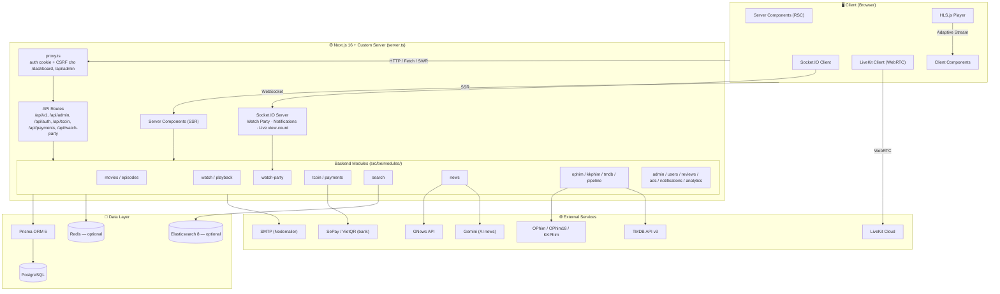
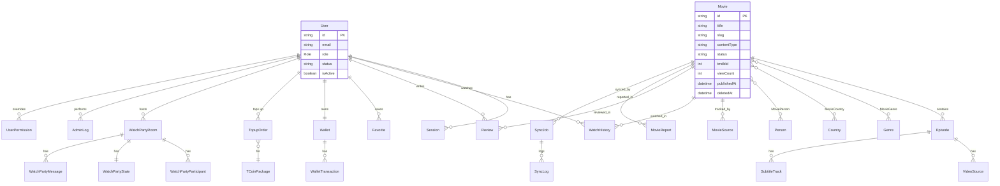
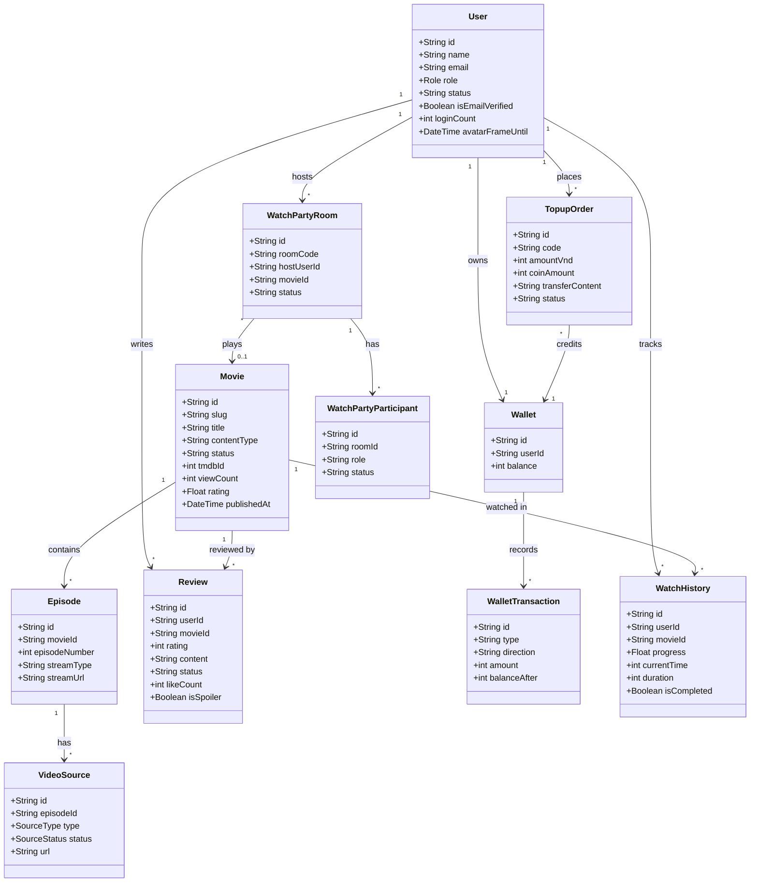
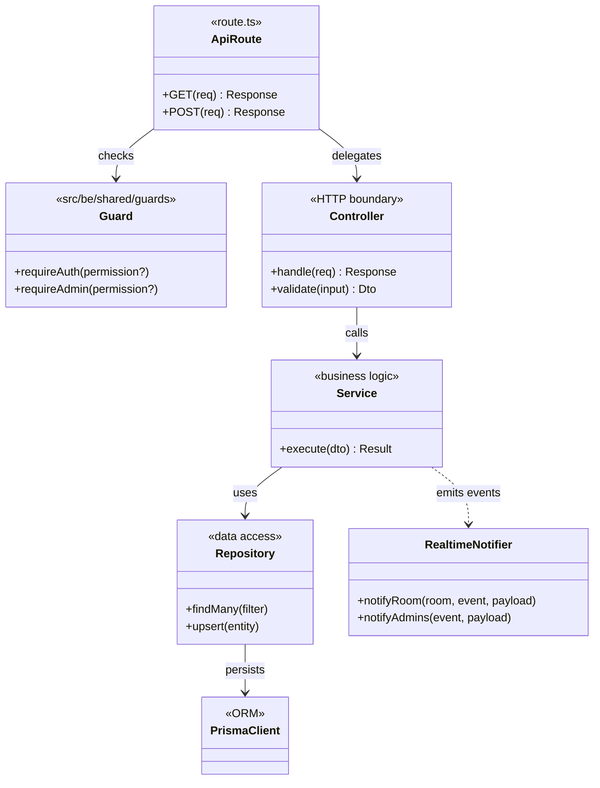
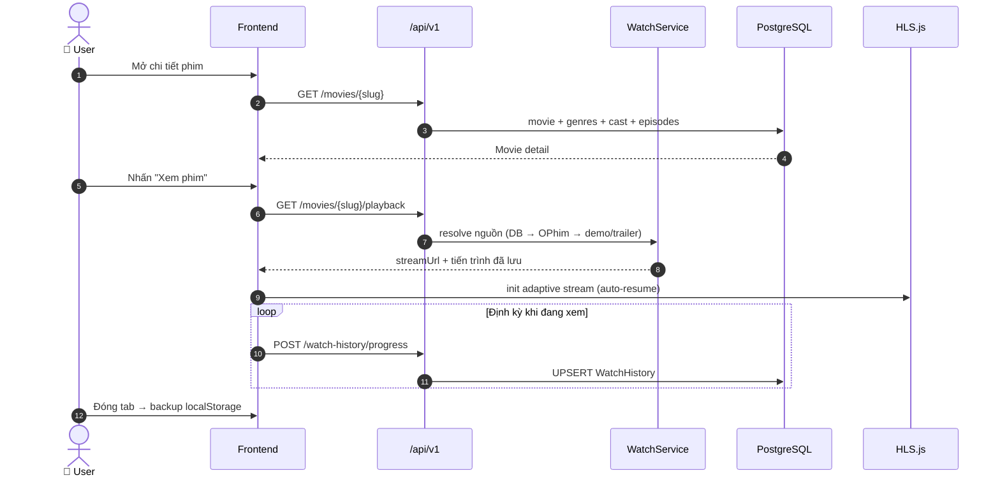
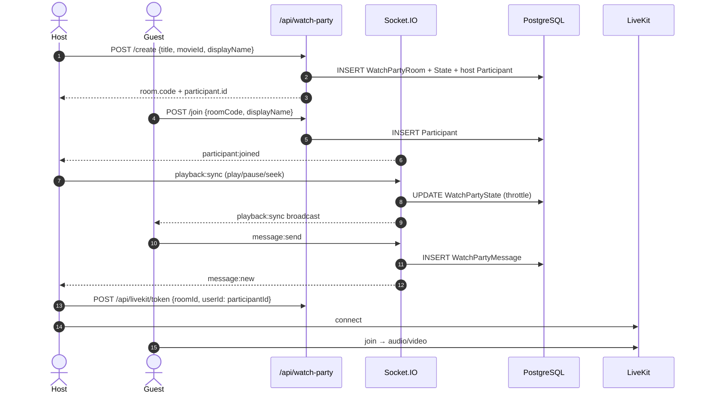
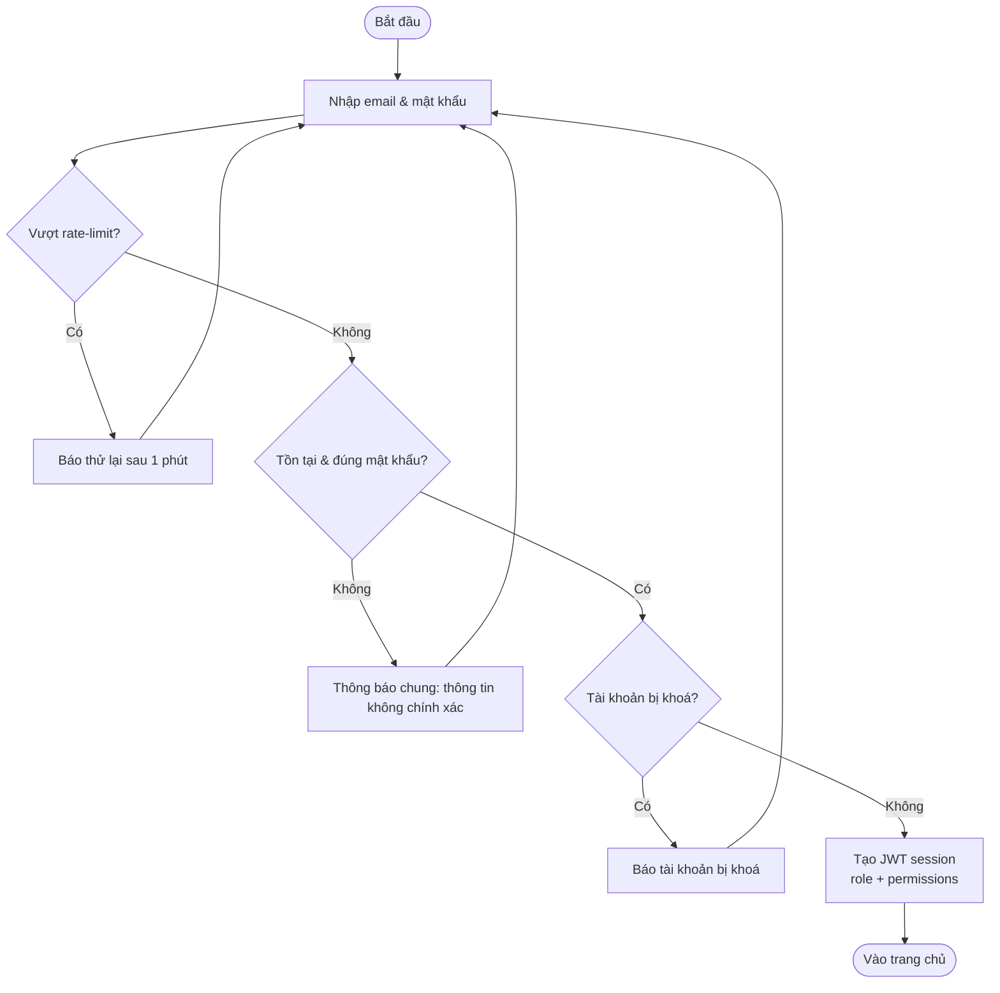
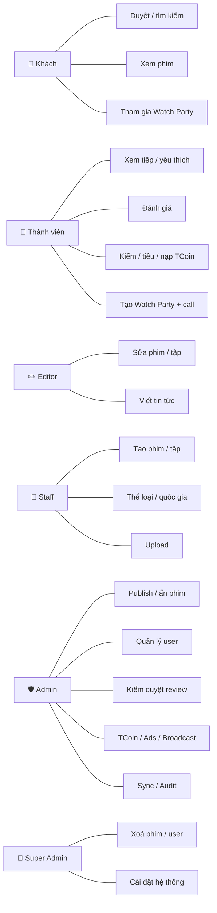
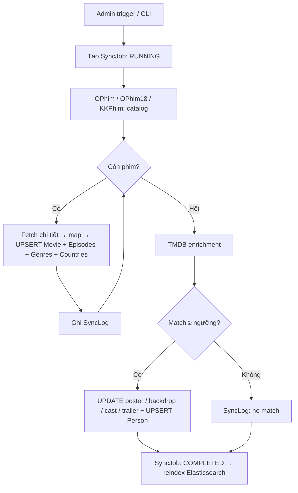
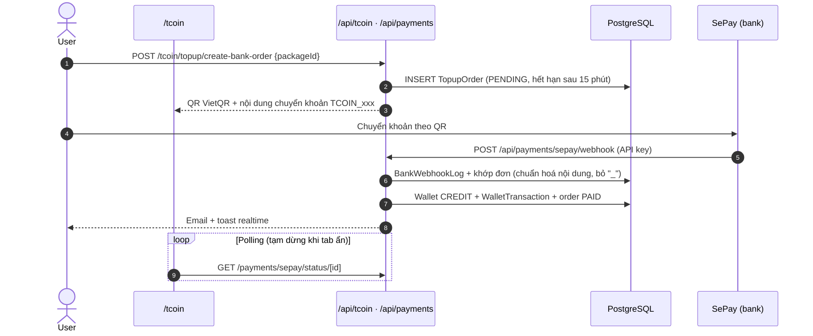

# 🎬 TERENCE — Nền tảng xem phim trực tuyến

> **Terence** là nền tảng khám phá và xem phim trực tuyến, xây dựng bằng **Next.js 16**
> (App Router + custom server), **Prisma ORM + PostgreSQL**, **Socket.IO**, **LiveKit (WebRTC)**,
> tích hợp **TMDB** và các nguồn dữ liệu **OPhim / OPhim18 / KKPhim**.
>
> 📚 Đồ án môn **Công nghệ phần mềm** — Đại học HUTECH.


> 📌 Tài liệu này mô tả kiến trúc, database, API, phân quyền, biến môi trường và cách vận hành
> hệ thống. Nội dung được đối chiếu trực tiếp với mã nguồn và kiểm thử end-to-end (cập nhật 2026-10).

---

## 📑 Mục lục

- [1. Tổng quan](#1-tổng-quan)
- [2. Kiến trúc hệ thống](#2-kiến-trúc-hệ-thống)
- [3. Tính năng](#3-tính-năng)
- [4. Phân quyền (RBAC)](#4-phân-quyền-rbac)
- [5. Tech Stack](#5-tech-stack)
- [6. Cấu trúc thư mục](#6-cấu-trúc-thư-mục)
- [7. Database (PostgreSQL + Prisma)](#7-database-postgresql--prisma)
- [8. Danh mục API](#8-danh-mục-api)
- [9. Luồng nghiệp vụ chính](#9-luồng-nghiệp-vụ-chính)
- [10. Realtime: Socket.IO & LiveKit](#10-realtime-socketio--livekit)
- [11. Data Pipeline (OPhim → TMDB)](#11-data-pipeline-ophim--tmdb)
- [12. Shorts (video ngắn kiểu TikTok)](#12-shorts-video-ngắn-kiểu-tiktok)
- [13. Thanh toán TCoin (SePay / VietQR)](#13-thanh-toán-tcoin-sepay--vietqr)
- [14. Bảo mật](#14-bảo-mật)
- [15. Cài đặt & chạy local](#15-cài-đặt--chạy-local)
- [16. Biến môi trường](#16-biến-môi-trường)
- [17. Deploy production](#17-deploy-production)
- [18. Scripts](#18-scripts)
- [19. Kiểm thử](#19-kiểm-thử)
- [20. Quy ước code & workflow](#20-quy-ước-code--workflow)
- [21. Roadmap](#21-roadmap)
- [License](#license)

---

## 1. Tổng quan

TERENCE là nền tảng xem phim full-stack:

- **Người xem**: duyệt/tìm kiếm phim, xem phim bằng **HLS adaptive streaming**, lưu tiến trình & xem
  tiếp, yêu thích, đánh giá, **xem chung real-time (Watch Party)** kèm chat và gọi video/voice,
  kiếm và tiêu **TCoin** (tiền ảo, nạp qua chuyển khoản VietQR/SePay).
- **Quản trị**: CMS tại `/dashboard` — quản lý phim/tập/nguồn, người dùng, kiểm duyệt đánh giá, tin
  tức, quảng cáo, TCoin, thông báo, đồng bộ dữ liệu, nhật ký audit — với phân quyền 5 cấp.
- **Dữ liệu**: pipeline đồng bộ tự động từ OPhim/OPhim18/KKPhim, làm giàu metadata từ TMDB, tìm
  kiếm full-text bằng Elasticsearch (tự fallback về PostgreSQL khi ES không sẵn sàng).

Mô hình **Modular Monolith**: một process Next.js + Socket.IO, backend chia module theo domain
trong `src/be/modules/`, dễ tách service khi cần.

---

## 2. Kiến trúc hệ thống

### 2.1 Tổng quan



### 2.2 Phân tầng

```
app/ (App Router)         → Pages (RSC/Client) + API route handlers
   └─ src/be/modules/<domain>/<domain>.controller.ts   (HTTP boundary, validate bằng Zod)
         └─ <domain>.service.ts                         (business logic)
              └─ <domain>.repository.ts / prisma        (data access)
src/be/shared/            → guards (requireAuth/requireAdmin), api-handler, rate-limit, realtime, logger
src/fe/                   → components, hooks, contexts, realtime client
src/dta/                  → Prisma schema + migrations, seed, scripts đồng bộ dữ liệu
src/lib/permissions/      → ma trận quyền theo role + kiểm tra quyền (server & UI)
lib/                      → tiện ích dùng chung (auth/NextAuth, env, mail, LiveKit, tmdb-image…)
server.ts                 → custom server: Next.js + Socket.IO trên cùng 1 process
proxy.ts                  → Next.js proxy (trước đây middleware): cookie phiên + CSRF cho khu vực quản trị
```

Phần lớn route mỏng và uỷ thác cho controller; một số route đơn giản (favorites, reviews, quản trị
phim…) truy vấn Prisma trực tiếp trong handler.

### 2.3 Luồng hoạt động chính

| # | Luồng | Mô tả |
|---|-------|-------|
| 1 | **Page render** | Next.js render Server Component → service → Prisma/PostgreSQL |
| 2 | **Client interaction** | Client Component gọi `/api/v1/*` → controller → service → JSON |
| 3 | **Admin CMS** | `/dashboard` → `/api/admin/*` → kiểm tra quyền → service + ghi `AdminLog` |
| 4 | **Watch Party** | REST tạo/join phòng; Socket.IO sync playback + chat; LiveKit voice/video |
| 5 | **Data pipeline** | OPhim/KKPhim sync → TMDB enrichment → upsert → `SyncJob`/`SyncLog` → reindex ES |
| 6 | **Video playback** | HLS.js adaptive; lưu tiến trình (DB `WatchHistory` + localStorage) |
| 7 | **Payments** | Tạo đơn nạp → QR VietQR → webhook SePay → cộng TCoin + email + toast realtime |

---

## 3. Tính năng

### 3.1 Người dùng (khách & thành viên)

| Nhóm | Tính năng | Chi tiết |
|------|-----------|----------|
| 🔐 Tài khoản | Đăng ký / đăng nhập | Email + mật khẩu (bcryptjs) hoặc Google OAuth; xác minh email; quên / đặt lại mật khẩu; rate-limit chống brute-force |
| 🎬 Phim | Duyệt & tìm kiếm | Lọc thể loại / quốc gia / năm / loại; full-text + gợi ý (autocomplete) |
| 🎬 Phim | Trang giới thiệu | Bấm vào phim luôn mở trang giới thiệu (`/movie/<slug>`): poster, thông tin, thể loại, trailer, danh sách tập, diễn viên, bình luận, phim tương tự; nút **Xem phim** / chọn tập mới mở player. Nút ▶ trên card và "Xem tiếp" vào thẳng player |
| 📺 Player | Xem phim HLS | Adaptive bitrate, auto-resume, nhiều nguồn, phụ đề, danh sách tập/season |
| 📋 Cá nhân | Lịch sử & yêu thích | Xem tiếp đồng bộ khi đăng nhập, danh sách yêu thích, gợi ý "Dành cho bạn" |
| 🎉 Watch Party | Xem chung | Tạo/join phòng bằng mã (khách cũng tham gia được), sync playback, chat, voice/video, chuyển host, duyệt yêu cầu tham gia |
| ⭐ Đánh giá | Review | 1–5 sao + nội dung + like, hiển thị sau khi được duyệt |
| 💰 TCoin | Ví tiền ảo | Kiếm (điểm danh, review, xác minh email…), tiêu (perks: bỏ quảng cáo, theme phòng, khung avatar…), nạp qua VietQR |
| 🎞️ Shorts | Video ngắn kiểu TikTok | Feed dọc, thả tim, bình luận, chia sẻ, 3 tab; nguồn TMDB / YouTube / trailer kho (xem Mục 12) |
| 📰 Nội dung | Tin tức, lịch chiếu, Top View | Tin phim (GNews/AI), lịch chiếu từ dữ liệu thật, bảng xếp hạng realtime |
| 👤 Hồ sơ | Profile | Avatar, bio, thống kê, perks đang kích hoạt, thông báo |
| 🚩 Báo lỗi | Report | Báo lỗi phim/tập (cả khách), giới hạn 5 lần/ngày/phim với người đăng nhập |

### 3.2 Quản trị (`/dashboard`)

| Nhóm | Tính năng |
|------|-----------|
| 📊 Tổng quan & thống kê | Users / phim / doanh thu / lượt xem, biểu đồ, Top View realtime, báo cáo chất lượng nội dung |
| 🎬 Phim | CRUD; publish / hide / archive; xoá mềm & khôi phục; feature / trending / recommend |
| 📺 Tập & nguồn | Quản lý tập, video source, phụ đề, kiểm tra nguồn hỏng |
| 🏷️ Metadata | CRUD thể loại, quốc gia |
| 👥 Người dùng | Tạo, sửa, khoá/mở khoá, đặt lại mật khẩu, đổi role, ghi đè quyền từng user, xoá mềm & khôi phục |
| ⭐ Kiểm duyệt | Duyệt / từ chối đánh giá |
| 📰 Tin tức | CRUD bài viết + sinh bài bằng AI (Gemini) |
| 🎞️ Shorts | Nhập video từ TMDB/YouTube/trailer kho, thêm thủ công (YouTube/MP4/HLS), ẩn/hiện, xoá, xoá bình luận |
| 📣 Quảng cáo | CRUD quảng cáo (pre-roll / mid-roll / banner), lịch chạy, thống kê impression |
| 💰 TCoin | Ví, giao dịch, điều chỉnh số dư, hoàn tiền, xác nhận đơn nạp thủ công |
| 🔔 Thông báo | Gửi thông báo broadcast |
| 🔄 Đồng bộ | Sync OPhim catalog/phim, enrich TMDB, reindex Elasticsearch, validate nguồn |
| 📝 Audit & hệ thống | Nhật ký `AdminLog`, cài đặt hệ thống, Redis viewer |

Sidebar dashboard chỉ hiển thị các mục mà tài khoản có quyền sử dụng.

---

## 4. Phân quyền (RBAC)

5 role theo thứ bậc: `SUPER_ADMIN (100) > ADMIN (80) > STAFF (60) > EDITOR (40) > USER (0)`.

- **Nguồn quyền**: ma trận trong [src/lib/permissions/role-permissions.ts](src/lib/permissions/role-permissions.ts)
  (khoá quyền ở [src/constants/permissions.ts](src/constants/permissions.ts)). Nếu bảng `RolePermission`
  trong DB có dữ liệu thì DB được ưu tiên; ghi đè theo từng user (`UserPermission`) luôn được áp dụng sau cùng.
- **Kiểm tra phía server**: mọi route `/api/admin/*` gọi `requireAdmin('<quyền>')` — yêu cầu
  `dashboard.view` **và** quyền cụ thể của thao tác. `SUPER_ADMIN` luôn được phép.
- **Phía UI**: session NextAuth mang danh sách quyền hiệu lực (`session.user.permissions`); dùng
  `can()` trong [src/lib/permissions/ui-guard.ts](src/lib/permissions/ui-guard.ts) để ẩn/hiện chức năng.
- **Đổi role**: chỉ được gán role thấp hơn role của chính mình.

| Khu vực | SUPER_ADMIN | ADMIN | STAFF | EDITOR | USER |
|---------|:-:|:-:|:-:|:-:|:-:|
| Vào dashboard | ✅ | ✅ | ✅ | ✅ | ❌ |
| Xem / sửa phim, tập | ✅ | ✅ | ✅ | ✅ (sửa) | ❌ |
| Tạo phim, tập | ✅ | ✅ | ✅ | ❌ | ❌ |
| Publish / hide / archive phim | ✅ | ✅ | ❌ | ❌ | ❌ |
| Xoá phim | ✅ | ❌ | ❌ | ❌ | ❌ |
| Thể loại, quốc gia (thêm/sửa) | ✅ | ✅ | ✅ | ❌ | ❌ |
| Tin tức | ✅ | ✅ | ❌ | ✅ | ❌ |
| Upload media | ✅ | ✅ | ✅ | ✅ | ❌ |
| Quản lý Shorts | ✅ | ✅ | ✅ | ✅ | ❌ |
| Kiểm duyệt đánh giá | ✅ | ✅ | ❌ | ❌ | ❌ |
| Quản lý người dùng (xem/tạo/sửa/khoá/đổi role) | ✅ | ✅ | ❌ | ❌ | ❌ |
| Xoá người dùng | ✅ | ❌ | ❌ | ❌ | ❌ |
| TCoin & thanh toán | ✅ | ✅ | ❌ | ❌ | ❌ |
| Quảng cáo, broadcast thông báo | ✅ | ✅ | ❌ | ❌ | ❌ |
| Thống kê, nhật ký audit | ✅ | ✅ | ❌ | ❌ | ❌ |
| Đồng bộ dữ liệu, Elasticsearch, Redis | ✅ | ✅ | ❌ | ❌ | ❌ |
| Xem cài đặt hệ thống | ✅ | ✅ | ❌ | ❌ | ❌ |
| Sửa cài đặt hệ thống | ✅ | ❌ | ❌ | ❌ | ❌ |
| Hồ sơ, review, lịch sử xem, TCoin, thích/bình luận Shorts của chính mình | ✅ | ✅ | ✅ | ✅ | ✅ |

---

## 5. Tech Stack

| Layer | Công nghệ | Phiên bản |
|-------|-----------|-----------|
| Framework | Next.js (App Router + RSC + custom server) | 16 |
| Ngôn ngữ / UI | TypeScript / React | 5.7 / 19 |
| Styling | Tailwind CSS + Radix UI (shadcn/ui) | 4 |
| Database | PostgreSQL qua Prisma ORM | Prisma 6 |
| Cache / rate-limit store | Redis (ioredis) — tuỳ chọn | 5 |
| Search | Elasticsearch — tuỳ chọn, fallback PostgreSQL | 8 |
| Auth | NextAuth (JWT session) + bcryptjs, Google OAuth | 4 |
| Video streaming | HLS.js (adaptive bitrate) | 1.6 |
| Realtime | Socket.IO | 4.8 |
| Voice/Video call | LiveKit (WebRTC) | 2.x |
| Thanh toán | SePay webhook + VietQR | — |
| Nguồn dữ liệu phim | TMDB v3, OPhim, OPhim18, KKPhim | — |
| Tin tức / AI | GNews API + Gemini | — |
| Email | Nodemailer (SMTP) | 7 |
| Data fetching | React Context + SWR | — |
| Validation | Zod | 3 |
| Charts | Recharts | 2.15 |
| Logging | pino + pino-pretty | — |
| Test | Vitest | 4 |
| Deploy | PM2 + Nginx (VPS) / Docker / Cloudflare | — |

---

## 6. Cấu trúc thư mục

```
TERENCE/
├── app/                        # Next.js App Router
│   ├── api/                    #   REST API
│   │   ├── admin/              #     API quản trị (requireAdmin + permission)
│   │   ├── auth/               #     NextAuth + register / verify-email / forgot / reset
│   │   ├── v1/                 #     API công khai & người dùng (movies, search, reviews, favorites, watch-history…)
│   │   ├── tcoin/ · payments/  #     Ví, reward, spend, đơn nạp, SePay
│   │   ├── watch-party/        #     Tạo / join / sync / chat / role phòng
│   │   ├── cron/               #     expire-orders, reconcile-orders (Bearer CRON_SECRET)
│   │   └── livekit · news · ads · user · hls-proxy · tmdb-image · health …
│   ├── dashboard/              #   Trang quản trị
│   ├── movie/[id] · tv/[id]    #   Trang giới thiệu: id số = TMDB, slug/id DB = phim trong kho
│   ├── watch/[id]              #   Trình xem phim
│   ├── xem-chung/[code]        #   Watch party (alias /watch-party qua rewrite)
│   └── browse · movies · series · news · schedule · shorts · top-view · reviews · tcoin · profile · favorites …
│
├── src/
│   ├── be/
│   │   ├── modules/            #   admin · auth · users · movies · episodes · watch · watch-party
│   │   │                       #   tcoin · payments · reviews · news · ads · notifications · analytics
│   │   │                       #   search · uploads · ophim · kkphim · tmdb · pipeline
│   │   ├── services/           #   topup-order, wallet, video-source resolver, tmdb services
│   │   └── shared/             #   db, guards, api-handler, rate-limit, realtime, logger, errors
│   ├── fe/                     #   components (ui, shared, player, watch-party, admin…), features (hooks, contexts)
│   ├── dta/
│   │   ├── prisma/             #   schema.prisma, migrations/, seed.ts
│   │   └── scripts/            #   sync-ophim*, sync-kkphim*, enrich-tmdb, elastic-reindex, seed-ads…
│   ├── constants/              #   roles, permissions
│   ├── lib/                    #   permissions (matrix, access-control, ui-guard), redis, cache
│   └── types/
│
├── lib/                        # auth (NextAuth), env, mail, LiveKit, tmdb-image, player, watch-history, watch-party
├── types/                      # kiểu dùng chung + next-auth.d.ts
├── scripts/                    # tiện ích vận hành / demo (xem Mục 18)
├── tests/                      # Vitest: unit + integration
├── deploy/nginx/               # cấu hình Nginx mẫu
├── server.ts                   # custom server (Next.js + Socket.IO)
├── proxy.ts                    # bảo vệ /dashboard & /api/admin (cookie + CSRF)
├── docker-compose.yml          # db, elasticsearch, redis, mailpit, app
└── .env.example                # mẫu biến môi trường
```

---

## 7. Database (PostgreSQL + Prisma)

Schema: [src/dta/prisma/schema.prisma](src/dta/prisma/schema.prisma) — **45 model**, migration
baseline `20261006000000_baseline` + `…_shorts`. `DATABASE_URL` (pooled) + `DIRECT_URL` (migration).

### 7.1 Enum

| Enum | Giá trị |
|------|---------|
| `Role` | SUPER_ADMIN · ADMIN · STAFF · EDITOR · USER |
| `UserStatus` | ACTIVE · SUSPENDED · BANNED |
| `MovieType` | MOVIE · SERIES · ANIME · TRAILER · SHORT |
| `PublishStatus` | DRAFT · PUBLISHED · HIDDEN · ARCHIVED |
| `SourceType` | HLS · MP4 · DASH · IFRAME · YOUTUBE |
| `SourceStatus` | ACTIVE · MISSING · BROKEN · PENDING |
| `ReviewStatus` | PENDING · APPROVED · REJECTED · FLAGGED |
| `WalletTransactionType` | CREDIT · DEBIT |
| `PaymentStatus` | PENDING · COMPLETED · FAILED · REFUNDED · CANCELLED |
| `RoomStatus` | WAITING · ACTIVE · ENDED |
| `PartyMemberRole` | HOST · CO_HOST · MEMBER · GUEST |
| `PersonRoleType` | ACTOR · DIRECTOR · PRODUCER · WRITER · CREATOR · OTHER |
| `MetadataSourceType` | TMDB · IMDB · OPHIM · KKPHIM · MANUAL · INTERNAL |
| `SyncJobStatus` | PENDING · RUNNING · SUCCESS · COMPLETED · FAILED · CANCELLED · PARTIAL |
| `SyncLogLevel` | INFO · WARN · ERROR |

### 7.2 Models

| Nhóm | Models |
|------|--------|
| Users & Auth | `User`, `Session`, `Account`, `VerificationToken`, `PasswordResetToken`, `Notification`, `Permission`, `RolePermission`, `UserPermission` |
| Phim | `Movie`, `Episode`, `VideoSource`, `SubtitleTrack`, `MovieSource`, `MovieReport` |
| Metadata | `Genre`, `MovieGenre`, `Country`, `MovieCountry`, `Person`, `MoviePerson` |
| Tương tác | `WatchHistory`, `Favorite`, `Review` |
| Tin tức | `NewsPost` |
| TCoin & Payments | `Wallet`, `WalletTransaction`, `TCoinPackage`, `TopupOrder`, `BankWebhookLog` |
| Quảng cáo | `Advertisement`, `AdImpression` |
| Watch Party | `WatchPartyRoom`, `WatchPartyParticipant`, `WatchPartyMessage`, `WatchPartyState` |
| Vận hành | `AdminLog`, `PageView`, `Upload`, `SystemSetting` |
| Shorts | `Short`, `ShortLike`, `ShortComment` |
| Pipeline | `SyncJob`, `SyncLog` |

> Video ngắn của feed `/shorts` nằm ở model `Short` (có thể liên kết `Movie`); không có model `PaymentOrder` —
> đơn nạp TCoin là `TopupOrder`, gói nạp nằm trong bảng `TCoinPackage`.

### 7.3 ERD (lõi)



### 7.4 Class diagram — Domain model



### 7.5 Class diagram — Tầng kiến trúc



---

## 8. Danh mục API

> 🔓 công khai · 👤 cần đăng nhập · 🛡️ cần quyền quản trị. Postman collection:
> [TERENCE_Postman_Collection.json](TERENCE_Postman_Collection.json) (biến `baseUrl = http://localhost:3000/api`).

<details>
<summary><strong>📡 Phim, tìm kiếm, nội dung — /api/v1 & khác</strong></summary>

| Path | Quyền | Mô tả |
|------|:-:|-------|
| `GET /api/v1/home` | 🔓 | Dữ liệu trang chủ |
| `GET /api/v1/movies` · `/[slug]` · `/[slug]/episodes` · `/[slug]/playback` | 🔓 | Danh sách / chi tiết / tập / nguồn phát |
| `GET /api/v1/movies/trending-stats` · `/most-liked` · `/recommendations` | 🔓 | Xếp hạng & gợi ý (cá nhân hoá khi đăng nhập) |
| `POST /api/v1/movies/[slug]/report` | 🔓 | Báo lỗi phim |
| `GET /api/v1/search` · `/search/suggest` | 🔓 | Tìm kiếm + autocomplete (rate-limit 20/phút) |
| `GET /api/v1/shorts` (`tab`, `seed`, `skip`, `limit`, `movieId`) · `GET /api/v1/shorts/[id]` | 🔓 | Feed Shorts · một video |
| `POST /api/v1/shorts/[id]/view` · `/share` · `GET /[id]/comments` | 🔓 | Đếm lượt xem / chia sẻ · danh sách bình luận |
| `POST /api/v1/shorts/[id]/like` · `POST /[id]/comments` · `DELETE /[id]/comments/[commentId]` | 👤 | Thích (bật/tắt) · bình luận · xoá bình luận |
| `GET /api/v1/thumbnails` | 🔓 | Thumbnail |
| `GET /api/v1/reviews` · `/recent` · `/top` · `/movies/[slug]/reviews` | 🔓 | Danh sách đánh giá |
| `POST /api/v1/reviews` · `/reviews/[id]/like` | 👤 | Viết / like đánh giá |
| `GET/POST /api/v1/favorites` | 👤 | Danh sách / bật-tắt yêu thích |
| `… /api/v1/watch-history` (`/bootstrap` `/progress` `/continue` `/complete` `/sync` `/[id]`) | 👤 | Lịch sử & tiến trình xem |
| `GET /api/v1/notifications` · `POST /read-all` | 👤 | Thông báo |
| `POST /api/v1/analytics/track` | 🔓 | Ghi page/movie view + broadcast realtime |
| `GET /api/news` · `/news/category` · `/news/related` · `/news/search` | 🔓 | Tin tức |
| `GET /api/movies/upcoming` | 🔓 | Phim sắp chiếu |
| `GET /api/ads/active` · `POST /api/ads/events` | 🔓 | Quảng cáo đang chạy · ghi impression |
| `GET/PATCH /api/user/profile` · `POST /api/user/profile/avatar` | 👤 | Hồ sơ |
| `GET /api/hls-proxy` · `/api/tmdb-image/[id]` · `/api/health` | 🔓 | Proxy HLS (whitelist host) · ảnh TMDB · health check |

</details>

<details>
<summary><strong>🔐 Auth — /api/auth</strong></summary>

`[...nextauth]` (credentials + Google) · `POST /register` · `GET/POST /verify-email` ·
`POST /forgot-password` · `POST /reset-password`. Đăng nhập, đăng ký, quên/đặt lại mật khẩu đều có rate-limit.

</details>

<details>
<summary><strong>💰 TCoin & Payments</strong></summary>

| Path | Quyền | Mô tả |
|------|:-:|-------|
| `GET /api/tcoin/overview` | 🔓 | Gói nạp, perks, quy tắc kiếm (kèm số dư nếu đăng nhập) |
| `GET /api/tcoin/wallet` · `/transactions` · `/my-perks` | 👤 | Ví & lịch sử |
| `POST /api/tcoin/spend` · `/reward/daily-checkin` · `/reward/verify-email` | 👤 | Tiêu / kiếm TCoin |
| `POST /api/tcoin/topup/create-bank-order` · `GET/DELETE /api/tcoin/order/[code]` | 👤 | Đơn nạp |
| `POST /api/payments/sepay/create` · `GET /status/[id]` | 👤 | Tạo QR · trạng thái đơn |
| `POST /api/payments/sepay/webhook` · `POST /api/webhooks/sepay` | 🔑 | Webhook ngân hàng (xác thực API key SePay) |
| `GET/POST /api/cron/expire-orders` · `/reconcile-orders` | 🔑 | Cron đối soát (Bearer `CRON_SECRET`) |

</details>

<details>
<summary><strong>🎉 Watch Party — /api/watch-party</strong></summary>

`GET /` (phòng đang mở) · `POST /create` · `POST /join` · `POST /leave` · `GET/PATCH /[roomCode]` ·
`GET/POST /[roomCode]/messages` · `GET/POST /[roomCode]/sync` · `POST /[roomCode]/role` ·
`POST /[roomCode]/request` · `POST /[roomCode]/approve` · `GET/POST /api/livekit/token`.
Khách chưa đăng nhập vẫn tạo/tham gia được; danh tính người dùng luôn lấy từ session, không tin `userId` gửi lên.
Token LiveKit chỉ cấp cho participant đang hoạt động của đúng phòng.

</details>

<details>
<summary><strong>🛡️ Admin — /api/admin</strong></summary>

| Path | Mô tả |
|------|-------|
| `GET /summary` · `/reports` · `/search` · `/sync/summary` · `/sync/logs` | Dashboard, báo cáo, tìm kiếm nhanh, thống kê sync |
| `GET/POST /movies` · `GET/PUT/DELETE /movies/[id]` · `POST /movies/[id]/{publish,hide,archive,restore,feature,trending,recommend}` · `GET /movies/reports` | Quản lý phim |
| `GET/POST /episodes` · `GET/PUT/DELETE /episodes/[id]` · `/video-sources` · `/subtitles` | Tập, nguồn, phụ đề |
| `GET/POST /users` · `GET/PUT/PATCH/DELETE /users/[id]` · `POST /users/[id]/{block,unblock,reset-password,restore}` · `GET/PUT /users/[id]/permissions` | Người dùng |
| `GET/POST /genres` · `/countries` (+ `PATCH/DELETE /[id]`) | Metadata |
| `GET/POST /news` · `GET/PATCH/DELETE /news/[id]` · `POST /news/ai-generate` | Tin tức |
| `GET/POST /shorts` · `PATCH/DELETE /shorts/[id]` · `POST /shorts/verify` · `POST /shorts/sync` (`{ source: tmdb \| youtube \| catalog \| all, limit, perMovie }`) | Shorts |
| `GET/POST /ads` · `GET/PATCH/DELETE /ads/[id]` | Quảng cáo |
| `GET /reviews` · `PATCH /reviews/[id]` (`{ action: "approve" \| "reject" }`) | Kiểm duyệt |
| `GET/POST /uploads` · `POST /uploads/{movie-poster,movie-backdrop,movie-thumbnail,movie-media}` | Upload |
| `POST /sync/ophim/catalog` · `/sync/ophim/movie/[slug]` · `/sync/tmdb/[movieId]` · `/sync/elastic/[movieId]` · `/sync/validate-sources` | Pipeline |
| `GET /elastic/health` · `POST /elastic/reindex` | Elasticsearch |
| `GET /tcoin/wallets` · `/tcoin/payments` · `/tcoin/users/[id]/transactions` · `POST /tcoin/adjust` · `/tcoin/refund` · `/tcoin/orders/[id]/confirm` | TCoin |
| `GET /logs` · `GET/POST /settings` · `GET/POST /redis` · `GET /notifications` · `POST /notifications/broadcast` | Vận hành |

</details>

---

## 9. Luồng nghiệp vụ chính

### 9.1 Xem phim + lưu tiến trình



### 9.2 Watch Party (sync + chat + call)



### 9.3 Đăng nhập



Session được kiểm tra lại trạng thái tài khoản ở mỗi lần đọc: user bị khoá sẽ mất phiên ngay, đổi
role có hiệu lực mà không cần đăng nhập lại.

### 9.4 Use case



---

## 10. Realtime: Socket.IO & LiveKit

- **Custom server** ([server.ts](server.ts)) chạy Next.js + Socket.IO trên cùng process, path
  `/api/socketio`. Dev có realtime: `npm run dev:socket`.
- **Xác thực socket**: cookie NextAuth được giải mã ở handshake ([src/be/shared/realtime/socket-auth.ts](src/be/shared/realtime/socket-auth.ts)).
- **Sự kiện** ([src/be/shared/realtime/notify.ts](src/be/shared/realtime/notify.ts), `RT_EVENTS`):
  - Watch Party: `playback:sync`, `message:new`, `participant:joined/left`, role / request / approve.
  - Thông báo người dùng & admin, toast khi nạp TCoin thành công.
  - **Live view-count**: phát tới admin, phòng phim `movie:{id}` và Top View.
- **Redis**: lưu rate-limit & cache dùng chung; không có Redis thì tự rơi về bộ nhớ trong process.
- **LiveKit**: voice/video trong phòng; dev offline dùng `docker-compose.dev-services.yml`.

---

## 11. Data Pipeline (OPhim → TMDB)



- **Nguồn**: `ophim` (OPhim + OPhim18) và `kkphim` — client + mapper riêng từng nguồn.
- **Enrichment**: module `tmdb` so khớp theo tiêu đề/năm (ngưỡng tin cậy ~70%).
- **Orchestration**: [src/be/modules/pipeline/movie-enrichment-pipeline.ts](src/be/modules/pipeline/movie-enrichment-pipeline.ts) — lỗi TMDB không rollback dữ liệu nguồn.
- **CLI**: xem Mục 18.

---

## 12. Shorts (video ngắn kiểu TikTok)

Trang `/shorts` là feed video ngắn cuộn dọc giống TikTok / Facebook Reels, gắn với kho phim.

**Trải nghiệm người xem**

- Mỗi màn hình một video, cuộn/vuốt dọc có snap; chỉ video đang hiển thị được phát (các video khác chỉ hiện ảnh bìa → nhẹ máy).
- Chạm để dừng/phát, **chạm đúp để thả tim** (hiệu ứng tim bay), nút bật/tắt tiếng (ghi nhớ lựa chọn), thanh tiến trình.
- Cột tác vụ: ảnh phim (mở trang giới thiệu), ❤️ thích, 💬 bình luận (bottom sheet trên mobile, panel bên phải trên desktop), ↗ chia sẻ (Web Share API / sao chép link).
- Nút **Xem phim đầy đủ** mở player; tên phim mở trang giới thiệu. Trang giới thiệu phim cũng có hàng "Shorts" của phim đó.
- 3 tab: **Dành cho bạn** (xáo trộn theo seed riêng mỗi lượt truy cập — phân trang không lặp), **Mới nhất**, **Phổ biến**.
- Cuộn vô hạn; phím tắt `↑/↓` hoặc `J/K` chuyển video, `Space` dừng, `M` tắt tiếng.
- URL theo video đang xem (`/shorts?v=<id>`) để chia sẻ; mở link sẽ phát đúng video đó trước (có thẻ OG title/ảnh).
- Lượt xem chỉ tính khi xem ≥ 3 giây, mỗi IP tối đa 1 lần / 10 phút / video. Video YouTube bị chặn nhúng sẽ hiện thông báo kèm link mở trên YouTube.

**Nguồn video (API)**

| Nguồn | Cấu hình | Nội dung |
|-------|----------|----------|
| **TMDB Videos API** | `TMDB_READ_ACCESS_TOKEN` / `TMDB_API_KEY` (đã dùng sẵn cho metadata) | Clip, teaser, hậu trường, trailer chính thức của từng phim (ưu tiên tiếng Việt, rồi clip/teaser trước trailer) — YouTube 16:9, hiển thị trên nền mờ |
| **YouTube Data API v3** | `YOUTUBE_API_KEY` (tuỳ chọn) | Shorts dọc 9:16 thật, tìm theo `"<tên phim> <năm> #shorts"`, `videoDuration=short`, vùng VN; lọc theo tên phim. Mỗi phim tốn 100 quota (mặc định 10.000/ngày ≈ 100 phim) |
| **Trailer trong kho** | Không cần | `Movie.trailerKey` có sẵn từ OPhim/KKPhim |
| **Thủ công** | Dashboard | Link YouTube (watch / shorts / youtu.be), MP4 hoặc HLS (`.m3u8`, phát bằng hls.js) |

Video trùng được loại bằng khoá `externalId` (`yt:<id>`); video YouTube bị chủ kênh chặn nhúng được phát hiện qua
oEmbed (không cần key) và bỏ qua khi nhập — `npm run shorts:sync -- --verify` / nút "Kiểm tra video hỏng" quét lại và ẩn
các video đã hỏng. Trên feed, video không phát được sẽ tự chuyển sang video kế tiếp. Lấy YouTube API key: Google Cloud Console →
bật **YouTube Data API v3** → Credentials → *Create API key* → thêm `YOUTUBE_API_KEY=...` vào `.env`.

**Nhập dữ liệu**

```bash
npm run shorts:sync                          # TMDB + trailer kho (+ YouTube nếu có key), 50 phim chưa có Shorts
npm run shorts:sync -- --limit=200 --perMovie=3
npm run shorts:sync -- --source=youtube      # chỉ YouTube #shorts
npm run shorts:sync -- --all                 # quét lại cả phim đã có Shorts
npm run shorts:sync -- --verify              # ẩn video YouTube không còn nhúng được
```

Docker: đặt `SYNC_SHORTS_ON_START=true` (và `SHORTS_SYNC_MOVIES`, mặc định 100) để tự nhập khi container khởi động.

**Quản trị** — `/dashboard/shorts` (quyền `short.manage`: Super Admin, Admin, Staff, Editor): thống kê lượt
xem/thích, nút nhập từ từng nguồn API, thêm video thủ công (chọn phim liên kết, hashtag, khung dọc/ngang,
nháp/hiển thị), lọc theo trạng thái/nguồn, tìm kiếm, ẩn/hiện, xoá, xem trước. Người có quyền này cũng xoá được
bình luận của người khác; người dùng thường chỉ xoá bình luận của mình.

**Mã nguồn**: [src/be/modules/shorts/](src/be/modules/shorts/) (`shorts.providers.ts` nguồn API,
`shorts.service.ts` feed/tương tác/đồng bộ, `shorts.controller.ts` HTTP) ·
[src/fe/components/shorts/](src/fe/components/shorts/) (`ShortsFeed`, `ShortPlayer` — YouTube IFrame API / `<video>` / hls.js, `ShortComments`) ·
[app/dashboard/shorts/page.tsx](app/dashboard/shorts/page.tsx).

---

## 13. Thanh toán TCoin (SePay / VietQR)



- `packageId` là id của bản ghi `TCoinPackage` (lấy từ `GET /api/tcoin/overview`).
- Webhook **idempotent**: gửi lại cùng giao dịch không cộng tiền hai lần.
- Ngân hàng có thể lược ký tự `_` trong nội dung nên hệ thống chuẩn hoá trước khi so khớp.
- Cron `expire-orders` / `reconcile-orders` dọn đơn quá hạn và đối soát.
- **Demo local** (SePay không gọi được localhost): `npm run demo:pay -- <MÃ_ĐƠN>` gửi đúng payload
  webhook để đánh dấu đơn đã thanh toán.

---

## 14. Bảo mật

| Hạng mục | Cách làm |
|----------|----------|
| Mật khẩu | bcryptjs, tối thiểu 8 ký tự; token đặt lại mật khẩu ngẫu nhiên 32 byte, hết hạn 1 giờ |
| Brute-force | Rate-limit: đăng nhập 10 lần/phút theo IP+email; đăng ký / quên / đặt lại mật khẩu 5 lần/phút theo IP; tìm kiếm 20 lần/phút |
| Dò email | Đăng nhập trả thông báo chung; quên mật khẩu luôn trả cùng một thông điệp |
| Phân quyền | `requireAdmin('<quyền>')` ở mọi API quản trị; UI ẩn chức năng không đủ quyền |
| Khu vực quản trị | `proxy.ts` chặn khi thiếu cookie phiên; kiểm tra `Origin/Referer` (CSRF) cho POST/PUT/PATCH/DELETE |
| Phiên | JWT 30 ngày, kiểm tra lại trạng thái khoá / role ở mỗi lần đọc session |
| Webhook / cron | Xác thực API key SePay; cron yêu cầu `Authorization: Bearer $CRON_SECRET` |
| Input | Zod validate ở biên API; nội dung tin tức hiển thị dạng text đã escape (HTML từ trình soạn thảo được chuyển thành đoạn văn) |
| Socket.IO | CORS theo `ALLOWED_ORIGINS` ở production; xác thực cookie ở handshake |

Báo cáo lỗ hổng: xem [SECURITY.md](SECURITY.md).

---

## 15. Cài đặt & chạy local

### Yêu cầu

- **Node.js ≥ 20.9** (yêu cầu của Next.js 16), npm ≥ 10
- **Docker** (khuyến nghị) để chạy PostgreSQL, Redis, Elasticsearch, Mailpit — hoặc tự cài PostgreSQL
- (Tuỳ chọn) TMDB key, LiveKit, SePay/VietQR, Google OAuth, GNews/Gemini

### Cài đặt

```bash
git clone <repo-url> && cd TERENCE
npm install                        # postinstall tự chạy `prisma generate`
cp .env.example .env               # điền NEXTAUTH_SECRET và các key cần dùng

# Dịch vụ nền (PostgreSQL :5433, Redis :6379, Elasticsearch :9200, Mailpit :1025/:8025)
docker compose up -d db redis elasticsearch mailpit

npm run db:deploy                  # áp migration (45 bảng)
npm run db:seed                    # tài khoản mẫu, thể loại, quốc gia, phim mẫu
npm run search:reindex             # (tuỳ chọn) đẩy dữ liệu sang Elasticsearch
npm run shorts:sync                # (tuỳ chọn) nhập video Shorts từ TMDB / trailer kho
```

> DB cũ tạo bằng `prisma db push` (chưa có lịch sử migration) → đánh dấu baseline một lần:
> `npx prisma migrate resolve --schema=src/dta/prisma/schema.prisma --applied 20261006000000_baseline`

### Chạy

```bash
npm run dev:socket   # Next.js + Socket.IO (đầy đủ watch party) → http://localhost:3000
npm run dev          # chỉ Next.js dev (không có Socket.IO)
npm run build && NODE_ENV=production npx tsx server.ts   # chạy bản production có Socket.IO
```

Email (xác minh, đặt lại mật khẩu, hoá đơn) ở local được Mailpit bắt lại: http://localhost:8025.

### Tài khoản seed (chỉ local/dev)

| Email | Mật khẩu | Role |
|-------|----------|------|
| `admin@terence.vn` | `Admin@12345` | SUPER_ADMIN |
| `staff@terence.vn` | `Staff@12345` | STAFF |
| `editor@terence.vn` | `Staff@12345` | EDITOR |
| `user@terence.vn` | `User@12345` | USER |

- Production: đặt `SEED_ADMIN_PASSWORD`, `SEED_STAFF_PASSWORD`, `SEED_USER_PASSWORD`; nếu bỏ trống, seed
  sinh mật khẩu ngẫu nhiên và in ra log một lần. Seed chỉ **tạo mới**, không ghi đè user đã có.
- Đổi role cho một tài khoản có sẵn: `npm run user:role -- <email> ADMIN`.

---

## 16. Biến môi trường

Mẫu đầy đủ: [.env.example](.env.example). Biến server-only **không** có prefix `NEXT_PUBLIC_`.
[lib/env.ts](lib/env.ts) kiểm tra lúc khởi động: thiếu biến bắt buộc thì dừng, thiếu biến khuyến nghị thì cảnh báo.

| Nhóm | Biến | Bắt buộc |
|------|------|:-:|
| Core | `DATABASE_URL`, `DIRECT_URL`, `NEXTAUTH_SECRET` | ✅ |
| URL & bảo mật | `NEXTAUTH_URL`, `NEXT_PUBLIC_SITE_URL` / `APP_URL`, `CRON_SECRET`, `ALLOWED_ORIGINS` | ✅ production |
| Logging / runtime | `NODE_ENV`, `PORT`, `HOSTNAME`, `LOG_LEVEL` | — |
| Google OAuth | `NEXT_PUBLIC_GOOGLE_AUTH_ENABLED`, `GOOGLE_CLIENT_ID`, `GOOGLE_CLIENT_SECRET` | — |
| Email (SMTP) | `SMTP_HOST`, `SMTP_PORT`, `SMTP_USER`, `SMTP_PASS`, `EMAIL_FROM_NAME`, `EMAIL_FROM_ADDRESS` | — |
| Thanh toán | `SEPAY_WEBHOOK_API_KEY` (hoặc `SEPAY_WEBHOOK_SECRET`), `SEPAY_BANK_CODE`, `SEPAY_BANK_ACCOUNT`, `SEPAY_API_KEY`, `SEPAY_API_BASE`, `VIETQR_ACCOUNT_NAME` (+ `VIETQR_BANK_ID`, `VIETQR_ACCOUNT_NO`, `VIETQR_TEMPLATE` dạng cũ) | — |
| TMDB | `TMDB_API_KEY`, `TMDB_READ_ACCESS_TOKEN`, `TMDB_BASE_URL`, `NEXT_PUBLIC_TMDB_IMAGE_BASE_URL`, `NEXT_PUBLIC_REGION` | — |
| Nguồn phim | `OPHIM_BASE_URL`, `OPHIM_TIMEOUT`, `OPHIM18_BASE_URL`, `OPHIM18_TIMEOUT`, `KKPHIM_BASE_URL`, `KKPHIM_TIMEOUT`, `DISABLE_OPHIM_CHECK` | — |
| Player | `DEMO_HLS_URL`, `PUBLIC_STREAM_ALLOWED_HOSTS`, `NEXT_PUBLIC_ENABLE_RESUME`, `NEXT_PUBLIC_ENABLE_SUBTITLES` | — |
| Search | `ELASTICSEARCH_HOST`, `ELASTICSEARCH_INDEX_MOVIES`, `ELASTICSEARCH_USERNAME`/`PASSWORD`/`API_KEY` | — |
| Cache | `REDIS_URL` | — |
| LiveKit | `LIVEKIT_API_KEY`, `LIVEKIT_API_SECRET`, `LIVEKIT_URL`, `NEXT_PUBLIC_LIVEKIT_URL` | — |
| Tin tức / AI | `GNEWS_API_KEY`, `GEMINI_API_KEY`, `GEMINI_MODEL` | — |
| Shorts | `YOUTUBE_API_KEY` (tuỳ chọn — Shorts dọc từ YouTube) | — |
| Docker boot | `SEED_ON_START`, `SEED_*_PASSWORD`, `SYNC_OPHIM_ON_START`, `SYNC_KKPHIM_ON_START`, `SYNC_SHORTS_ON_START`, `OPHIM_SYNC_PAGES`, `KKPHIM_SYNC_PAGES`, `SHORTS_SYNC_MOVIES` | — |

---

## 17. Deploy production

### PM2 (VPS) + Nginx

```bash
cd /var/www && git clone <repo-url> TERENCE && cd TERENCE
cp .env.example .env && nano .env        # điền giá trị production

npm ci --legacy-peer-deps
npm run db:deploy
SEED_ADMIN_PASSWORD='<mật khẩu mạnh>' npm run db:seed
npm run build

mkdir -p logs
pm2 start ecosystem.config.js && pm2 save
```

- Cập nhật phiên bản về sau: `./deploy.sh` (pull → install → migrate → build → `pm2 restart`).
- Nginx reverse proxy (+ Cloudflare) đặt trước PM2; mẫu cấu hình ở [deploy/nginx/terence.conf](deploy/nginx/terence.conf).
  Socket.IO chạy chung process nên Nginx phải chuyển tiếp header `Upgrade` / `Connection`.
- Thêm domain mới thì cập nhật `ALLOWED_HOSTS` trong [proxy.ts](proxy.ts) (CSRF) và `ALLOWED_ORIGINS` (Socket.IO).

### Docker

```bash
npm run docker:up        # docker compose up -d (db, elasticsearch, redis, mailpit, app)
npm run docker:logs      # theo dõi log app
npm run docker:reindex   # reindex Elasticsearch trong container
```

Lần khởi động đầu đặt `SEED_ON_START=true` (và tuỳ chọn `SYNC_OPHIM_ON_START=true`) để seed + nạp dữ liệu.

---

## 18. Scripts

```bash
# Dev / build
npm run dev · dev:socket · build · start · lint

# Database
npm run db:generate · db:migrate · db:deploy · db:seed · db:reset

# Đồng bộ dữ liệu phim
npm run sync:ophim:catalog · sync:ophim:movie -- --slug=<slug>
npm run sync:ophim18:catalog · sync:ophim18:movie
npm run sync:kkphim:catalog · sync:kkphim:movie -- --slug=<slug>
npm run enrich:tmdb · pipeline:movie

# Tìm kiếm (Elasticsearch)
npm run search:reindex [-- --movieId=<id>] · search:clear · search:test · search:test:tiers
npm run search:sync-subtitles · search:sync-cast · search:enrich-real

# Shorts
npm run shorts:sync [-- --limit=200 --perMovie=3 --source=tmdb|youtube|catalog --all]

# Vận hành / demo
npm run user:role -- <email> <ROLE>   # đổi role tài khoản
npm run demo:pay -- <MÃ_ĐƠN>          # giả lập SePay webhook cho đơn nạp
npm run seed:ads                      # quảng cáo mẫu
npm run seed:demo-users · seed:demo-content · seed:demo-dashboard   # dữ liệu demo số lượng lớn
npm run cleanup:demo-data             # xoá user demo đã seed
npm run livekit:check                 # kiểm tra thông tin LiveKit Cloud

# Kiểm thử & tài liệu
npm test · test:watch · test:coverage · test:docker
npm run docs:check                    # cảnh báo khi đổi code quan trọng mà chưa cập nhật README
```

---

## 19. Kiểm thử

### 18.1 Tự động (Vitest)

`npm test` — **29 file, 341 test** (unit + integration): mapper, service, api-handler, RBAC, guard quản
trị, tcoin, payments/webhook, watch-party, auth API…

CI ([.github/workflows/ci.yml](.github/workflows/ci.yml)) chạy `tsc --noEmit` → `lint` → `test` → `build`
cho mỗi push / PR vào `main`.

### 18.2 Kiểm thử end-to-end theo vai trò (2026-10)

Chạy trên bản build production (`server.ts`, PostgreSQL + Redis + Elasticsearch thật), **204/204 kịch bản đạt**:

| Vai trò | Nội dung đã kiểm tra |
|---------|----------------------|
| Khách | 27 trang công khai; 20 API công khai; chặn 401 với API cần đăng nhập; `/dashboard` chuyển về `/login`; báo lỗi phim ẩn danh; tạo/tham gia Watch Party |
| Người dùng | Đăng ký (trùng email, mật khẩu yếu), đăng nhập (sai mật khẩu bị từ chối), hồ sơ, yêu thích, lưu tiến trình & xem tiếp, viết review (validate rating), thông báo, điểm danh (không nhận 2 lần), tiêu TCoin khi thiếu số dư, tạo đơn nạp + **webhook thanh toán cộng TCoin (idempotent)**, Watch Party (tạo, chat, sync, LiveKit token, rời phòng), Socket.IO; bị 403 ở mọi API quản trị |
| Editor / Staff | Truy cập đúng các API được phép; bị 403 ở users, TCoin, logs, settings, Redis…; Editor không tạo được thể loại, Staff không đọc được tin tức |
| Admin | Báo cáo, quản lý user, logs, ví TCoin; bị 403 khi sửa cài đặt hệ thống và xoá phim |
| Super Admin | 14 trang dashboard; 24 API đọc; vòng đời thể loại, phim (tạo → publish/feature/trending/recommend/hide/archive → xoá mềm → khôi phục), tập; khoá/mở khoá user (user bị khoá mất phiên ngay); điều chỉnh TCoin; duyệt review; tin tức; broadcast; chặn CSRF từ origin lạ |
| Shorts (47 kịch bản) | Feed 3 tab, seed ổn định & phân trang không trùng, deep-link `?v=`, trang giới thiệu có hàng Shorts; lượt xem/chia sẻ chống đếm trùng; thích/bình luận yêu cầu đăng nhập, validate nội dung, tác giả & người kiểm duyệt xoá bình luận; quản trị: Editor thêm YouTube/MP4, chặn link sai & video trùng, ẩn/hiện/xoá, nhập từ trailer kho, báo lỗi khi thiếu `YOUTUBE_API_KEY`; User bị 403 |

---

## 20. Quy ước code & workflow

- **Phân tầng theo module**: route handler → controller (validate, HTTP) → service (logic) →
  repository/prisma. Logic nghiệp vụ không viết trong component UI.
- **Phân quyền**: route quản trị luôn gọi `requireAdmin('<quyền>')` với khoá trong
  `src/constants/permissions.ts`; thêm quyền mới thì cập nhật ma trận role và bảng ở Mục 4.
- **Rate-limit**: dùng `rateLimit()` trong `src/be/shared/rate-limit.ts` ngay trong route handler.
- **TypeScript strict**: `npx tsc --noEmit` phải sạch; `npm run lint` không còn warning.
- **Validation**: Zod ở biên API.
- **Realtime**: phát sự kiện qua `src/be/shared/realtime/notify.ts` với hằng `RT_EVENTS`.
- **Audit**: thao tác quản trị ghi `AdminLog`.
- **Git**: Conventional Commits (`feat:`, `fix:`, `chore:`…); Husky + lint-staged chạy ESLint khi commit.

---

## 21. Roadmap

| Ưu tiên | Hạng mục | Mô tả |
|:------:|----------|-------|
| 🔴 Cao | Hardening PostgreSQL | Connection pooling (PgBouncer), rà soát index, backup định kỳ |
| 🟠 TB | Thống nhất response API quản trị | Một số route trả `{ data }`, số khác trả `{ success, data }` hoặc object trần — gom về một envelope |
| 🟠 TB | Cổng thanh toán thật | Adapter Momo/ZaloPay cắm vào `PaymentProvider` registry đã có |
| 🟡 Thấp | Shorts: tải video lên trực tiếp, gợi ý theo lịch sử xem | — |
| 🟡 Thấp | Dữ liệu rạp thật cho lịch chiếu | — |
| 🟡 Thấp | Mobile app | Client di động dùng chung API |

---

## License

Đồ án giáo dục (Educational) — Đại học HUTECH, môn Công nghệ phần mềm. Không dùng cho mục đích
thương mại. Dữ liệu phim thuộc về các nguồn tương ứng (TMDB, OPhim, KKPhim…).
