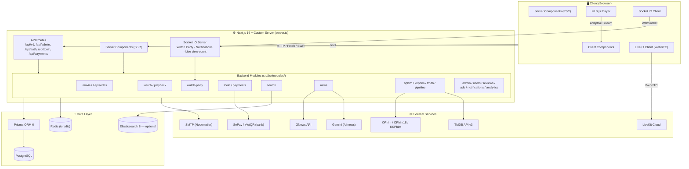
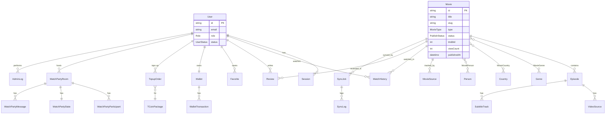
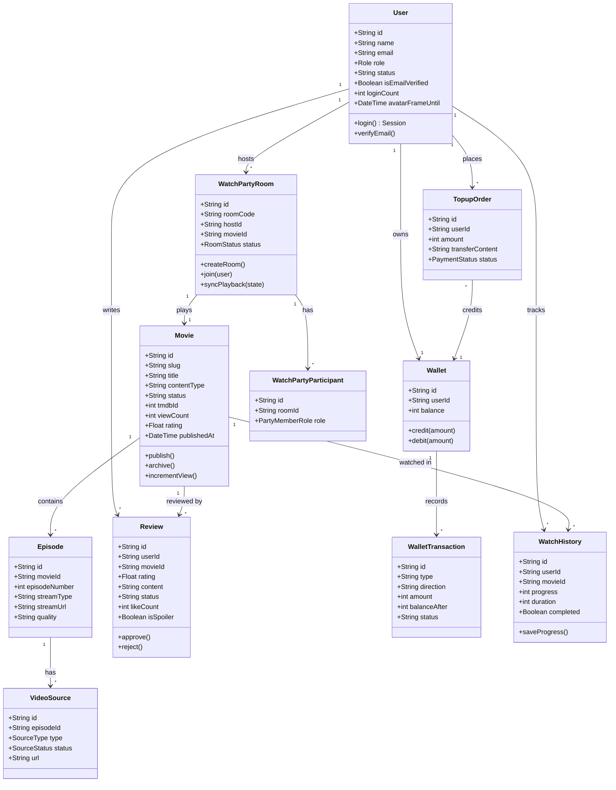
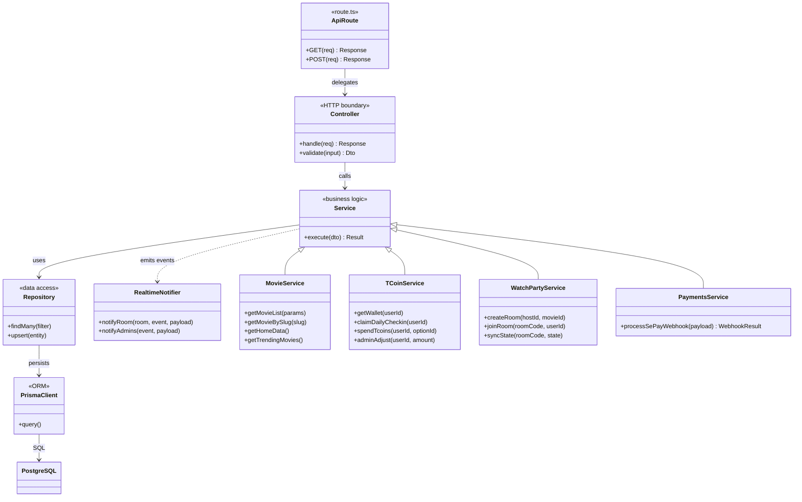
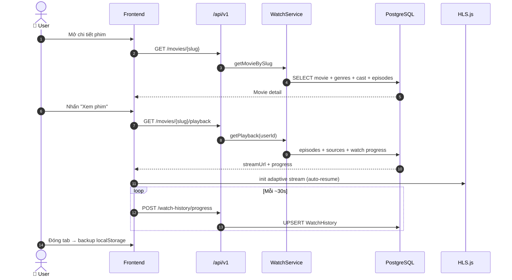
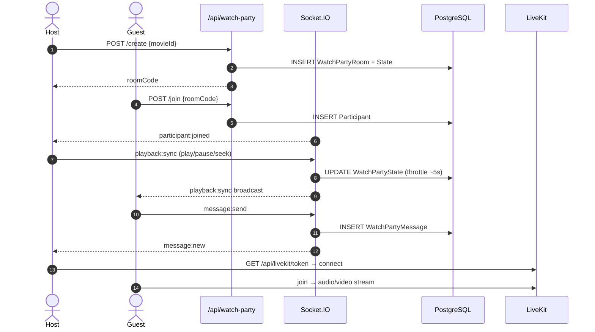
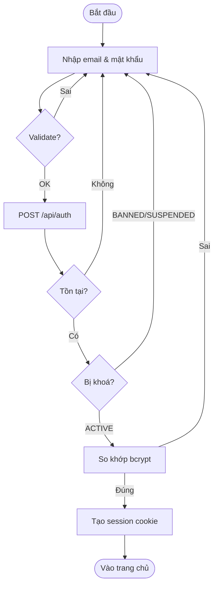
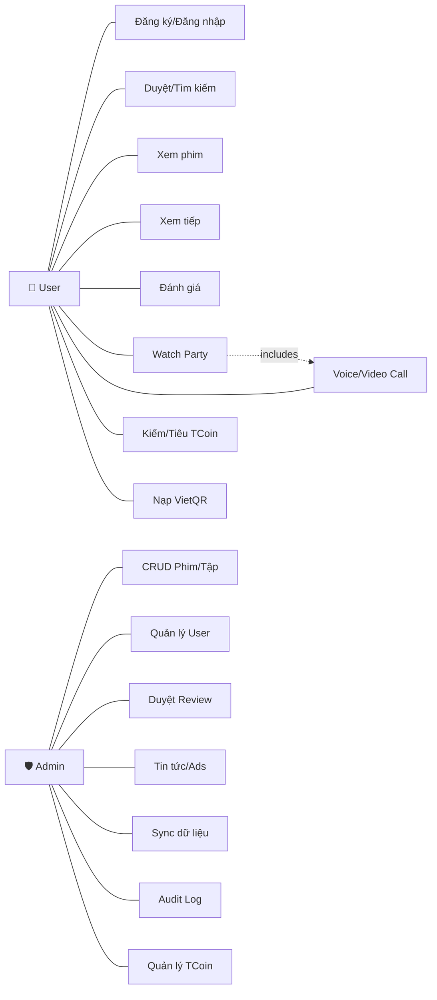
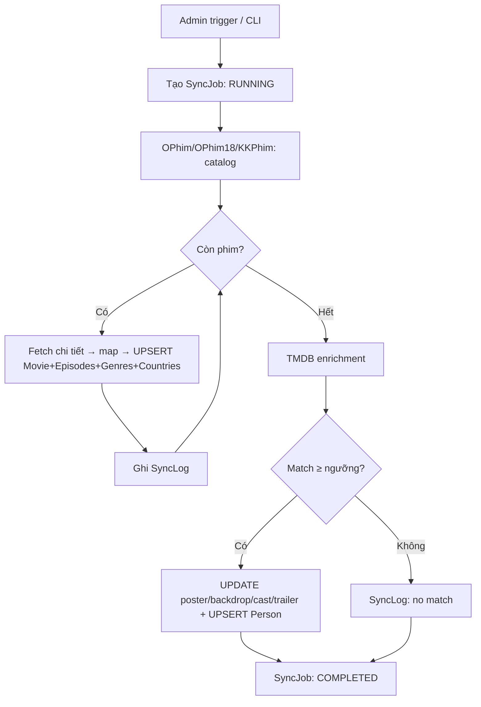
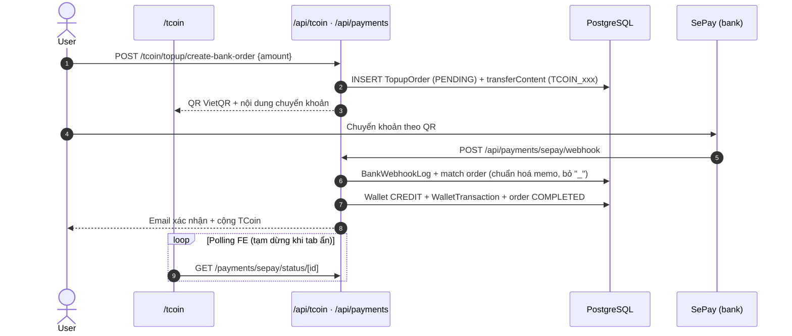

# 🎬 TERENCE — Nền tảng xem phim trực tuyến

> **Terence** là nền tảng khám phá và thưởng thức phim trực tuyến chất lượng cao,
> xây dựng bằng **Next.js 16** (App Router + custom server), **Prisma ORM + PostgreSQL**,
> **Socket.IO**, **LiveKit (WebRTC)**, tích hợp **TMDB** và nguồn dữ liệu **OPhim / OPhim18 / KKPhim**.
>
> 📚 Đồ án môn **Công nghệ phần mềm** — Đại học HUTECH.


> 📌 **Tài liệu này là nguồn tham chiếu duy nhất cho toàn hệ thống.** Mọi mô tả về kiến trúc,
> database, API, biến môi trường và trạng thái tính năng dưới đây đều được kiểm chứng trực tiếp
> từ mã nguồn (cập nhật 2026-06).

---

## 📑 Mục lục

- [1. Tổng quan hệ thống](#1-tổng-quan-hệ-thống)
- [2. Kiến trúc hệ thống](#2-kiến-trúc-hệ-thống)
- [3. Trạng thái hoàn thiện tính năng](#3-trạng-thái-hoàn-thiện-tính-năng)
- [4. Danh mục tính năng](#4-danh-mục-tính-năng)
- [5. Tech Stack](#5-tech-stack)
- [6. Cấu trúc thư mục](#6-cấu-trúc-thư-mục)
- [7. Database (PostgreSQL + Prisma)](#7-database-postgresql--prisma)
  - [7.3 ERD](#73-erd-lõi) · [7.4 Class Diagram — Domain](#74-class-diagram--domain-model) · [7.5 Class Diagram — Tầng kiến trúc](#75-class-diagram--tầng-kiến-trúc-controller--service--repository)
- [8. Danh mục API](#8-danh-mục-api)
- [9. Luồng nghiệp vụ chính (Sequence)](#9-luồng-nghiệp-vụ-chính-sequence)
- [10. Use Case & User Story](#10-use-case--user-story)
- [11. Realtime: Socket.IO & LiveKit](#11-realtime-socketio--livekit)
- [12. Data Pipeline (OPhim → TMDB)](#12-data-pipeline-ophim--tmdb)
- [13. Thanh toán TCoin (SePay / VietQR)](#13-thanh-toán-tcoin-sepay--vietqr)
- [14. Cài đặt & Chạy local](#14-cài-đặt--chạy-local)
- [15. Biến môi trường](#15-biến-môi-trường)
- [16. Deploy Production](#16-deploy-production)
- [17. Scripts & Lệnh thường dùng](#17-scripts--lệnh-thường-dùng)
- [18. Coding Convention & Workflow](#18-coding-convention--workflow)
- [19. Roadmap](#19-roadmap)
- [License](#license)

---

## 1. Tổng quan hệ thống

### 1.1 Giới thiệu

TERENCE là nền tảng xem phim trực tuyến full-stack: người dùng khám phá kho phim, xem phim với
**HLS adaptive streaming**, **xem chung real-time (Watch Party)** kèm chat và gọi video/voice, kiếm
và tiêu **TCoin** (tiền ảo demo, nạp qua chuyển khoản ngân hàng VietQR/SePay). Hệ thống có pipeline
đồng bộ dữ liệu tự động từ OPhim/OPhim18/KKPhim, làm giàu metadata từ TMDB, và một **CMS quản trị**
đầy đủ cho admin.

### 1.2 Mục tiêu & trạng thái

| # | Mục tiêu | Trạng thái |
|---|----------|------------|
| 1 | Web app xem phim full-stack hoàn chỉnh | ✅ Đạt |
| 2 | Tích hợp nguồn dữ liệu phim tự động (TMDB, OPhim, KKPhim) | ✅ Đạt |
| 3 | Hệ thống quản trị nội dung (CMS) cho admin | ✅ Đạt |
| 4 | Watch Party — xem phim chung real-time + chat + call | ✅ Đạt |
| 5 | TCoin — tiền ảo + nạp tiền qua VietQR/SePay | ✅ Đạt |
| 6 | Tìm kiếm full-text (Elasticsearch + fallback Prisma) | ✅ Đạt |
| 7 | Kiến trúc module-based, layered, dễ mở rộng | ✅ Đạt |

### 1.3 Định hướng

Mô hình **Modular Monolith**: đơn giản khi triển khai nhưng sẵn sàng tách microservice. Database
**đã chạy PostgreSQL** (không còn SQLite). Ưu tiên tiếp theo: AI recommendation, mobile app,
cổng thanh toán thực tế đa nhà cung cấp.

---

## 2. Kiến trúc hệ thống

### 2.1 Tổng quan



### 2.2 Kiến trúc phân tầng (Layered)

```
app/ (App Router)         → Pages (RSC/Client) + API route handlers (mỏng, chỉ điều phối)
   └─ delegate →  src/be/modules/<domain>/<domain>.controller.ts   (HTTP boundary, validate)
                     └─ <domain>.service.ts                         (business logic)
                          └─ <domain>.repository.ts / prisma        (data access)
src/fe/                   → Components, hooks, contexts, realtime client
src/dta/                  → Prisma schema, seed, scripts đồng bộ dữ liệu
lib/ , src/lib/           → tiện ích dùng chung (LiveKit, email, redis, tmdb-image…)
server.ts                 → Custom server: Next.js + Socket.IO trên cùng 1 process
middleware.ts             → Bảo vệ route (auth/role) ở edge
```

### 2.3 Luồng hoạt động chính

| # | Luồng | Mô tả |
|---|-------|-------|
| 1 | **Page Render** | Truy cập → Next.js render Server Component → Prisma query PostgreSQL |
| 2 | **Client Interaction** | Client Component gọi `/api/v1/*` → Controller → Service → Response |
| 3 | **Admin CMS** | `/dashboard` → `/api/admin/*` → Service + ghi `AdminLog` (audit) |
| 4 | **Watch Party** | Socket.IO sync playback + chat; LiveKit cho voice/video |
| 5 | **Data Pipeline** | OPhim/KKPhim sync → TMDB enrichment → upsert → `SyncJob`/`SyncLog` |
| 6 | **Video Playback** | HLS.js adaptive; lưu progress (DB `WatchHistory` + localStorage) |
| 7 | **Payments** | Tạo đơn nạp → VietQR → SePay webhook → cộng TCoin tự động + email |

---

## 3. Trạng thái hoàn thiện tính năng

> Bảng dưới là đánh giá **trung thực** dựa trên code (TypeScript build sạch, 341 unit test pass).

| Tính năng | Trạng thái | Ghi chú |
|-----------|:---------:|---------|
| Auth (đăng ký/đăng nhập/verify email/reset password, 5 roles) | ✅ Hoàn thành | NextAuth + bcrypt, session, Turnstile |
| Duyệt / tìm kiếm / lọc phim | ✅ Hoàn thành | Elasticsearch 5-tier + fallback Prisma |
| Chi tiết phim, cast & crew, phim tương tự | ✅ Hoàn thành | — |
| Player HLS + resume + danh sách tập | ✅ Hoàn thành | — |
| Lịch sử xem / Xem tiếp | ✅ Hoàn thành | Đồng bộ DB + localStorage |
| Watch Party (sync playback + chat) | ✅ Hoàn thành | Socket.IO, Redis pool room code |
| Watch Party voice/video call | ✅ Hoàn thành | LiveKit WebRTC |
| Đánh giá phim + moderation | ✅ Hoàn thành | Workflow approve/reject/flag |
| Tin tức (GNews + AI generator) | ✅ Hoàn thành | Gemini, fallback rỗng khi thiếu key |
| TCoin: earn / spend / lịch sử | ✅ Hoàn thành | Daily check-in, review, verify email… |
| Nạp TCoin qua VietQR / SePay | ✅ Hoàn thành | Webhook + polling + email auto-credit |
| Analytics tracking (page/movie view) | ✅ Hoàn thành | `/api/v1/analytics/track`, broadcast realtime |
| AI recommendation (gợi ý cá nhân hoá) | ✅ Hoàn thành | Content-based + Elasticsearch MLT theo watch history → rail "Dành Cho Bạn" |
| Admin CRUD (phim, tập, user, news, genres, countries, ads…) | ✅ Hoàn thành | + Audit log, settings, Redis viewer |
| Data pipeline (OPhim/OPhim18/KKPhim + TMDB) | ✅ Hoàn thành | SyncJob/SyncLog tracking |
| Trang Lịch chiếu (`/schedule`) | ✅ Hoàn thành | Luôn dùng phim thật từ DB (releases theo `publishedAt` + lấp bằng phim mới nhất), slot click sang `/watch`. `isDemo` chỉ khi DB rỗng. Giờ/rạp/giá là flavor tự sinh |
| Shorts — feed video ngắn (`/shorts`) | ✅ Hoàn thành | Feed dọc kiểu TikTok: ưu tiên `contentType='short'`, lấp bằng phim xem nhiều có backdrop; embed trailer YouTube nếu có; infinite scroll. API `/api/v1/shorts` |
| Đa cổng thanh toán | ✅ Khung sẵn sàng | `PaymentProvider` + registry; SePay là adapter đầu tiên và chạy qua khung. Cắm Momo/ZaloPay chỉ cần thêm provider + route |

**Không còn code chết / stub:** các stub cũ (`payments.types.ts`, `analytics.types.ts`,
`TODO_NOT_ACTIVE.md`, `payments/README.md`) đã được dọn; barrel export trỏ tới service/controller thật.

---

## 4. Danh mục tính năng

### 4.1 Người dùng

| Nhóm | Tính năng | Chi tiết |
|------|-----------|----------|
| 🔐 Auth | Đăng ký / Đăng nhập | Email + password (bcrypt), session cookie, Cloudflare Turnstile, verify email, reset password |
| 🎬 Phim | Duyệt & tìm kiếm | Lọc thể loại / quốc gia / năm / loại, full-text + gợi ý |
| 🎬 Phim | Chi tiết | Poster, backdrop, cast & crew, trailer, phim tương tự |
| 📺 Player | Xem phim HLS | Adaptive bitrate, resume, multi-source, phụ đề |
| 📺 Player | Danh sách tập | Series / anime / TV season |
| 📋 Lịch sử | Xem tiếp | Continue watching đồng bộ khi đăng nhập |
| 🎉 Watch Party | Xem chung | Tạo/join phòng, sync playback, chat, voice/video call, host transfer, request/approve |
| 📰 Tin tức | Tin phim | GNews + AI (Gemini) + phim sắp chiếu |
| ⭐ Đánh giá | Review | Rating 1–5 sao + comment + like, qua moderation |
| 💰 TCoin | Tiền ảo | Earn (check-in, review, verify email…), Spend (perks), nạp VietQR |
| 👤 Profile | Hồ sơ | Avatar, bio, thống kê, perks đang kích hoạt, thông báo |

### 4.2 Quản trị (Admin)

| Nhóm | Tính năng |
|------|-----------|
| 📊 Dashboard | Thống kê users/phim/doanh thu/lượt xem, biểu đồ 7 ngày, realtime Top View |
| 🎬 Phim | CRUD; publish / hide / archive / restore; feature / trending / recommend |
| 📺 Episodes & Sources | Quản lý tập, video source, phụ đề, validate nguồn |
| 👥 Users | Block/unblock, reset password, phân quyền (permissions), restore |
| 📰 Tin tức | CRUD bài viết + AI generate |
| ⭐ Reviews | Approve / reject / flag |
| 🏷️ Metadata | CRUD genres, countries |
| 📣 Ads | CRUD quảng cáo (pre-roll/mid-roll/banner), lịch chạy, impression |
| 📤 Upload | Poster, backdrop, thumbnail, media |
| 🔄 Sync | Trigger OPhim/KKPhim sync, TMDB enrichment, Elastic reindex |
| 💰 TCoin | Ví, giao dịch, điều chỉnh, hoàn tiền, xác nhận đơn nạp |
| 📝 Audit | `AdminLog`: ai làm gì, lúc nào |
| ⚙️ Hệ thống | Settings, Redis viewer, báo cáo (reports), notifications broadcast |

---

## 5. Tech Stack

| Layer | Công nghệ | Phiên bản |
|-------|-----------|-----------|
| Framework | Next.js (App Router + RSC + custom server) | 16 |
| Runtime ngôn ngữ | TypeScript / React | 5.7 / 19 |
| Styling | Tailwind CSS + Radix UI + shadcn/ui | 4 |
| **Database** | **PostgreSQL** qua Prisma ORM | Prisma 6 |
| Cache / Realtime store | Redis (ioredis) | 5 |
| Search | Elasticsearch (optional, fallback Prisma) | 8 |
| Auth | NextAuth + bcrypt / bcryptjs | 4 |
| Video Streaming | HLS.js (adaptive bitrate) | 1.6 |
| Realtime | Socket.IO | 4.8 |
| Voice/Video Call | LiveKit (WebRTC) | 2.x |
| Thanh toán | SePay webhook + VietQR | — |
| Nguồn dữ liệu phim | TMDB v3, OPhim, OPhim18, KKPhim | — |
| Tin tức / AI | GNews API + Gemini | — |
| Email | Nodemailer (SMTP) | 7 |
| State / Data fetching | React Context + SWR | — |
| Validation / Forms | Zod + React Hook Form | — |
| Charts | Recharts | 2.15 |
| Logging | pino + pino-pretty | — |
| Test | Vitest | 4 |
| Deploy | PM2 + Nginx (Vultr VPS) / Docker / Cloudflare | — |

---

## 6. Cấu trúc thư mục

```
TERENCE-main/
├── app/                        # Next.js App Router
│   ├── api/                    #   REST API (handler mỏng → controller)
│   │   ├── admin/              #     Admin APIs
│   │   ├── auth/               #     NextAuth + register/verify/reset
│   │   ├── v1/                 #     Public APIs (movies, search, watch-history, reviews…)
│   │   ├── tcoin/              #     Ví, reward, topup, spend
│   │   ├── payments/           #     SePay create/status/webhook
│   │   ├── watch-party/        #     Tạo/join/sync/chat/role phòng
│   │   ├── cron/               #     expire-orders, reconcile-orders
│   │   └── livekit, news, ads, user, hls-proxy, tmdb-image, health …
│   ├── dashboard/              #   Admin panel (movies, users, tcoin, news, ads, settings…)
│   ├── movie/[id]/ · tv/[id]/  #   Chi tiết phim / series / season
│   ├── watch/[id]/             #   Trình xem phim (HLS player)
│   ├── xem-chung/[code]/       #   Watch party (alias /watch-together qua rewrite)
│   ├── tcoin/ · profile/ · reviews/ · news/ · browse/ · top-view/ · schedule/ …
│   └── login · signup · forgot-password · reset-password · verify-email
│
├── src/
│   ├── be/                     # Backend
│   │   ├── modules/            #   Domain modules (controller/service/repository)
│   │   │   ├── admin · auth · users · movies · episodes · watch · watch-party
│   │   │   ├── tcoin · payments · reviews · news · ads · notifications · analytics
│   │   │   ├── search · uploads
│   │   │   └── ophim · kkphim · tmdb · pipeline   (data sync)
│   │   └── shared/             #   db (prisma), realtime/notify, api-handler, utils, middleware
│   ├── fe/
│   │   ├── components/         #   ui (shadcn), shared, player, watch-party, news, admin…
│   │   └── features/           #   hooks, contexts, realtime client
│   ├── dta/
│   │   ├── prisma/             #   schema.prisma, seed.ts
│   │   └── scripts/            #   sync-ophim*, enrich-tmdb, elastic-reindex, seed-ads…
│   ├── constants/ · lib/ · services/ · types/
│
├── lib/                        # LiveKit, email, auth helpers, tmdb-image, data/schedule
├── tests/                      # Unit & integration (Vitest) — 26 file, 341 test
├── deploy/                     # Nginx, PM2 ecosystem
├── server.ts                   # Custom server (Next.js + Socket.IO)
├── middleware.ts               # Route protection
└── package.json
```

---

## 7. Database (PostgreSQL + Prisma)

> Datasource: `provider = "postgresql"` (xem `src/dta/prisma/schema.prisma`). Có `DATABASE_URL`
> (pooled) và `DIRECT_URL` (migration).

### 7.1 Enum

| Enum | Giá trị |
|------|---------|
| `Role` | SUPER_ADMIN · ADMIN · STAFF · EDITOR · USER |
| `UserStatus` | ACTIVE · SUSPENDED · BANNED |
| `MovieType` | MOVIE · SERIES · ANIME · TRAILER · SHORT |
| `PublishStatus` | DRAFT · PUBLISHED · HIDDEN · ARCHIVED |
| `SourceType` | HLS · MP4 · DASH · IFRAME · YOUTUBE |
| `SourceStatus` | ACTIVE · MISSING · BROKEN · PENDING |
| `ReviewStatus` | PENDING · APPROVED · REJECTED · FLAGGED |
| `WalletTransactionType` | CREDIT · DEBIT |
| `PaymentStatus` | PENDING · COMPLETED · FAILED · REFUNDED · CANCELLED |
| `RoomStatus` | WAITING · ACTIVE · ENDED |
| `PartyMemberRole` | HOST · CO_HOST · MEMBER · GUEST |
| `PersonRoleType` | ACTOR · DIRECTOR · PRODUCER · WRITER · CREATOR · OTHER |
| `MetadataSourceType` | TMDB · IMDB · OPHIM · KKPHIM · MANUAL · INTERNAL |
| `SyncJobStatus` | PENDING · RUNNING · SUCCESS · COMPLETED · FAILED · CANCELLED · PARTIAL |
| `SyncLogLevel` | INFO · WARN · ERROR |

### 7.2 Models chính

| Nhóm | Models |
|------|--------|
| Users & Auth | `User`, `Session`, `Account`, `VerificationToken`, `PasswordResetToken`, `Notification`, `Permission`, `RolePermission`, `UserPermission` |
| Phim | `Movie`, `Episode`, `VideoSource`, `SubtitleTrack`, `MovieSource`, `MovieReport` |
| Metadata | `Genre`, `MovieGenre`, `Country`, `MovieCountry`, `Person`, `MoviePerson` |
| Tương tác | `WatchHistory`, `Favorite`, `Review` |
| Tin tức | `NewsPost` |
| TCoin & Payments | `Wallet`, `WalletTransaction`, `TCoinPackage`, `TopupOrder`, `BankWebhookLog` |
| Quảng cáo | `Advertisement`, `AdImpression` |
| Watch Party | `WatchPartyRoom`, `WatchPartyParticipant`, `WatchPartyMessage`, `WatchPartyState` |
| Vận hành | `AdminLog`, `PageView`, `Upload`, `SystemSetting` |
| Pipeline | `SyncJob`, `SyncLog` |

> ⚠️ Không tồn tại model `Short` hay `PaymentOrder`. Video ngắn là enum `MovieType.SHORT`;
> đơn nạp TCoin là model **`TopupOrder`** (không phải `PaymentOrder`).

### 7.3 ERD (lõi)



### 7.4 Class Diagram — Domain Model

> Lược đồ lớp các thực thể nghiệp vụ chính (rút gọn từ Prisma model — chỉ thuộc tính tiêu biểu).



### 7.5 Class Diagram — Tầng kiến trúc (Controller / Service / Repository)

> Mẫu phân tầng áp dụng cho mọi module backend trong `src/be/modules/<domain>`.



---

## 8. Danh mục API

> Tất cả handler trong `app/api/**/route.ts` đều mỏng và uỷ thác cho controller ở `src/be/modules`.

<details>
<summary><strong>📡 Public — /api/v1</strong></summary>

| Path | Mô tả |
|------|-------|
| `GET /api/v1/home` | Dữ liệu trang chủ |
| `GET /api/v1/movies` · `/[slug]` · `/[slug]/episodes` · `/[slug]/playback` | Danh sách / chi tiết / tập / playback |
| `GET /api/v1/movies/trending-stats` · `/most-liked` · `/recommendations` | Bảng xếp hạng & gợi ý |
| `POST /api/v1/movies/[slug]/report` | Báo lỗi phim |
| `GET /api/v1/search` · `/search/suggest` | Tìm kiếm + gợi ý |
| `GET/POST /api/v1/reviews` · `/[id]/like` · `/recent` · `/top` · `/movies/[slug]/reviews` | Đánh giá |
| `… /api/v1/watch-history` (`/bootstrap` `/progress` `/continue` `/complete` `/sync` `/[id]`) | Lịch sử & tiến trình xem |
| `GET /api/v1/notifications` · `/read-all` | Thông báo |
| `POST /api/v1/analytics/track` | Ghi page/movie view + broadcast realtime |

</details>

<details>
<summary><strong>🔐 Auth — /api/auth</strong></summary>

`[...nextauth]` · `POST /register` · `POST /verify-email` · `POST /forgot-password` · `POST /reset-password`

</details>

<details>
<summary><strong>💰 TCoin & Payments</strong></summary>

| Path | Mô tả |
|------|-------|
| `GET /api/tcoin/overview` · `/wallet` · `/transactions` · `/my-perks` | Ví & lịch sử |
| `POST /api/tcoin/spend` · `/reward/daily-checkin` · `/reward/verify-email` | Tiêu / kiếm TCoin |
| `POST /api/tcoin/topup/create-bank-order` · `GET/DELETE /api/tcoin/order/[id]` | Đơn nạp |
| `POST /api/payments/sepay/create` · `GET /status/[id]` · `POST /webhook` | VietQR + SePay |
| `POST /api/webhooks/sepay` | Webhook ngân hàng (đường dẫn phụ) |
| `GET /api/cron/expire-orders` · `/reconcile-orders` | Cron đối soát đơn |

</details>

<details>
<summary><strong>🎉 Watch Party</strong></summary>

`POST /create` · `/join` · `/leave` · `GET /[roomCode]` · `/[roomCode]/messages` ·
`POST /[roomCode]/sync` · `/role` · `/request` · `/approve` · `GET /api/livekit/token`

</details>

<details>
<summary><strong>🛡️ Admin — /api/admin</strong></summary>

| Path | Mô tả |
|------|-------|
| `GET /summary` · `/sync/summary` · `/sync/logs` | Dashboard & sync stats |
| `GET/POST /movies` · `… /[id]` · `/[id]/{publish,hide,archive,restore,feature,trending,recommend}` · `/movies/reports` | Quản lý phim |
| `GET/POST /episodes` · `/[id]` · `/video-sources` · `/subtitles` | Tập & nguồn |
| `GET/POST /users` · `/[id]` · `/[id]/{block,unblock,reset-password,permissions,restore}` | Người dùng |
| `GET/POST /genres` · `/countries` · `/news` (`/[id]` `/ai-generate`) · `/ads` (`/[id]`) | Metadata, tin, ads |
| `GET/PATCH /reviews` · `/reviews/[id]` | Duyệt review |
| `POST /uploads` (`/movie-poster` `/movie-backdrop` `/movie-thumbnail` `/movie-media`) | Upload |
| `POST /sync/ophim/catalog` · `/sync/ophim/movie/[slug]` · `/sync/tmdb/[movieId]` · `/sync/elastic/[movieId]` · `/sync/validate-sources` | Pipeline |
| `GET /elastic/health` · `POST /elastic/reindex` · `/search` | Elasticsearch |
| `GET/POST /tcoin/wallets` · `/payments` · `/adjust` · `/refund` · `/orders/[id]/confirm` · `/users/[id]/transactions` | TCoin admin |
| `GET /logs` · `/reports` · `/settings` · `/redis` · `/notifications` · `POST /notifications/broadcast` | Vận hành |

</details>

---

## 9. Luồng nghiệp vụ chính (Sequence)

### 9.1 Xem phim + lưu tiến trình



### 9.2 Watch Party (sync + chat + call)



### 9.3 Đăng nhập (Activity)



---

## 10. Use Case & User Story



| Mã | Actor | User Story |
|----|-------|-----------|
| US-01 | Guest/User | Duyệt & tìm phim qua bộ lọc + search để tìm phim phù hợp |
| US-02 | User | Xem phim HLS mượt, tự resume vị trí cũ |
| US-03 | User | Tạo Watch Party, chia sẻ room code, xem đồng bộ + chat + call |
| US-04 | User | Đánh giá phim; review hiển thị sau khi admin duyệt |
| US-05 | User | Kiếm TCoin từ hoạt động, nạp thêm qua VietQR, tiêu đổi perks |
| US-06 | Admin/Staff | CRUD kho phim, publish/hide/archive, upload media |
| US-07 | Admin | Trigger sync OPhim → enrich TMDB tự động |
| US-08 | Admin/Staff | Duyệt review (approve/reject/flag) kèm audit log |

---

## 11. Realtime: Socket.IO & LiveKit

- **Custom server** (`server.ts`) chạy Next.js + Socket.IO trên cùng process → không cần dịch vụ
  realtime tách rời. Dev realtime: `npm run dev:socket`.
- **Sự kiện** (xem `src/be/shared/realtime/notify.ts`, `RT_EVENTS`):
  - Watch Party: `playback:sync`, `message:new`, `participant:joined/left`, role/request/approve.
  - Thông báo admin & người dùng (broadcast).
  - **Live view-count**: khi có lượt xem, `viewCount` tăng và phát tới admin, phòng phim
    (`movie:{id}`) và Top View (`topview:listeners`).
- **Redis (ioredis)**: pool room code cho watch party (fallback DB khi không có Redis), cache.
- **LiveKit**: voice/video call trong phòng; token cấp qua `GET /api/livekit/token`.

---

## 12. Data Pipeline (OPhim → TMDB)



- **Nguồn**: OPhim (`ophim`), OPhim18, KKPhim (`kkphim`) — client + mapper riêng.
- **Enrichment**: `tmdb` module match theo title/year (ngưỡng tin cậy ~70%) rồi cập nhật metadata.
- **Orchestration**: `pipeline/movie-enrichment-pipeline.ts` — lỗi TMDB **không** rollback dữ liệu OPhim.
- **Tracking**: mọi thao tác ghi `SyncJob` + `SyncLog`. Search reindex qua Elasticsearch.
- **CLI**: `npm run sync:ophim:catalog`, `sync:ophim18:catalog`, `enrich:tmdb`, `pipeline:movie`, `elastic:reindex`.

---

## 13. Thanh toán TCoin (SePay / VietQR)



- **Idempotent webhook** (lưu `BankWebhookLog`), khớp đơn theo `transferContent`; ngân hàng có thể
  lược ký tự `_` trong nội dung nên hệ thống **chuẩn hoá** trước khi so khớp.
- Hai đường xác nhận: **webhook** (tức thời) + **polling** trạng thái phía FE.
- Cron `expire-orders` / `reconcile-orders` dọn đơn quá hạn & đối soát.

---

## 14. Cài đặt & Chạy local

### Yêu cầu
- **Node.js** ≥ 18, **npm** ≥ 9
- **PostgreSQL** đang chạy (local hoặc cloud)
- (Tuỳ chọn) Redis, Elasticsearch, TMDB key, LiveKit, SePay/VietQR, SMTP

### Cài đặt

```bash
git clone <repo-url> && cd TERENCE-main
npm install                       # postinstall tự chạy `prisma generate`
cp .env.example .env              # điền DATABASE_URL (PostgreSQL) + các key

# Tạo schema vào DB.
# Lưu ý: migration init hiện có sự cố datetime → dùng db push cho đáng tin cậy:
npx prisma db push --schema=src/dta/prisma/schema.prisma
# (hoặc thử: npm run db:migrate)

npm run db:seed                   # seed admin, phim mẫu…
```

### Chạy

```bash
npm run dev          # Next.js dev (KHÔNG có Socket.IO)
npm run dev:socket   # Custom server có Socket.IO (watch party) → http://localhost:3000
npm run build && npm start   # Production
```

### Tài khoản seed

| Email | Mật khẩu | Quyền |
|-------|----------|-------|
| `admin@terence.vn` | `Admin@12345` | Super Admin |
| `staff@terence.vn` | `Staff@12345` | Staff |
| `user@terence.vn` | `User@12345` | User |

---

## 15. Biến môi trường

> Tham chiếu `.env.example`. Biến **Server-only** **không** prefix `NEXT_PUBLIC_`.

| Nhóm | Biến |
|------|------|
| Core | `DATABASE_URL`, `DIRECT_URL`, `NODE_ENV`, `PORT`, `HOSTNAME`, `LOG_LEVEL` |
| Auth | `NEXTAUTH_SECRET`, `NEXTAUTH_URL`, `APP_URL`, `NEXT_PUBLIC_SITE_URL`, `GOOGLE_CLIENT_ID/SECRET`, `NEXT_PUBLIC_TURNSTILE_SITE_KEY` |
| Email (SMTP) | `SMTP_HOST`, `SMTP_PORT`, `SMTP_USER`, `SMTP_PASS`, `EMAIL_FROM_NAME`, `EMAIL_FROM_ADDRESS` |
| Payments | `SEPAY_BANK_CODE`, `SEPAY_BANK_ACCOUNT`, `SEPAY_PAYMENT_PREFIX`, `SEPAY_API_KEY`, `SEPAY_WEBHOOK_API_KEY`, `SEPAY_WEBHOOK_SECRET`, `VIETQR_BANK_ID`, `VIETQR_ACCOUNT_NO`, `VIETQR_ACCOUNT_NAME`, `VIETQR_TEMPLATE` |
| TMDB | `TMDB_API_KEY`, `TMDB_READ_ACCESS_TOKEN`, `TMDB_BASE_URL`, `NEXT_PUBLIC_TMDB_IMAGE_BASE_URL` |
| Nguồn phim | `OPHIM_BASE_URL`, `OPHIM_TIMEOUT`, `KKPHIM_BASE_URL`, `KKPHIM_TIMEOUT`, `DISABLE_OPHIM_CHECK`, `DEMO_HLS_URL` |
| Search | `ELASTICSEARCH_HOST`, `ELASTICSEARCH_INDEX_MOVIES`, `ELASTICSEARCH_USERNAME/PASSWORD/API_KEY` |
| Realtime / Cache | `REDIS_URL`, `LIVEKIT_API_KEY`, `LIVEKIT_API_SECRET`, `NEXT_PUBLIC_LIVEKIT_URL` |
| Tin tức / AI | `GNEWS_API_KEY`, `GEMINI_API_KEY`, `GEMINI_MODEL` |
| Khác | `CRON_SECRET`, `NEXT_PUBLIC_REGION`, `ALLOWED_ORIGINS`, `GRAPUCO_API_KEY` |

---

## 16. Deploy Production

### PM2 (Vultr VPS) + Nginx

```bash
ssh root@<server-ip>
cd /var/www && git clone <repo-url> TERENCE && cd TERENCE
cp .env.example .env && nano .env        # điền production values

npm install
npx prisma generate
npx prisma db push --schema=src/dta/prisma/schema.prisma   # init schema (xem ghi chú migrate)
npm run db:seed
npm run build

mkdir -p logs
pm2 start ecosystem.config.js
pm2 save
```

> Nginx reverse proxy + Cloudflare CDN đặt trước PM2. Cấu hình mẫu trong `deploy/`.
> Socket.IO chạy chung process nên Nginx cần bật `proxy_set_header Upgrade/Connection` cho WebSocket.

### Docker

```bash
npm run docker:up        # docker compose up -d
npm run docker:logs      # theo dõi log
npm run docker:reindex   # reindex Elasticsearch trong container
```

---

## 17. Scripts & Lệnh thường dùng

```bash
# Dev / build
npm run dev · dev:socket · build · start · lint

# Database
npm run db:generate · db:seed · db:reset
npx prisma db push --schema=src/dta/prisma/schema.prisma   # khuyến nghị cho init schema

# Sync dữ liệu phim
npm run sync:ophim:catalog · sync:ophim18:catalog · sync:ophim:movie · enrich:tmdb · pipeline:movie

# Search (Elasticsearch)
npm run search:reindex · search:sync · search:clear · search:test

# Test
npm test            # vitest run (26 file · 341 test)
npm run test:watch · test:coverage
```

---

## 18. Coding Convention & Workflow

- **Layered, module-based**: route handler chỉ điều phối → controller (validate, HTTP) → service
  (logic) → repository/prisma (data). Không nhét logic vào route.
- **TypeScript strict**: `npx tsc --noEmit` phải sạch trước khi commit.
- **Validation**: Zod ở biên controller; Forms dùng React Hook Form + resolver.
- **Realtime**: phát sự kiện qua `src/be/shared/realtime/notify.ts` với hằng `RT_EVENTS` — đặt tên
  phòng đồng nhất giữa server (`socket-handlers.ts`) và emitter.
- **Audit**: thao tác admin ghi `AdminLog`.
- **Test**: Vitest cho mapper, service thuần, api-handler… Chạy `npm test` trước khi PR.
- **Git**: commit theo Conventional Commits (`feat:`, `fix:`, `chore:`, `style:`…). Husky +
  lint-staged chạy lint khi commit.

---

## 19. Roadmap

**Đã hoàn thành gần đây:** ✅ Lịch chiếu dùng dữ liệu thật · ✅ Shorts feed (`/shorts`) ·
✅ AI recommendation cá nhân hoá · ✅ Khung đa cổng thanh toán (`PaymentProvider` + registry).

| Ưu tiên | Hạng mục | Mô tả |
|:------:|----------|-------|
| 🔴 Cao | Hardening PostgreSQL | Connection pooling (PgBouncer), index review, backup định kỳ |
| 🟠 TB | Tích hợp cổng thật | Viết adapter Momo/ZaloPay thật cắm vào registry đã có; trang quản trị Shorts |
| 🟡 Thấp | Nguồn lịch chiếu rạp thật | Thay flavor giờ/rạp/giá bằng dữ liệu rạp thực tế (nếu cần) |
| 🟡 Thấp | Mobile app | Client di động dùng chung API |

---

## License

Đồ án giáo dục (Educational) — Đại học HUTECH, môn Công nghệ phần mềm. Không dùng cho mục đích
thương mại. Dữ liệu phim thuộc về các nguồn tương ứng (TMDB, OPhim, …).
