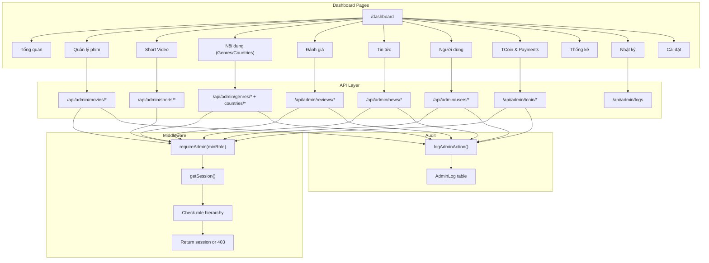
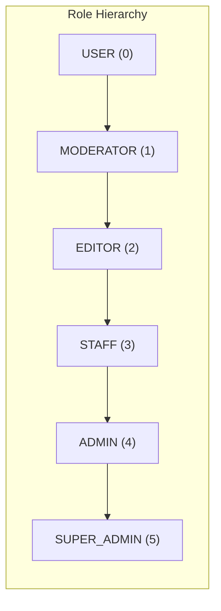
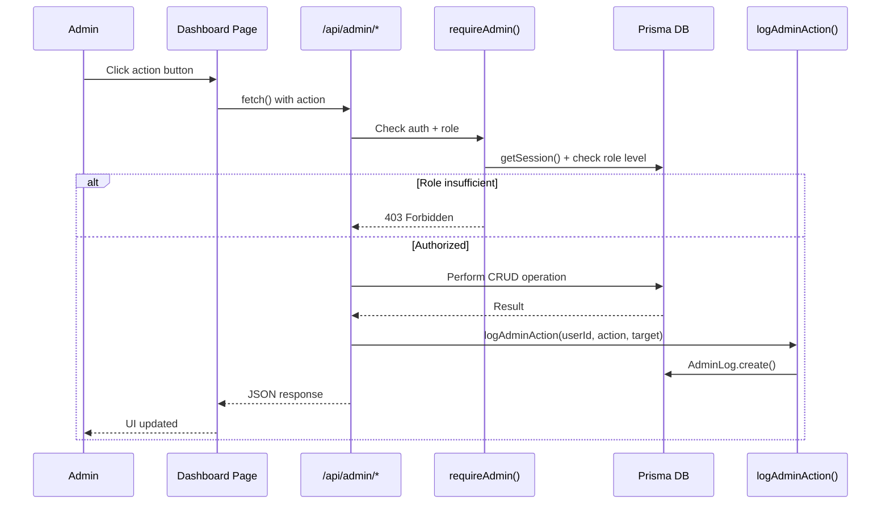

# CMS Flow — Architecture

> **Last Updated**: 2026-03-31

---

## Overview

The TERENCE CMS is an admin dashboard for managing all platform content: movies, episodes, video sources, genres, countries, users, reviews, news, and TCoin. It uses role-based access control and logs every action.

---

## System Architecture



---

## Role-Based Access Control



### Permission Matrix

| Resource | View | Create | Update | Delete | Special |
|----------|------|--------|--------|--------|---------|
| Movies | EDITOR | EDITOR | EDITOR | ADMIN | Publish/Hide/Feature: EDITOR |
| Episodes | EDITOR | EDITOR | EDITOR | ADMIN | — |
| Video Sources | EDITOR | EDITOR | EDITOR | ADMIN | — |
| Genres | EDITOR | EDITOR | EDITOR | ADMIN | — |
| Countries | EDITOR | EDITOR | EDITOR | ADMIN | — |
| Reviews | MODERATOR | — | MODERATOR | MODERATOR | Approve/Reject: MODERATOR |
| News | EDITOR | EDITOR | EDITOR | ADMIN | Publish: EDITOR |
| Users | ADMIN | ADMIN | ADMIN | ADMIN | Block/Role change: ADMIN |
| TCoin | ADMIN | — | — | — | Adjust: ADMIN |
| Logs | ADMIN | — | — | — | Read-only |

---

## Data Flow: Admin Action



---

## Dashboard Pages

| Page | Route | Features |
|------|-------|----------|
| Tổng quan | `/dashboard` | Stats overview, quick actions |
| Quản lý phim | `/dashboard/movies` | CRUD, filter, sort, feature/trending flags, soft delete |
| Short Video | `/dashboard/shorts` | CRUD, publish/hide |
| Nội dung | `/dashboard/content` | Genres + Countries (tabbed), CRUD with movie counts |
| Đánh giá | `/dashboard/reviews` | Moderation queue, bulk approve/reject/delete, status filter |
| Tin tức | `/dashboard/news` | CRUD, publish/draft toggle, search |
| Người dùng | `/dashboard/users` | CRUD, role change, block/unblock, reset password, soft delete |
| TCoin | `/dashboard/tcoin` | Wallet list, payment orders, manual adjustment |
| Thống kê | `/dashboard/analytics` | Charts, metrics |
| Nhật ký | `/dashboard/logs` | Full audit trail, filter by action/target/date |
| Cài đặt | `/dashboard/settings` | System configuration |

---

## Shared Utilities

```
src/server/modules/admin/
  └─ admin.utils.ts
       ├─ requireAdmin(minRole)  — Role guard, returns session or error response
       ├─ logAdminAction()       — Write to AdminLog with IP address
       └─ paginatedResponse()    — Standard paginated JSON builder
```

### requireAdmin()
```typescript
// Usage in API route:
const auth = await requireAdmin('editor')
if ('error' in auth) return auth.error
// auth.session, auth.userId, auth.user available
```

### logAdminAction()
```typescript
await logAdminAction(
  userId,       // Who performed the action
  'create',     // Action type
  'movie',      // Target entity type
  movieId,      // Target entity ID
  { title: '...' } // Extra metadata
)
```

---

## Bulk Actions

The Reviews page supports bulk operations:
1. Select multiple reviews via checkboxes
2. Choose action: Approve / Reject / Delete
3. All selected items are processed in parallel
4. Admin log is written for each action

---

## Soft Delete Pattern

Used for: Movies, Users

```typescript
// Delete: set deletedAt timestamp
await prisma.movie.update({
  where: { id },
  data: { deletedAt: new Date() }
})

// Restore: clear deletedAt
await prisma.movie.update({
  where: { id },
  data: { deletedAt: null }
})

// List: exclude deleted by default
where: { deletedAt: null }
// Show deleted: where deleted=true parameter
```

---

## Security Considerations

1. **Role guard on every route**: `requireAdmin()` verifies both authentication and authorization
2. **Audit trail**: Every write operation logs to AdminLog with actor, action, target, metadata, IP
3. **Soft delete**: Destructive operations are reversible
4. **Input validation**: All POST/PATCH routes validate required fields
5. **SUPER_ADMIN protection**: Cannot demote the last SUPER_ADMIN
