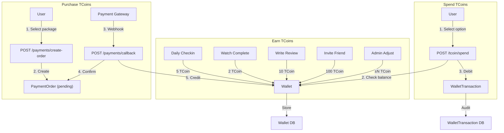
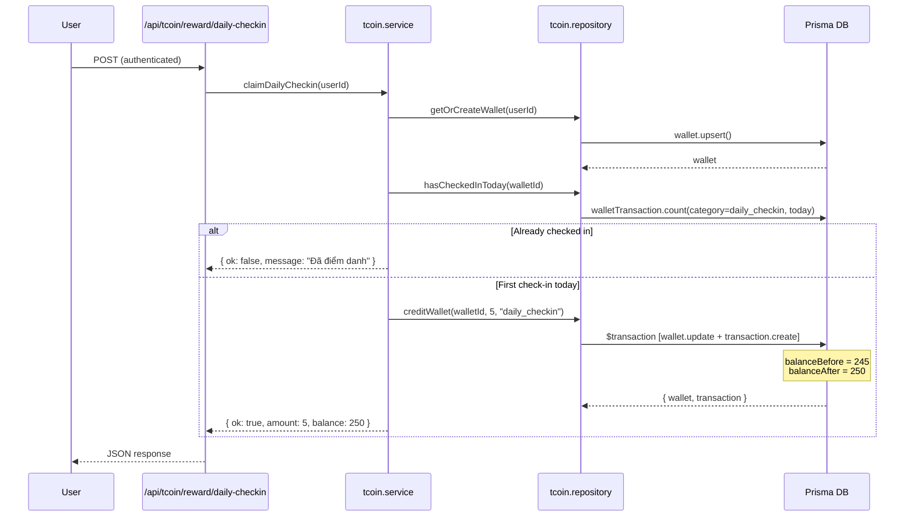
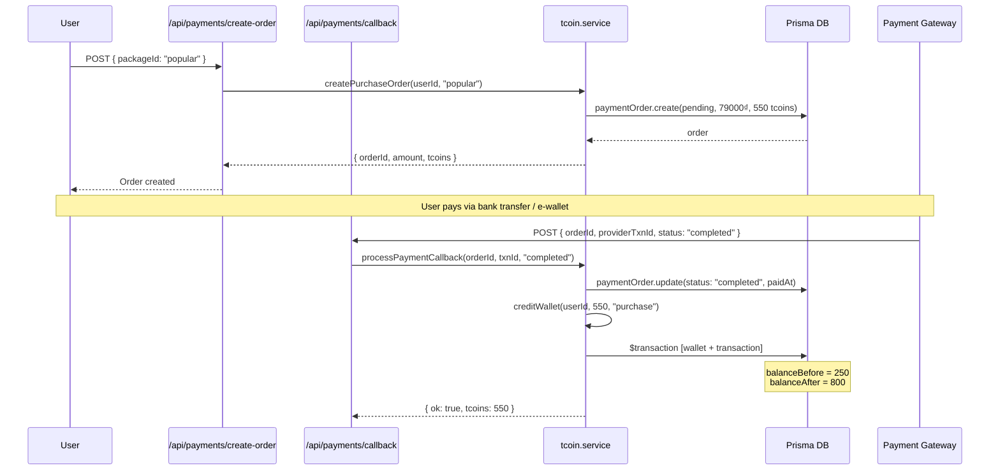
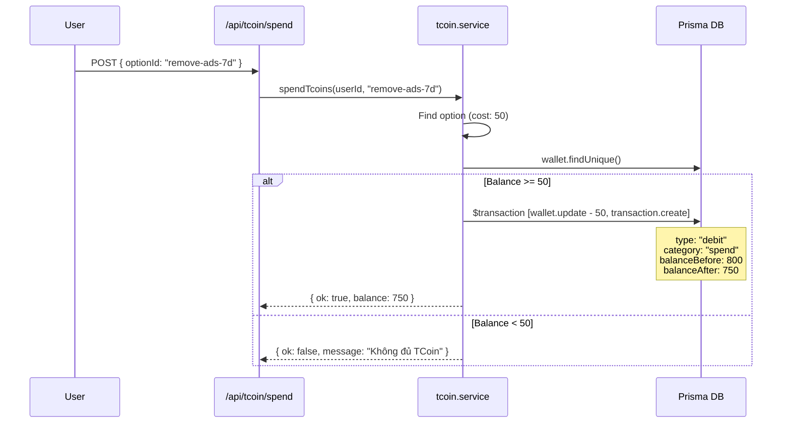

# TCoin Flow — Architecture

> **Last Updated**: 2026-03-31

---

## Overview

TCoin is the virtual currency of the TERENCE platform. Users earn TCoins through daily check-ins, watching movies, writing reviews, and referrals. They can spend TCoins on premium features or purchase more through payment packages.

---

## System Architecture



---

## Data Flow: Daily Check-in



---

## Data Flow: Purchase TCoins



---

## Data Flow: Spend TCoins



---

## Transaction Audit Trail

Every transaction records:

```
┌─────────────────────────────────────────────────┐
│ WalletTransaction                               │
├─────────────────────────────────────────────────┤
│ id: "clx..."                                    │
│ walletId: "clx..."                              │
│ type: "credit" | "debit"                        │
│ category: "daily_checkin" | "purchase" | ...     │
│ amount: 5                                       │
│ balanceBefore: 245  ◄── snapshot before          │
│ balanceAfter: 250   ◄── snapshot after           │
│ description: "Điểm danh hàng ngày: +5 TCoin"   │
│ referenceId: null | "orderId" | "adminId"       │
│ referenceType: null | "payment_order" | "admin" │
│ createdAt: 2026-03-31T03:00:00Z                │
└─────────────────────────────────────────────────┘
```

This enables:
- **Audit**: Trace exactly how balance changed
- **Reconciliation**: Sum all balanceAfter should match wallet.balance
- **Debugging**: If balance is wrong, find the discrepancy transaction

---

## Module Architecture

```
src/server/modules/tcoin/
  ├─ index.ts                     ← Barrel export
  ├─ tcoin.types.ts               ← All type definitions
  ├─ tcoin.service.ts             ← Business logic
  │    ├─ REWARD_CONFIGS          ← Reward definitions
  │    ├─ SPEND_OPTIONS           ← Spend definitions
  │    ├─ TCOIN_PACKAGES          ← Purchase packages
  │    ├─ getWallet()             ← User wallet info
  │    ├─ getTransactions()       ← Transaction history
  │    ├─ claimDailyCheckin()     ← Daily reward
  │    ├─ rewardWatchComplete()   ← Watch reward
  │    ├─ rewardReview()          ← Review reward
  │    ├─ spendTcoins()           ← Spend TCoins
  │    ├─ createPurchaseOrder()   ← Purchase flow
  │    ├─ processPaymentCallback()← Payment confirmation
  │    ├─ adminAdjust()           ← Admin manual adjust
  │    ├─ getAdminWallets()       ← Admin wallet list
  │    └─ getAdminPaymentOrders() ← Admin orders list
  └─ tcoin.repository.ts         ← Prisma queries only
       ├─ creditWallet()          ← Atomic credit (interactive txn)
       ├─ debitWallet()           ← Atomic debit (interactive txn)
       ├─ hasCheckedInToday()     ← Cooldown check
       ├─ countTodayRewards()     ← Daily limit check
       └─ ...CRUD operations
```

---

## API Routes

```
app/api/
  ├─ tcoin/
  │    ├─ wallet/route.ts              GET  — User wallet info
  │    ├─ transactions/route.ts        GET  — Transaction history
  │    ├─ reward/daily-checkin/route.ts POST — Daily check-in
  │    └─ spend/route.ts               POST — Spend TCoins
  ├─ payments/
  │    ├─ create-order/route.ts        POST — Create purchase order
  │    └─ callback/route.ts            POST — Payment webhook
  └─ admin/tcoin/
       ├─ wallets/route.ts             GET  — Admin: all wallets
       ├─ payments/route.ts            GET  — Admin: all orders
       └─ adjust/route.ts             POST — Admin: manual adjust
```

---

## Database Tables

| Table | Purpose |
|-------|---------|
| `Wallet` | 1:1 per user, stores `balance` |
| `WalletTransaction` | Every credit/debit with `balanceBefore`/`balanceAfter` |
| `PaymentOrder` | Purchase orders with status lifecycle |

---

## Security Considerations

1. **Atomic operations**: `creditWallet` / `debitWallet` use Prisma interactive transactions — balance is read + updated in the same transaction, preventing race conditions.
2. **Daily limits**: Check-in is once/day, watch rewards max 10/day, review rewards max 3/day.
3. **Balance validation**: Spending always checks `wallet.balance >= cost` inside the transaction.
4. **Admin audit**: Admin adjustments record the admin's userId in `referenceId`.
5. **Payment idempotency**: `processPaymentCallback` checks `order.status !== 'pending'` to prevent double-processing.

---

## Future: Payment Gateway Integration

The current implementation uses `provider: "manual"` with admin confirmation. To integrate a real payment gateway (VNPay, MoMo, ZaloPay):

1. Replace `createPurchaseOrder()` to generate a redirect URL to the gateway
2. Implement HMAC signature verification in `/api/payments/callback`
3. Add webhook retry handling
4. Add refund flow
