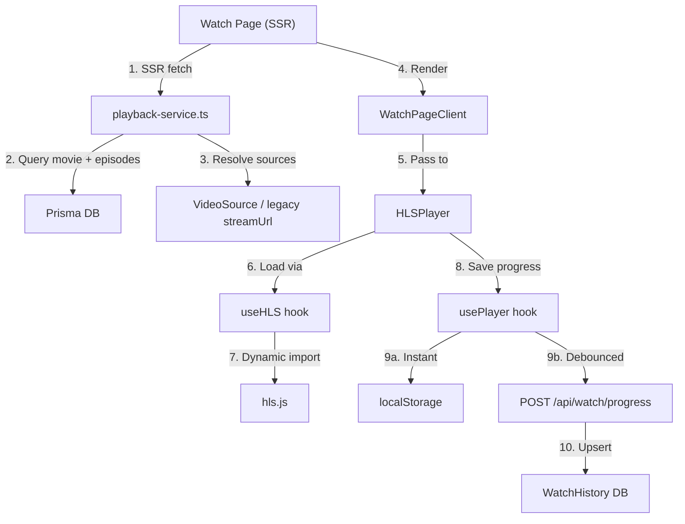
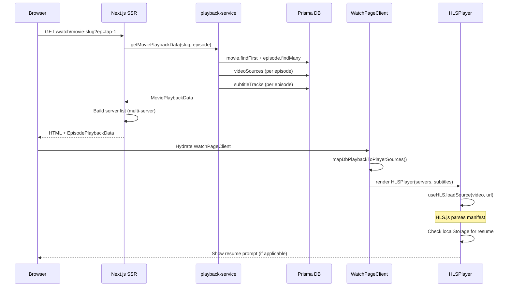
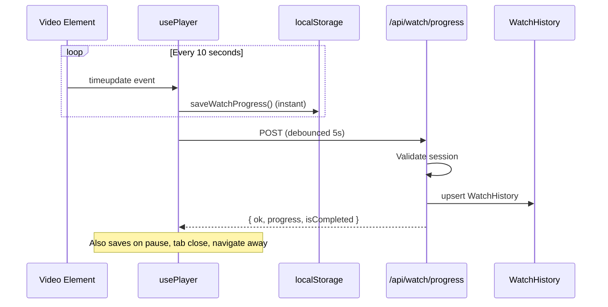
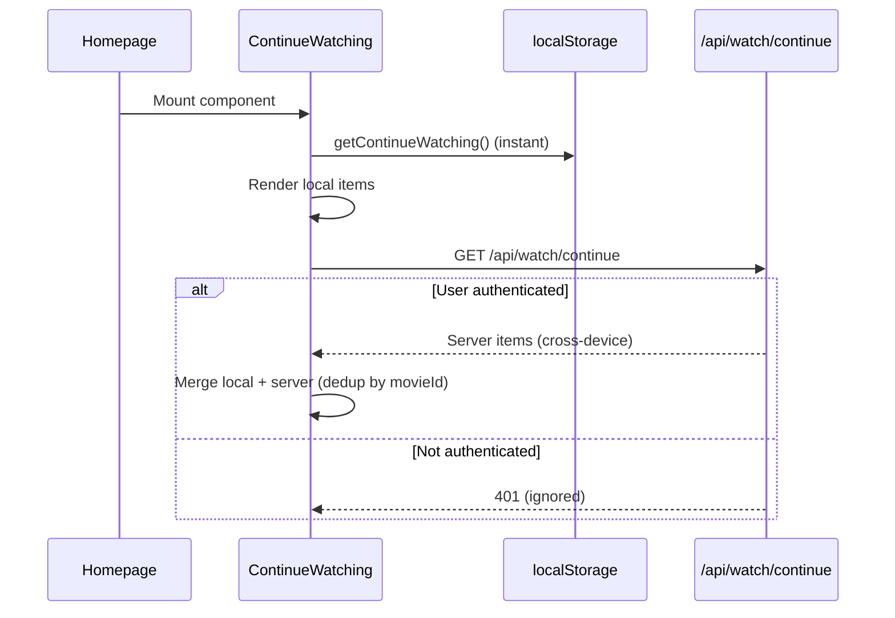

# Watch Flow — Architecture

> **Last Updated**: 2026-03-31

---

## Overview

The watch system provides a complete movie playback experience with multi-source resolution, resume playback, and hybrid progress persistence (localStorage + server DB).

---

## System Architecture



---

## Data Flow: Watch Page Load



---

## Data Flow: Save Progress



---

## Data Flow: Continue Watching



---

## Source Resolution Priority

```
┌──────────────────────────────────────────────┐
│ 1. VideoSource records (isActive = true)     │
│    └─ Sorted: isPrimary DESC, priority DESC  │
│    └─ Type priority: hls > mp4 > iframe      │
├──────────────────────────────────────────────┤
│ 2. Legacy episode.streamUrl (fallback)       │
│    └─ Only if no VideoSource records exist   │
│    └─ Type from episode.streamType           │
├──────────────────────────────────────────────┤
│ 3. Legacy episode.backupSourceUrl            │
│    └─ Added as non-primary backup            │
├──────────────────────────────────────────────┤
│ 4. External source resolver (Demo/TMDB)      │
│    └─ Only if no DB sources at all           │
└──────────────────────────────────────────────┘
```

---

## Component Architecture

```
app/watch/[id]/page.tsx          ← SSR entry (fetches data)
  └─ components/player/
       ├─ WatchPageClient.tsx    ← Client orchestrator
       │   ├─ HLSPlayer.tsx     ← Production video player
       │   │   ├─ useHLS.ts     ← HLS.js lifecycle hook
       │   │   └─ usePlayer.ts  ← State + progress hook
       │   └─ WatchPartyOverlay ← Future: watch party layer
       └─ source-adapter.ts     ← DB → PlayerServer[] mapper

components/watch/
  ├─ ContinueWatching.tsx       ← Homepage section
  ├─ EpisodeListBar.tsx         ← Episode selector
  ├─ VideoPlayer.tsx            ← Legacy player
  └─ WatchPlayer.tsx            ← Legacy watch player
```

---

## Module Architecture (Server)

```
src/server/modules/watch/
  ├─ index.ts                   ← Barrel export
  ├─ watch.types.ts             ← All type definitions
  ├─ watch.service.ts           ← Business logic (bootstrap, progress, continue)
  └─ watch.repository.ts        ← Prisma queries only

app/api/watch/
  ├─ bootstrap/route.ts         ← GET /api/watch/bootstrap
  ├─ progress/route.ts          ← POST /api/watch/progress
  ├─ complete/route.ts          ← POST /api/watch/complete
  └─ continue/route.ts          ← GET /api/watch/continue
```

---

## Player Features

| Feature | Implementation |
|---------|---------------|
| HLS playback | hls.js dynamic import, native Safari fallback |
| Multi-server | `servers[]` array, auto-fallback on error |
| Retry logic | 3 retries per server, then auto-switch |
| Resume playback | Resume prompt from localStorage/DB |
| Progress save | localStorage (instant) + API (debounced 5s) |
| Keyboard shortcuts | Space/K/F/M/Arrows |
| Subtitles | VTT tracks, language selector |
| Playback speed | 0.5x — 2x |
| Fullscreen | Browser Fullscreen API |
| Auto-hide controls | 3s timeout during playback |
| Error handling | Loading/retry/error states |
| Auto-complete | Progress ≥ 92% = completed |

---

## Database Tables Used

| Table | Purpose |
|-------|---------|
| `Movie` | Movie metadata |
| `Episode` | Episode list per movie |
| `VideoSource` | Multi-source per episode |
| `SubtitleTrack` | VTT subtitle tracks |
| `WatchHistory` | User progress (per movie+episode) |

---

## Future: Watch Party Integration

The watch player is designed with a `WatchPartyOverlay` wrapper that will:
1. Sync playback state across room members via WebSocket
2. Add chat overlay
3. Add voice/video via LiveKit
4. Enforce host-only play/pause/seek controls

This is NOT implemented in Phase 1.
