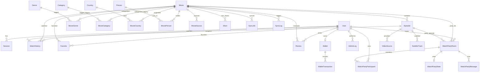

# TERENCE — Schema v2.0 Documentation

> **Last updated**: 2026-03-31  
> **Datasource**: SQLite (migration to PostgreSQL planned)

---

## Entity-Relationship Diagram

---

## Enums

| Enum | Values | Usage |
|------|--------|-------|
| `UserRole` | SUPER_ADMIN, ADMIN, STAFF, EDITOR, USER | `User.role` validation |
| `UserStatus` | ACTIVE, SUSPENDED, BANNED | `User.status` validation |
| `MovieType` | MOVIE, SERIES, ANIME, TRAILER, SHORT | `Movie.contentType` validation |
| `PublishStatus` | DRAFT, PUBLISHED, HIDDEN, ARCHIVED | `Movie.status` validation |
| `SourceType` | HLS, MP4, DASH, IFRAME, YOUTUBE | `VideoSource.sourceType` validation |
| `SourceStatus` | ACTIVE, MISSING, BROKEN, PENDING | `Movie.sourceStatus` validation |
| `ReviewStatus` | PENDING, APPROVED, REJECTED, FLAGGED | `Review.status` validation |
| `WalletTransactionType` | CREDIT, DEBIT | `WalletTransaction.type` validation |
| `PaymentStatus` | PENDING, COMPLETED, FAILED, REFUNDED, CANCELLED | `PaymentOrder.status` validation |
| `RoomStatus` | WAITING, ACTIVE, ENDED | `WatchPartyRoom.status` validation |
| `PartyMemberRole` | HOST, CO_HOST, MEMBER, GUEST | `WatchPartyParticipant.role` validation |
| `PersonRoleType` | ACTOR, DIRECTOR, PRODUCER, WRITER, CREATOR, OTHER | `MoviePerson.role` validation |
| `MetadataSourceType` | TMDB, IMDB, OPHIM, KKPHIM, MANUAL, INTERNAL | `Movie.metadataSource` / `MovieSource.sourceName` validation |
| `SyncJobStatus` | PENDING, RUNNING, SUCCESS, COMPLETED, FAILED, CANCELLED, PARTIAL | `SyncJob.status` validation |
| `SyncLogLevel` | INFO, WARN, ERROR | `SyncLog.level` validation |

> **Note**: SQLite does not support native enums. These are enforced at the application level via Prisma's generated TypeScript types.

---

## Models

### 1. User & Auth

| Model | Fields | Description |
|-------|--------|-------------|
| **User** | id, name, email, passwordHash, role, avatar, bio, isActive, status, blockedReason, lastLoginAt, lastLoginIp, loginCount, createdAt, updatedAt, deletedAt | User accounts with RBAC |
| **Session** | id, userId, expiresAt, createdAt | Server-side sessions |

### 2. Catalog

| Model | Fields | Description |
|-------|--------|-------------|
| **Movie** | id, ophimId, tmdbId, imdbId, slug, title, originalTitle, description, shortDescription, contentType, status, quality, language, year, duration, episodeCurrent, episodeTotal, trailerUrl, thumbUrl, posterUrl, backdropUrl, rating, ageRating, *legacy text fields*, sourceStatus, viewCount, ... | Main content entity |
| **Episode** | id, movieId, sourceName, serverName, episodeName, episodeSlug, episodeNumber, episodeOrder, streamType, streamUrl, sourceUrl, ... | Episodes per movie |
| **VideoSource** | id, episodeId, sourceType, url, label, mimeType, isPrimary, isActive, drmType, priority | Multi-source per episode |
| **SubtitleTrack** | id, episodeId, label, lang, url, isDefault, kind, isActive | VTT subtitles |

### 3. Taxonomy

| Model | Fields | Description |
|-------|--------|-------------|
| **Genre** | id, name, slug, tmdbId, description, sortOrder, isActive | ✨ New — normalized genres |
| **MovieGenre** | id, movieId, genreId | ✨ New — M:N pivot |
| **Category** | *(legacy mirror of Genre)* | Kept for backward compatibility |
| **MovieCategory** | *(legacy mirror of MovieGenre)* | Kept for backward compatibility |
| **Country** | id, name, slug, code, sortOrder, isActive | Country lookup |
| **MovieCountry** | id, movieId, countryId | M:N pivot |
| **Person** | id, name, slug, originalName, tmdbId, imdbId, profileUrl, biography, gender, knownFor, popularity | Cast & crew |
| **MoviePerson** | id, movieId, personId, role, character, department, job, sortOrder | M:N pivot with role |

### 4. User Interactions

| Model | Fields | Description |
|-------|--------|-------------|
| **WatchHistory** | id, userId, movieId, episodeId, progress, duration, currentTime, isCompleted, deviceType | Watch progress tracking |
| **Favorite** | id, userId, movieId, createdAt | ✨ New — user favorites |
| **Review** | id, userId, movieId, rating, title, content, status, isSpoiler, likeCount | ✨ New — user reviews |

### 5. TCoin & Payments

| Model | Fields | Description |
|-------|--------|-------------|
| **Wallet** | id, userId, balance | ✨ New — TCoin wallet per user |
| **WalletTransaction** | id, walletId, type, amount, description, referenceId | ✨ New — Transaction log |
| **PaymentOrder** | id, userId, amount, currency, tcoins, provider, providerTxnId, status, paidAt | ✨ New — Payment tracking |

### 6. Watch Party

| Model | Fields | Description |
|-------|--------|-------------|
| **WatchPartyRoom** | id, roomCode, title, hostUserId, movieId, episodeId, status, shareCode, maxMembers | Watch party rooms |
| **WatchPartyParticipant** | id, roomId, userId, displayName, role, isOnline | Room participants |
| **WatchPartyState** | id, roomId, playbackTime, isPlaying, playbackRate, version | Sync state |
| **WatchPartyMessage** | id, roomId, senderName, type, content | Chat messages |

### 7. CMS & Content

| Model | Fields | Description |
|-------|--------|-------------|
| **NewsPost** | id, title, slug, excerpt, content, coverImage, authorId, status, tags, viewCount, publishedAt | ✨ New — CMS articles |
| **Short** | id, movieId, title, slug, videoUrl, sourceType, duration, hashtags, status | Short-form video |

### 8. Admin & Analytics

| Model | Fields | Description |
|-------|--------|-------------|
| **AdminLog** | id, actorId, action, targetType, targetId, metadata, ipAddress | Audit trail |
| **Upload** | id, fileName, originalName, mimeType, size, path, url, uploadedBy | File tracking |
| **PageView** | id, path, movieId, shortId, userId, ip, userAgent | ✨ Updated — added userId |

### 9. Sync Pipeline

| Model | Fields | Description |
|-------|--------|-------------|
| **SyncJob** | id, movieId, source, jobType, status, totalItems, processedItems, ... | Sync job tracking |
| **SyncLog** | id, syncJobId, movieId, source, action, status, level, message | Sync event log |

---

## Key Indexes

### High-traffic queries
- `Movie`: title, slug (unique), tmdbId, year, contentType, status, isPublished, isFeatured
- `Episode`: movieId + episodeNumber (composite unique), slug
- `WatchHistory`: userId + lastWatchedAt (continue watching), userId + movieId + episodeId (unique)
- `Genre/Category`: slug (unique), tmdbId (unique)

### Admin/analytics queries
- `AdminLog`: actorId, createdAt
- `PageView`: path, movieId, createdAt
- `SyncJob/SyncLog`: source, status, createdAt

---

## Legacy Text Fields (Denormalized)

These fields on `Movie` are **retained** for backward compatibility:

| Field | Type | Normalized Alternative |
|-------|------|----------------------|
| `actorText` | String? | `MoviePerson` with role="actor" |
| `directorText` | String? | `MoviePerson` with role="director" |
| `countryText` | String? | `MovieCountry` → `Country` |
| `categoryText` | String? | `MovieGenre` → `Genre` |
| `tags` | String? | Future: Tag model |

> **Migration**: These fields will be populated from normalized data during sync, AND normalized data will be populated from these fields during migration. See `MIGRATION_PLAN.md`.
